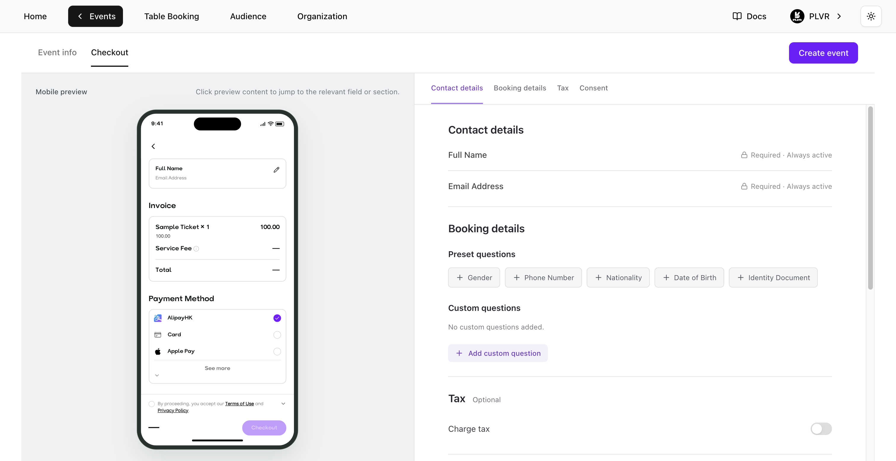
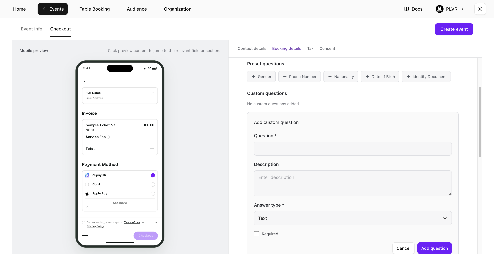

打开 **Event Editor**（活动编辑器），选择 **Checkout**（结账），然后进入 **Booking details**（预订信息）。你也可以在[创建活动](/zh-hans/events/create-an-event)时，在 **Checkout** 标签页中设置这些问题。

<Frame>
  
</Frame>

## 添加问题

- **Preset questions**（预设问题）— 在 **Preset questions** 下选择一个问题。
- **Custom questions**（自定义问题）— 选择 **Add custom question**（添加自定义问题），输入问题内容，并选择 **Text**（文本）、**Number**（数字）、**Single choice**（单选）或 **Multiple choice**（多选）。选择题类型至少需要填写一个选项。选择 **Add question**（添加问题）将其应用到表单中。

<Frame>
  
</Frame>

## 管理问题

- 选择自定义问题旁的 **Edit**（编辑），完成后选择 **Save question**（保存问题）。
- 选择 **Required**（必填）可将问题设为必答。关闭 **Show at checkout**（在结账时显示）可隐藏问题并保留其设置。
- 拖动问题可在 **Preset questions** 或 **Custom questions** 内调整顺序。

在 **Event Editor** 中选择 **Save changes**（保存更改），或在创建新活动时选择 **Create event**（创建活动），即可在结账页启用这些问题。

<Note>
  **Contact details**（联系信息）下的 **Full Name** 和 **Email Address** 始终为必填项。
</Note>

## 查看回答

- **RSVP 申请** — 在 [RSVP](/zh-hans/events/rsvp) 页面的 **Form Responses**（表单回答）中查看答案。
- **未启用 RSVP 的活动** — 在[门票报表](/zh-hans/tickets/ticket-report)页面查看答案。

<Tip>
  使用 PLVR Tap 的活动另有单独的[个性化信息表](/zh-hans/tap/personalization-form)。
</Tip>
