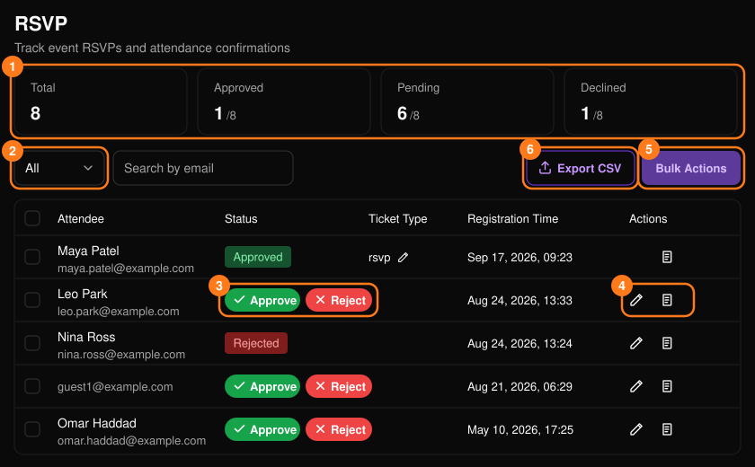
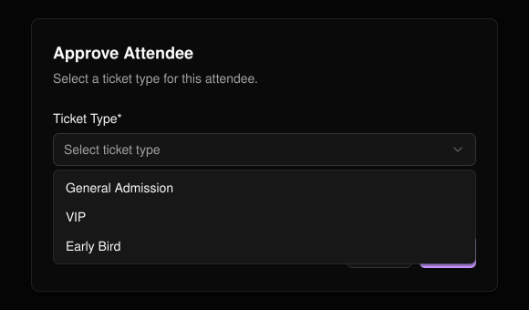
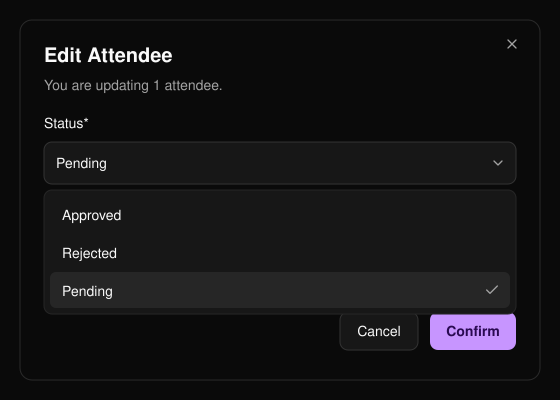
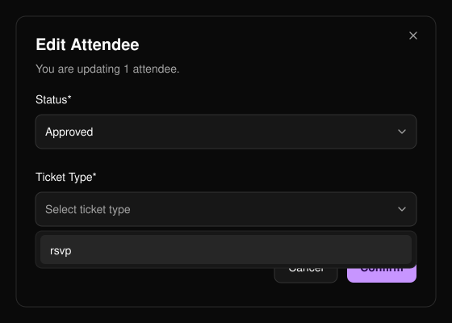
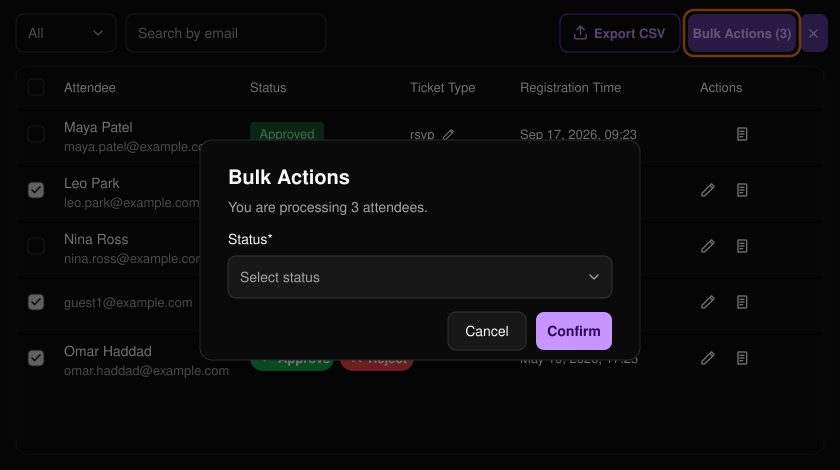

**RSVP**（位于活动菜单中）用于审核参与申请。

<Note>
  RSVP 功能需申请后开通。
</Note>

<Frame>
  
</Frame>

**Total**（总计）、**Approved**（已批准）、**Pending**（待处理）和 **Declined**（已拒绝）卡片显示各类申请数量，列表下方的控件可用于翻页。

按 **Pending**、**Approved** 或 **Rejected** 筛选 (2)。汇总卡片中将被拒绝的申请显示为 "Declined"，二者含义相同。

## 批准或拒绝

在待处理的行上选择 **Approve**（批准）或 **Reject**（拒绝）(3)。如活动有多个票种，批准时需选择 **Ticket Type**（票种）。活动至少需要有一个票种才能批准申请。

<Frame>
  
</Frame>

## 修改状态

铅笔图标 (4) 会打开 **Edit Attendee**（编辑参与者）。批准时需选择票种。

- 已批准的参与者无法编辑。
- 已拒绝的参与者只能改回待处理状态。

书本图标 (4) 会打开该参与者在[报名表](/zh-hans/events/registration-form)中的 **Form Responses**（表单回答）。

<Frame>
  
</Frame>

<Frame>
  
</Frame>

## 批量操作

勾选多行后，选择 **Bulk Actions**（批量操作）(5)，选择状态（批准时还需选择票种），然后点击 **Confirm**（确认）。

- 一次最多处理 50 位参与者。
- 所选参与者必须处于相同状态，且无法选择已批准的参与者。

<Frame>
  
</Frame>

选择 **Export CSV**（导出 CSV）(6) 即可下载名单。
