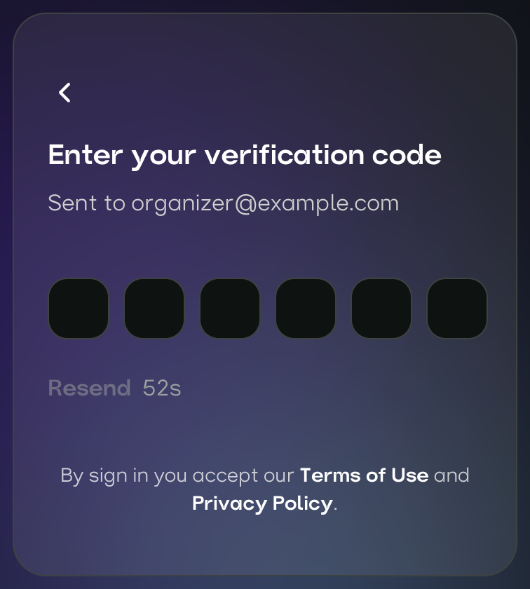
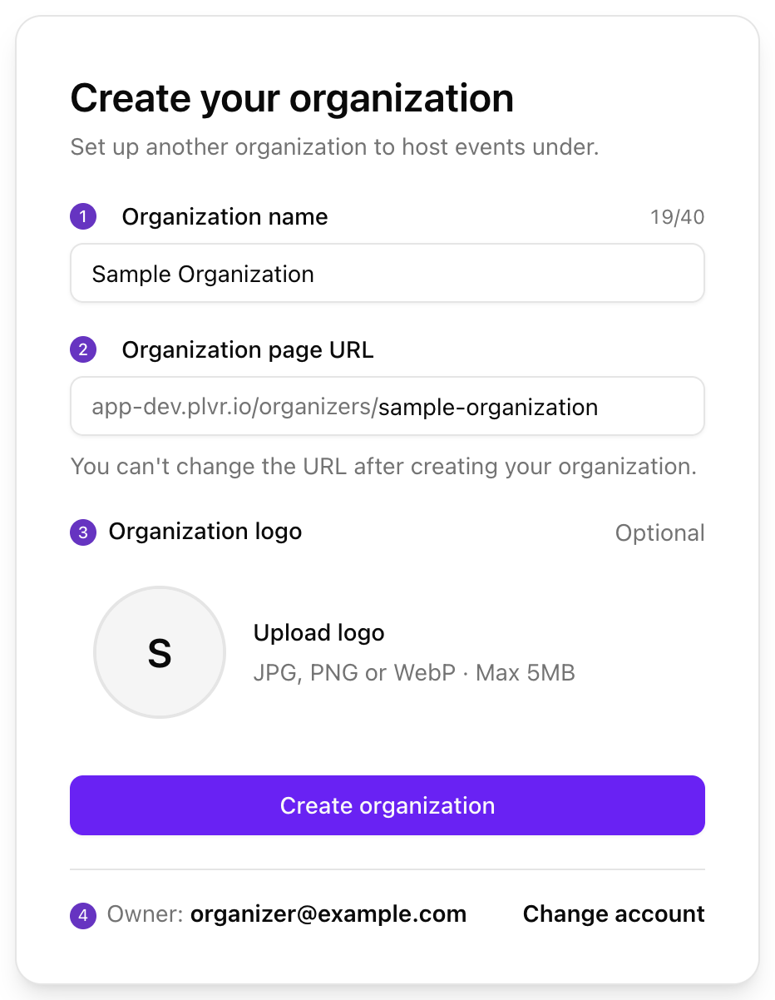

从零开始快速建好一个可用的组织。任何人都可以创建账号。

## 设置步骤

<Steps>
  <Step title="登录">
    打开 [Business Portal](https://business.plvr.io)（商家后台），使用邮箱、Apple 或 Google 登录。首次登录时会自动创建你的账号。
  </Step>
  <Step title="创建组织">
    填写名称、页面 URL，以及可选的 logo。
  </Step>
  <Step title="完善资料">
    打开 **Organization**（组织），填写参与者会在你的公开页面上看到的信息。
  </Step>
  <Step title="添加团队成员">
    打开 **Team**（团队），选择 **Add**（添加），并为每个人分配角色。
  </Step>
  <Step title="创建第一个活动">
    联系 PLVR 合作伙伴团队。
  </Step>
</Steps>

## 登录

<Frame>
  
</Frame>

使用邮箱登录时，我们会发送一个 6 位验证码，在下一个界面输入即可。

<Frame>
  
</Frame>

<Tip>
  请始终使用相同的登录方式和邮箱地址，否则可能找不到你的组织。
</Tip>

## 创建组织

组织是承载你所有活动的账号。首次登录后你会进入这个表单。之后如需再添加组织，可在账号菜单中使用 **Create organization**（创建组织）。

<Frame>
  
</Frame>

- **Name（1）：** 最多 40 个字符，且必须唯一。
- **Page URL（2）：** 3 到 60 个小写字母、数字和连字符，必须以字母或数字开头和结尾。不允许使用 `admin`、`support`、`help` 等保留词。
- **Logo（3）：** 可选，支持 JPG、PNG 或 WebP，最大 5 MB。
- **Owner（4）：** 你当前登录的账号将成为所有者。如果账号不对，请选择 **Change account**（切换账号）。

<Warning>
  组织创建后，页面 URL 无法更改。请提前确认。
</Warning>

## 完善资料

在顶部导航栏打开 **Organization**，填写 logo、名称和 **About My Organization**（组织简介），然后选择 **Save**（保存）。所有选项请参阅[组织设置](/zh-hans/organization/settings)。

## 添加团队成员

{/* SCREENSHOT: images/getting-started/onboarding-team-add-button.png | Team Management page (Team in the header) with a few members listed; highlight the Add button at the top. Crop to the page title, Add button and the top of the member table. */}

| 角色 | 权限 |
| --- | --- |
| **Admin** | 可完整访问 PLVR Business 和 PLVR Scan。 |
| **Manager** | 可访问 PLVR Business 和 PLVR Scan，但不含 Team Management（团队管理）。 |
| **Scanner** | 仅可访问 PLVR Scan。 |

为每个人分配满足需要的最低角色。入口工作人员只需要 **Scanner**。请参阅[团队与角色](/zh-hans/organization/team)。

## 创建第一个活动

目前还不能自助创建活动。在空的 **Events**（活动）页面上，发送邮件至合作伙伴团队 partners@plvr.io，由他们为你设置活动。设置完成后，活动会出现在你的列表中。请参阅[活动概览](/zh-hans/events/overview)。

{/* SCREENSHOT: images/getting-started/onboarding-no-events-yet.png | Events page for a brand-new organization showing the 'No events yet' empty state with the 'contact partners@plvr.io' message. Crop to the empty state card. */}

## 上线之前

<Steps>
  <Step title="搭建活动页面">
    在 **Event Editor**（活动编辑器）中检查页面并选择 **Save Event**（保存活动）。在此之前不会发布任何内容。请参阅[活动编辑器](/zh-hans/events/event-editor)。
  </Step>
  <Step title="设置门票">
    在 **Tickets**（门票）下检查票种和价格。请参阅[门票管理](/zh-hans/tickets/ticket-management)。
  </Step>
  <Step title="添加结账问题（可选）">
    使用[报名表](/zh-hans/events/registration-form)。
  </Step>
  <Step title="选择活动状态">
    在 **Events** 页面设置为 **Public**（公开）、**Private**（私密）或 **Inactive**（停用）。请参阅[活动状态](/zh-hans/events/overview)。
  </Step>
  <Step title="以参与者身份预览">
    选择 **View event**（查看活动）检查公开页面。
  </Step>
  <Step title="邀请入口团队">
    在[团队页面](/zh-hans/organization/team)将扫码工作人员添加为 **Scanner**。
  </Step>
</Steps>

## 常见问题

| 问题 | 解决方法 |
| --- | --- |
| **Access denied**（拒绝访问） | 你的角色无权访问该页面，或者你当前处于另一个组织中。选择 **Back to home**（返回首页），检查账号菜单，或请所有者核实你的角色。 |
| 找不到我的组织，或被要求创建新组织 | 你登录所用的账号与团队使用的不同。请退出后使用原来的邮箱或登录方式重新登录。 |
| 已被加入团队，但看不到对方的组织 | 使用对方添加的邮箱登录，然后在账号菜单中切换组织。 |
| 名称或页面 URL 已被占用或为保留词 | 让它更有辨识度，例如加上你所在的城市。 |
| Logo 上传被拒 | 使用小于 5 MB 的 JPG、PNG 或 WebP 文件。 |
| 没收到验证码 | 检查垃圾邮件，等待倒计时结束后选择 **Resend**（重新发送）。并检查邮箱地址是否有拼写错误。 |
| Apple 或 Google 登录失败 | 重试一次，或改用邮箱登录。 |
| 需要更换页面 URL | 页面 URL 无法修改。请从账号菜单创建一个新组织。 |

<Frame>
  
</Frame>

## 下一步

<Columns cols={2}>
  <Card title="发布你的第一个活动" icon="rocket" href="/zh-hans/getting-started/quickstart">
    从活动设置到售出第一张门票。
  </Card>

  <Card title="后台导览" icon="compass" href="/zh-hans/getting-started/portal-tour">
    了解各项功能的位置。
  </Card>
</Columns>
