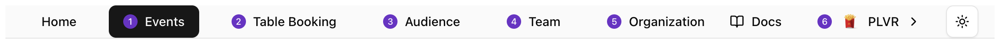
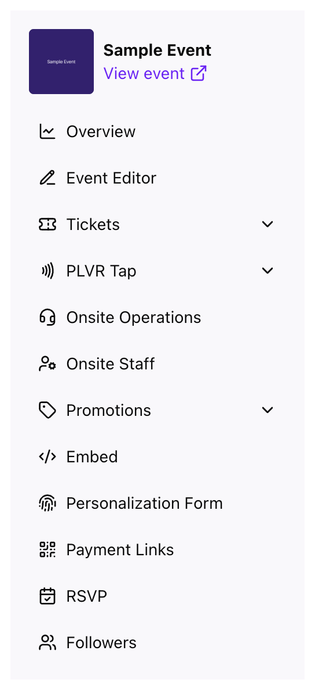

导航分为两个层级：用于组织级页面的**顶部导航栏**，以及活动内部的**侧边菜单**。

## 顶部导航栏

<Frame>
  
</Frame>

| 链接 | 页面 | 可见范围 |
| --- | --- | --- |
| **Events** | [活动概览](/zh-hans/events/overview) | 所有人 |
| **Table Booking** | [订台](/zh-hans/other/table-booking) | 所有者、管理员、经理 |
| **Audience** | [受众](/zh-hans/organization/audience) | 所有人 |
| **Team** | [团队与角色](/zh-hans/organization/team) | 所有者、管理员 |
| **Organization** | [组织设置](/zh-hans/organization/settings) | 所有者、管理员、经理 |

## 账号菜单

可在此切换组织、创建新组织、更改外观或退出登录。

<Frame>
  
</Frame>

<Tip>
  如果有未保存的更改，在你离开页面、切换组织或退出登录前，后台会先进行确认。
</Tip>

## 活动菜单

进入某个活动后，左侧菜单中会列出该活动的各项工具。顶部的 **View event**（查看活动）会打开公开页面。

<Frame>
  
</Frame>

- **Overview**：[销售与表现](/zh-hans/events/overview)
- **Event Editor**：[公开活动页面](/zh-hans/events/event-editor)
- **Tickets**：[门票报表](/zh-hans/tickets/ticket-report)、门票管理和赠票
- **PLVR Tap**：[无现金设置与动态](/zh-hans/tap/introduction)
- **Onsite Operations**：[指挥中心](/zh-hans/onsite/command-center)
- **Onsite Staff**：[活动现场工作人员](/zh-hans/onsite/onsite-staff)
- **Promotions**：[优惠码](/zh-hans/promotions/promo-codes)、营销活动、追踪链接等
- **Registration Form**：[结账问题](/zh-hans/events/registration-form)
- **Personalization Form**：[个性化表单](/zh-hans/tap/personalization-form)
- **Payment Links**：[支付链接](/zh-hans/other/payment-links)
- **RSVP** 和 **Followers**：[RSVP](/zh-hans/events/rsvp)、[关注者](/zh-hans/events/followers)

<Note>
  **PLVR Tap** 和 **Personalization Form** 仅在使用 PLVR Tap 的活动中显示。
</Note>

在顶部导航栏选择 **Events** 即可退出当前活动。
