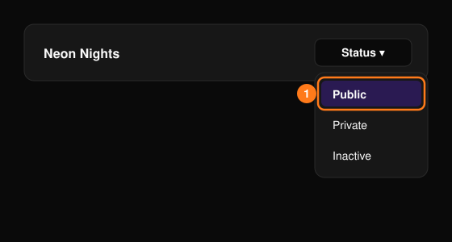

本页假设你已经拥有一个组织。如果还没有，请先阅读[入门引导](/zh-hans/getting-started/onboarding)。

<Steps>
  <Step title="打开你的活动">
    在顶部导航栏选择 **Events**（活动），然后选择你的活动。还没有活动？请参阅[创建第一个活动](/zh-hans/getting-started/onboarding)。
  </Step>
  <Step title="搭建活动页面">
    在 **Event Editor**（活动编辑器）中逐一检查各部分，然后选择 **Save Event**（保存活动）。请参阅[活动编辑器](/zh-hans/events/event-editor)。
  </Step>
  <Step title="设置门票">
    在 **Tickets**（门票）下检查票种和价格。请参阅[门票管理](/zh-hans/tickets/ticket-management)。
  </Step>
  <Step title="让活动上线">
    在 **Events** 页面的状态菜单中选择 **Public**（公开）。请参阅[活动状态](/zh-hans/events/overview)。
  </Step>
  <Step title="开始推广">
    分享[优惠码](/zh-hans/promotions/promo-codes)或[追踪链接](/zh-hans/promotions/tracking-links)。
  </Step>
  <Step title="关注销售情况">
    查看 [Overview](/zh-hans/events/overview)（概览）和[门票报表](/zh-hans/tickets/ticket-report)。
  </Step>
</Steps>

<Frame>
  
</Frame>

<Note>
  在将活动设置为 **Public** 之前，请先完成[上线之前](/zh-hans/getting-started/onboarding)的检查。
</Note>
