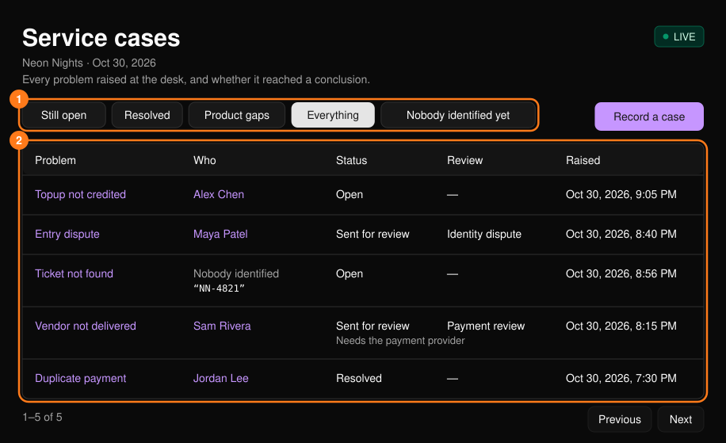
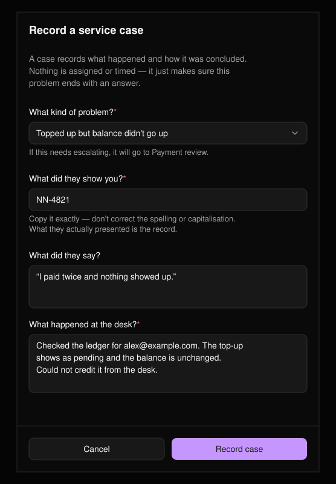
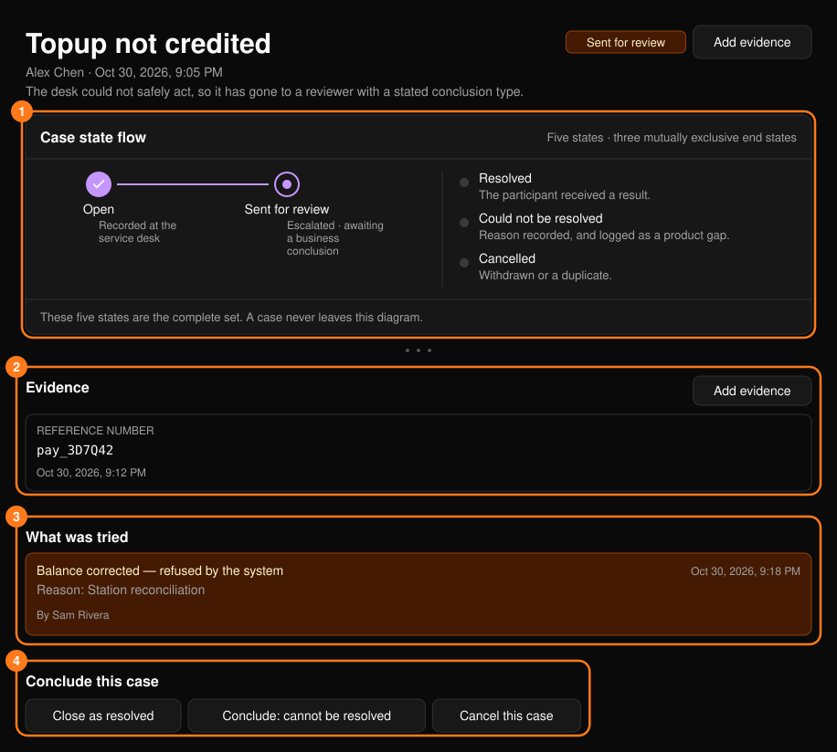
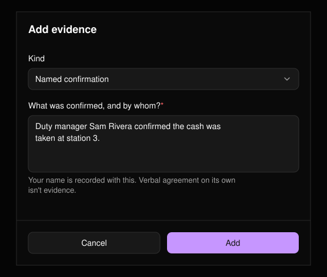
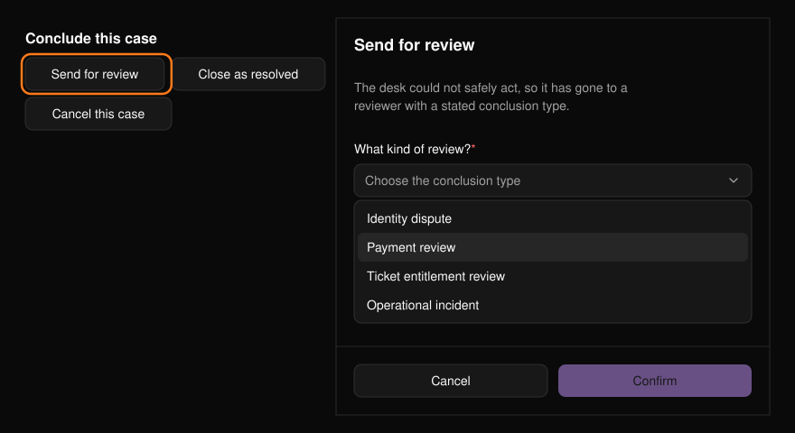

服务工单（service case）用于记录服务台遇到的问题及其处理结果，确保不会有人在没有任何记录的情况下被拒之门外。工单不涉及分派或计时。可从[指挥中心](/zh-hans/onsite/command-center)的 **Service cases** 打开列表。

<Frame>
  
</Frame>

## 状态

| 状态 | 含义 |
| --- | --- |
| **Open**（处理中） | 仍在处理。 |
| **Sent for review**（已提交审核） | 服务台无法安全处理，已转交审核人员。 |
| **Resolved**（已解决） | 参与者已获得明确答复。 |
| **Could not be resolved**（无法解决） | 无法处理，并附有原因。计为产品功能缺口。 |
| **Cancelled**（已取消） | 已撤回或为重复工单。 |

风险等级（High 高、Medium 中、Normal 普通）与状态相互独立。审核类型包括 Identity dispute（身份争议）、Payment review（支付审核）、Ticket entitlement review（门票权益审核）和 Operational incident（运营事故）。

## 记录工单

选择 **Record a case**（记录工单）。从门票、交易以及无结果的搜索中也会打开同一表单，并尽可能预先填写信息。所附门票或交易的状态会随工单一同保存，让审核人员看到你当时看到的内容。

<Frame>
  
</Frame>

- 如果无法确认对方身份，请按原样填写对方出示的信息。不要修正拼写或大小写。
- 描述你核查了什么、发现了什么，以及哪些操作无法完成。

## 处理工单

工单页面显示状态、工单在流程中所处的阶段、创建时门户显示的内容、证据以及每一次尝试过的操作。被拒绝的尝试会被刻意保留：“我们尝试过但被拒绝了”本身就是证据。

<Frame>
  
</Frame>

### 添加证据

选择 **Add evidence**（添加证据），然后选择 **Reference number**（参考号，如支付参考号、订单号、现金清点记录）、**Named confirmation**（具名确认，即确认了什么以及由谁确认）或 **Note**（备注）。

<Frame>
  
</Frame>

<Tip>
口头同意不算证据。请记录参考号，或记录由谁确认了什么。
</Tip>

### 关联参与者

对于尚未确认身份的工单，先在[搜索](/zh-hans/onsite/search)中找到此人，然后选择 **Link to a participant**（关联参与者）并输入其参与者用户 ID。关联操作不会改变工单状态。

### 结案

在 **Conclude this case**（结案）下，你只能看到自己有权执行的操作。例如，服务台操作员无法选择 "Conclude: cannot be resolved"。

<Frame>
  
</Frame>

| 按钮 | 必填内容 |
| --- | --- |
| **Send for review** | 审核类型。 |
| **Close as resolved** | 处理结果：告知了对方什么，以及你做了什么。 |
| **Conclude: cannot be resolved** | 原因，即控制台无法完成的操作。 |
| **Cancel this case** / **Reopen** | 无。 |

选择 **Confirm**（确认）以应用。
