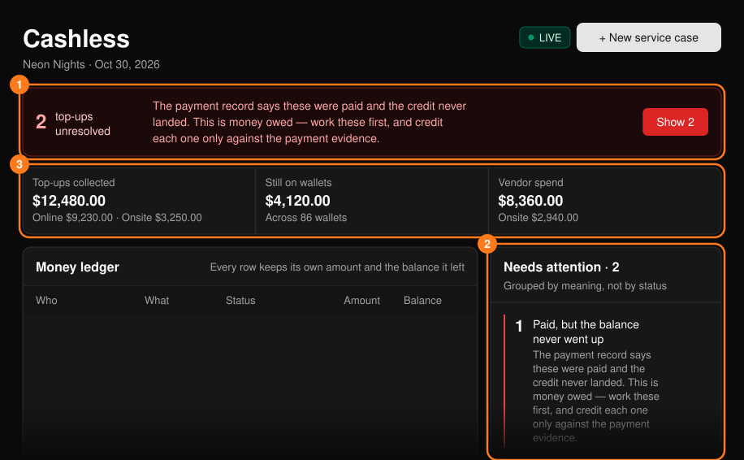
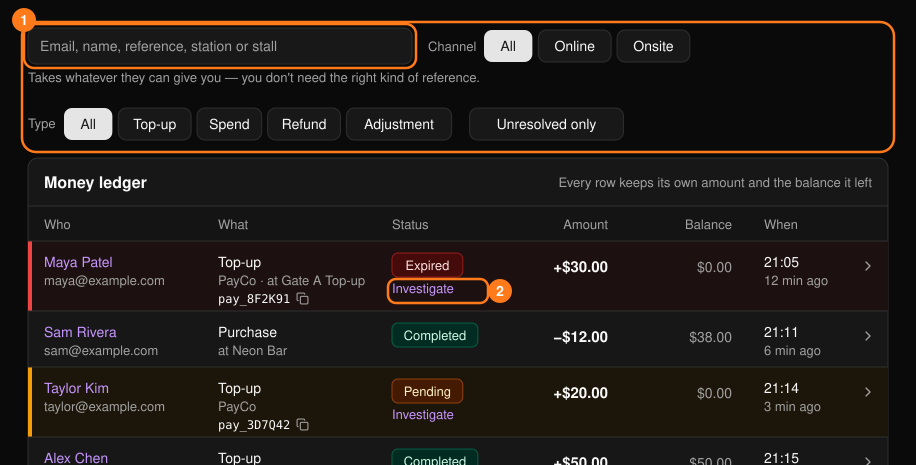
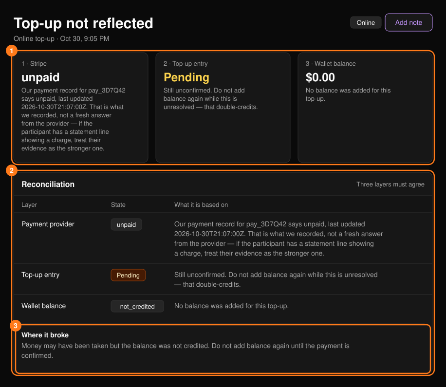
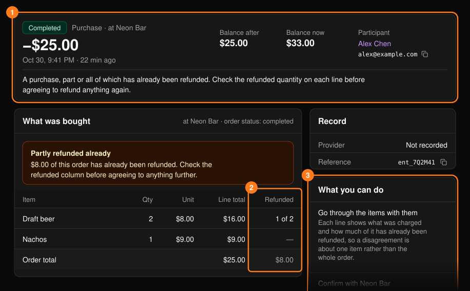

**Cashless**（无现金）工作区显示资金在哪里收取、余额是否已入账，以及在哪里消费。仅适用于启用了无现金支付的 Tap 活动。可从[指挥中心](/zh-hans/onsite/command-center)打开。

<Note>
活动整体报表请参阅[无现金交易记录](/zh-hans/tap/cashless-activity)。如需配置充值，请参阅[充值设置](/zh-hans/tap/top-up-setup)。
</Note>

所有内容均按渠道划分。**Online**（线上）充值通过支付服务商完成，带有支付参考号。**Onsite**（现场）充值在充值站通过现金或收款终端记账，没有支付参考号；请按充值站、支付方式和现金记录进行核对。

<Frame>
  
</Frame>

## 未解决的充值

顶部栏统计资金可能已转移但余额未同步的充值（待处理、已过期或失败）。**Show N**（显示 N 条）会将资金流水筛选为这些充值。已过期的充值不会被视为无需处理：在有人核查之前，它会一直保持标记状态。

如有钱包被冻结，会显示提示说明冻结数量。冻结钱包会阻止消费，但不影响入场；冻结手环是另一项单独的操作。

## 资金流水

每一笔资金变动都是一行记录，包含金额以及变动后的余额。可按邮箱、姓名、参考号、充值站或摊位搜索，并按渠道、类型或 **Unresolved only**（仅未解决）筛选。点击行内的箭头可查看其交易详情（见下文）。

<Frame>
  
</Frame>

**Top-up stations**（充值站）面板显示每个充值站的动态及其健康状态标签（Healthy 正常、Watch 关注、Degraded 降级）。

## 控制台无法执行的操作

唯一可写入资金的操作是在钱包中执行 **Correct the balance**（更正余额）。参见[参与者](/zh-hans/onsite/participants)。为未确认的充值入账、在钱包之间转移充值，以及退还余额或商户扣款，都需要核查支付服务商或作出政策决定，因此请将每种情况记录为[服务工单](/zh-hans/onsite/cases)。

## 充值详情

在未解决的充值上选择 **Investigate**（调查），打开 **Top-up not reflected**（充值未到账）页面。页面显示三个必须一致的层级：**Payment provider**（支付服务商）、**Top-up entry**（充值记录）和 **Wallet balance**（钱包余额）。**Where it broke**（问题环节）给出诊断结果。

<Frame>
  
</Frame>

<Warning>
已过期不代表未扣款。在核查之前，不要告诉来宾没有扣款。
</Warning>

- 如果 PLVR 显示支付服务商已扣款但余额从未增加，说明应为来宾补充入账。不要要求对方再次付款。
- 如果充值已过期，但来宾能出示账单上的扣款记录，请相信对方并发起支付审核（**Open a payment review case**，即创建支付审核工单）。
- 原始付款未解决前，无法再次入账。
- 如果参考号无法匹配任何记录，请检查是否混淆了 0/O 和 1/I。如对方有收据，请按其提供的原样记录参考号，创建未匹配工单。

## 交易详情

顶部区域显示状态、类型、金额、交易后余额和当前余额、参与者，以及一句可以直接念给对方听的话。下方的 **What was bought**（购买内容）列出商品和已退款项，**What you can do**（可执行的操作）给出下一步建议。

<Frame>
  
</Frame>

在同意任何进一步操作之前，请先查看已退款列。"Not on this event"（不属于此活动）表示该参考号属于其他活动，或输入有误。
