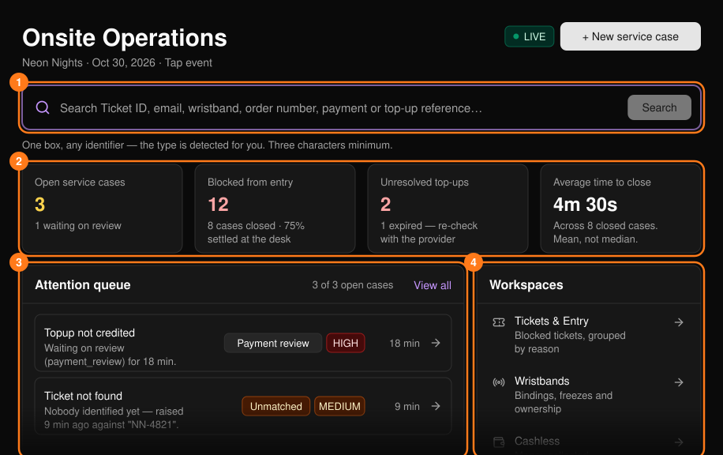
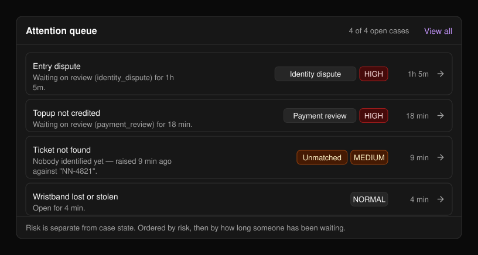
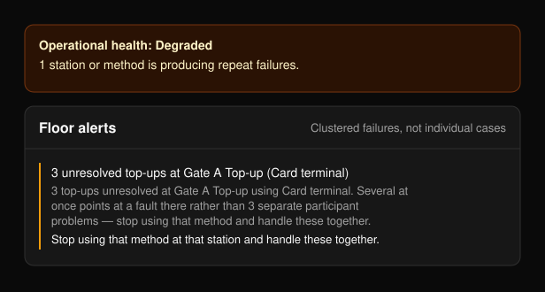

Onsite Operations（现场运营）是活动当天服务台使用的控制台。在活动侧边栏中选择 **Onsite Operations** 即可打开。Command Center（指挥中心）会显示现场是否运转正常，以及接下来需要处理的事项。

活动类型决定了可用的功能：

- **仅门票活动：** 通过扫描 QR 码入场，二维码无法识别时可手动签到。不支持手环和无现金支付。
- **Tap 活动：** 仅通过轻触手环入场。会显示 Wristbands（手环）和 Cashless（无现金）工作区。参见 [PLVR Tap](/zh-hans/tap/introduction)。

<Frame>
  
</Frame>

页面约每 30 秒自动刷新一次。

## 查找来宾

输入 Ticket ID、邮箱、手环、订单号或支付/充值参考号（至少三个字符），然后选择 **Search**（搜索）。系统会自动识别类型。结果会在[搜索](/zh-hans/onsite/search)页面中打开。

## 记录问题

选择 **+ New service case**（新建服务工单）记录问题。参见[服务工单](/zh-hans/onsite/cases)。

## 汇总卡片和运行状态

卡片显示未关闭的服务工单、被禁止入场的门票、未解决的充值（仅限 Tap 活动）以及平均关闭时长。点击卡片可打开对应列表。如现场运转不正常，会显示 **Degraded**（降级）或 **Incident**（故障）横幅；否则不显示横幅。

## 待处理队列

未关闭的工单按风险等级排序，其次按等待时长排序。默认显示前八条；选择 **View all**（查看全部）可查看其余工单。点击某一行即可打开该工单。

<Frame>
  
</Frame>

## 工作区

| 工作区 | 用途 | 显示条件 |
| --- | --- | --- |
| [Tickets & Entry（门票与入场）](/zh-hans/onsite/tickets) | 被拦截的门票 | 始终显示 |
| [Wristbands（手环）](/zh-hans/onsite/wristbands) | 绑定、冻结、归属 | Tap 活动 |
| [Cashless（无现金）](/zh-hans/onsite/cashless) | 收款、入账、消费 | 已启用无现金支付 |
| [Guests（嘉宾）](/zh-hans/onsite/guests) | 邀请名单、已批准的追加名额 | 始终显示 |
| [Service cases（服务工单）](/zh-hans/onsite/cases) | 服务台提出的所有问题 | 始终显示 |

**Desk activity**（服务台动态）统计过去 30 分钟内记录的操作。搜索不会被记录，因此它反映的是已完成的工作，而不是接待的人数。只有在多个故障集中出现时，才会显示 **Floor alerts**（现场警报）面板，并为每项警报给出建议操作。

<Frame>
  
</Frame>

## 相关页面

<CardGroup cols={2}>
  <Card title="搜索" href="/zh-hans/onsite/search" icon="magnifying-glass">
    通过任意标识查找参与者。
  </Card>
  <Card title="服务工单" href="/zh-hans/onsite/cases" icon="file-lines">
    记录、处理并结案服务台问题。
  </Card>
  <Card title="现场工作人员" href="/zh-hans/onsite/onsite-staff" icon="user-gear">
    为检票和充值团队创建登录码。
  </Card>
</CardGroup>
