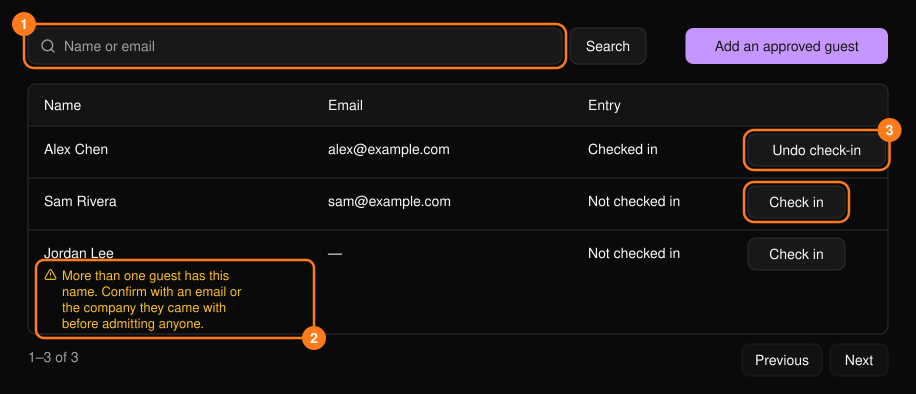
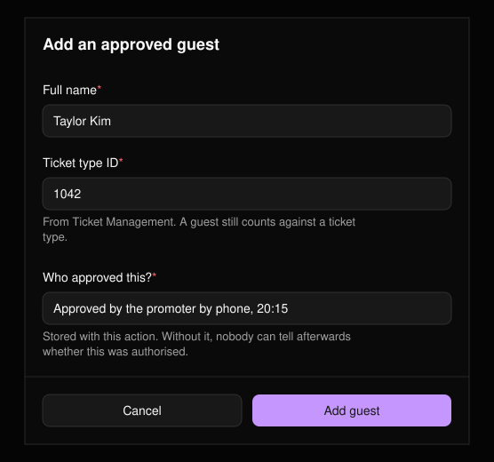

**Guests**（嘉宾）工作区用于管理邀请名单。可从[指挥中心](/zh-hans/onsite/command-center)打开。可按姓名或邮箱搜索；列表每页显示 25 条。

<Frame>
  
</Frame>

<Warning>
姓名不等于身份。如果有多位嘉宾可能匹配，姓名下方会显示警告。请先确认对方身份，再为其办理入场。
</Warning>

## 为嘉宾办理入场

在嘉宾所在行选择 **Check in**（签到）。无需填写原因。

## 撤销签到

选择 **Undo check-in**（撤销签到），选择 **Reason**（原因，必填），可选填 **Note**（备注），然后选择 **Confirm**（确认）。该嘉宾名单条目可再次使用，但原始入场记录仍保留在动态日志中。

## 添加经批准的嘉宾

为不在名单上的人选择 **Add an approved guest**（添加经批准的嘉宾）。

<Frame>
  
</Frame>

三个字段均为必填项：

- **Full name**（全名）：与对方在门口报出的姓名一致。
- **Ticket type ID**（票种 ID）：该嘉宾计入的票种。可在[门票管理](/zh-hans/tickets/ticket-management)中查找。
- **Who approved this?**（由谁批准？）：批准人和时间，例如 "Approved by the promoter by phone, 20:15"（推广方电话批准，20:15）。缺少此信息，之后将无人能判断该追加是否经过授权。
