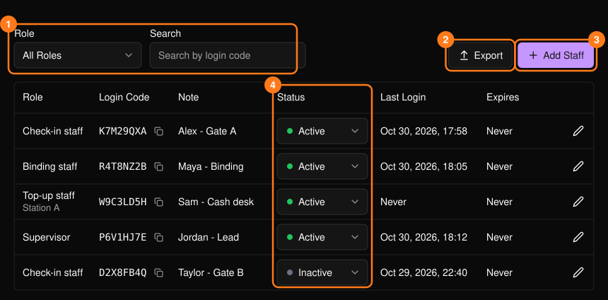
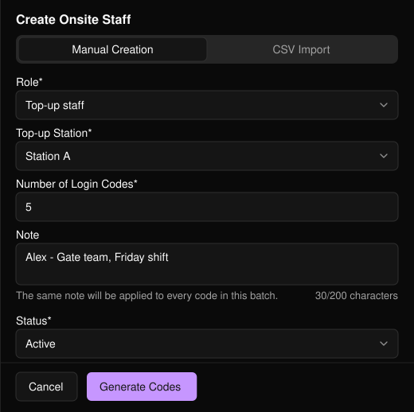
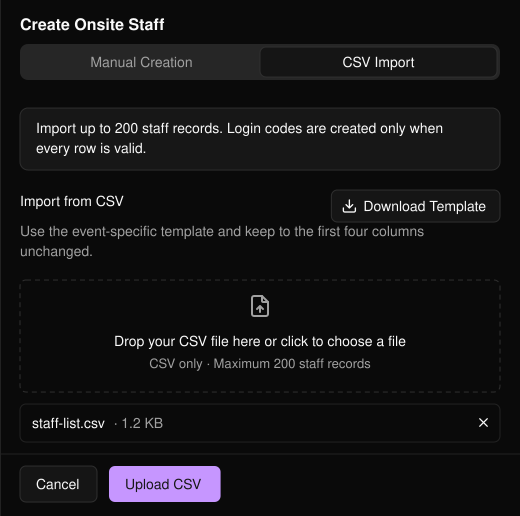

在活动侧边栏中打开 **Onsite Staff**（现场工作人员），管理活动当天工作人员的访问权限。每位工作人员使用登录码登录，登录码的角色决定其可执行的操作。

<Note>
如需邀请成员加入你的 Business Portal（商家后台）组织，请参阅[团队](/zh-hans/organization/team)。
</Note>

<Frame>
  
</Frame>

可按角色筛选或按登录码搜索。**Export**（导出）会下载当前筛选结果的 CSV。**Status**（状态）可直接在列表中更改。

活动开始前，请在工作人员列表中检查 **Status** 和 **Expires**（到期时间）。通过 **Last Login**（最近登录）可查看该登录码是否已被用于登录。每个登录码只应分享给被分配的工作人员。

## 添加工作人员

选择 **Add Staff**（添加工作人员），然后使用以下两个标签页之一。

### 手动创建

<Steps>
  <Step title="选择角色">
    对于仅门票活动，**Check-in Ticket**（门票签到）允许工作人员扫描门票 QR 码为参与者签到。**Supervisor**（主管）可访问该活动所有可用的工作区，以便为现场团队提供支持。充值工作人员还需要指定 **Top-up Station**（充值站），充值站在[充值设置](/zh-hans/tap/top-up-setup)中配置。
  </Step>
  <Step title="设置登录码数量">
    1 至 200 个，所有登录码使用相同的角色和备注（最多 200 个字符）。
  </Step>
  <Step title="选择状态并选择 Generate Codes">
    状态可选 **Active**（启用，默认）或 **Inactive**（停用）。然后选择 **Generate Codes**（生成登录码）。
  </Step>
</Steps>

<Frame>
  
</Frame>

### CSV 导入

可一次性为指定人员创建登录码。选择 **Download Template**（下载模板，该模板专属于本活动；请勿修改前四列），填写后上传。仅支持 CSV，最多 200 条记录。

<Frame>
  
</Frame>

<Warning>
只要有一行出错，就不会创建任何登录码。请修正提示中列出的行，然后重新上传。
</Warning>

## 编辑登录码

点击铅笔图标可更改 **Note**（备注）、**Status**（状态）或（充值工作人员的）**Top-up Station**（充值站），然后选择 **Save Changes**（保存更改）。角色无法更改，如需不同角色请新建登录码。

<Tip>
将登录码设为 **Inactive** 即可在不删除的情况下停用，例如在班次结束时。
</Tip>
