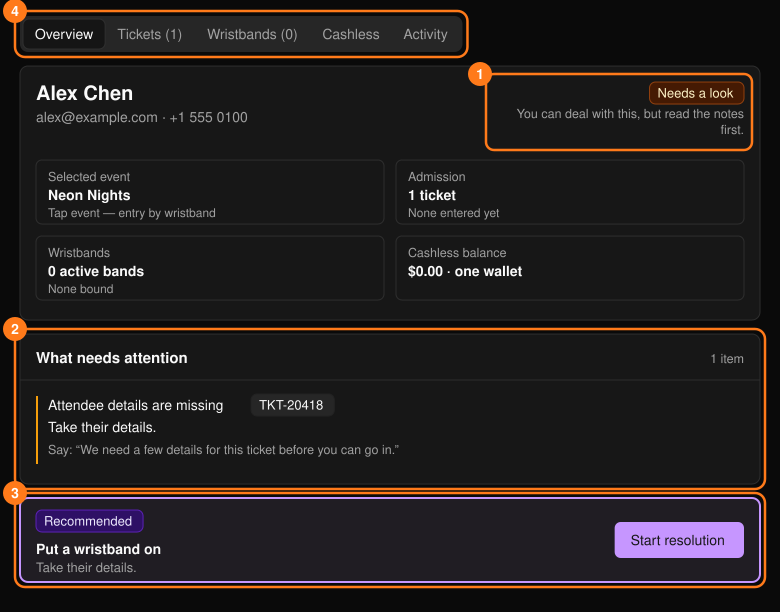
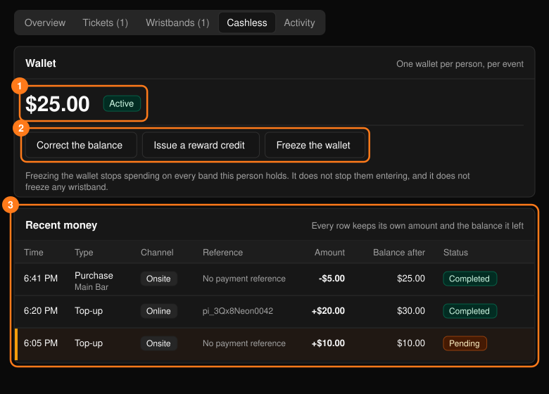
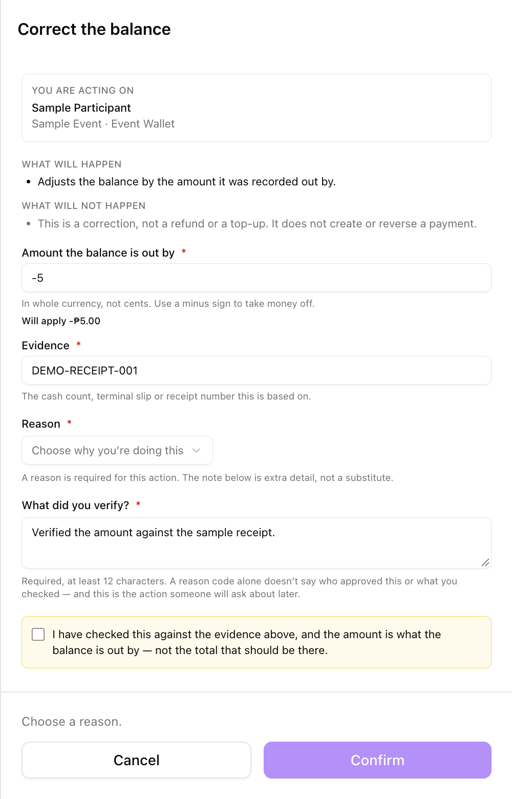
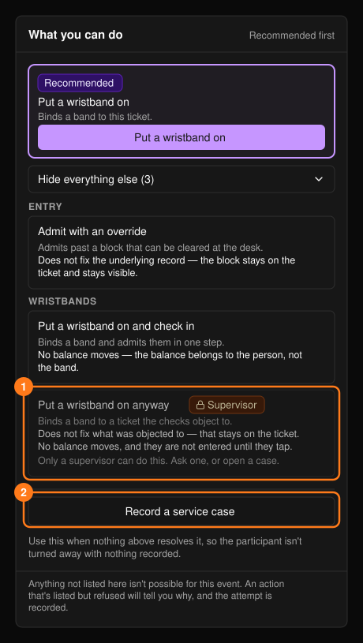

参与者资料（**Participant 360**）将一个人的身份、门票、入场和无现金动态集中在一个页面上。可在[搜索](/zh-hans/onsite/search)中选择某人进入，也可通过门票、手环、交易或工单上的链接进入。**+ Create service case**（创建服务工单）用于记录问题。

<Note>
在多场次活动中，一个人可以持有多张门票和多个手环，但只共用一个钱包。余额从不存储在手环上。
</Note>

## 概览

**Overview**（概览）标签页首先显示判定结果：**Ready**（可直接处理）、**Needs a look**（请先阅读备注）或 **Blocked**（需先解决问题）。

<Frame>
  
</Frame>

- **What needs attention**（需关注事项）说明问题所在、下一步操作，以及一句可念给参与者听的 "Say" 话术。如问题无法在服务台解决，请使用 **Record a service case**（记录服务工单）。
- **Recommended action**（推荐操作）中的 **Start resolution**（开始处理）会打开该门票的引导式处理流程。参见[门票与入场](/zh-hans/onsite/tickets)。
- **Bought for other people**（为他人购买）列出此人为他人购买的门票。这些门票都不属于此人，因此不要凭其中任何一张为其放行；请使用 **Open that person**（打开该持票人）。

## 标签页

**Tickets**（门票）标签页中每张门票都有 **Resolve**（处理）按钮。**Wristbands**（手环）和 **Cashless**（无现金）标签页仅在 Tap 活动中显示；已被更换的手环仍会保留在列表中。**Activity**（动态）是此人所有相关事件的时间线。

### 无现金

该标签页显示钱包余额、钱包状态（Active 启用或 Frozen 冻结）以及近期资金变动。活动整体的资金流水请参阅[无现金](/zh-hans/onsite/cashless)。

<Frame>
  
</Frame>

| 操作 | 用途 | 不适用于 |
| --- | --- | --- |
| **Correct the balance** | 修正记录错误的金额。 | 退款或充值。此操作不会创建或撤销任何付款。 |
| **Issue a reward credit** | 发放补偿金额，并附带参与者可见的标签。 | 更正余额。 |
| **Freeze the wallet** / **Unfreeze the wallet** | 停止或恢复其所持全部手环上的无现金消费。 | 入场，或冻结单个手环。 |

这些操作使用[操作面板](/zh-hans/onsite/tickets)。**Correct the balance**（更正余额）还需要：

- 余额的**差额**（而不是余额应有的总数），以整数货币单位填写，扣减金额时使用负号。确认前，**Will apply**（将应用）会显示带正负号的金额；
- **Evidence**（证据），例如现金清点记录、终端小票或收据编号；
- **What did you verify?**（你核实了什么？，至少 12 个字符）以及确认勾选框。

<Frame>
  
</Frame>

**Issue a reward credit**（发放奖励金额）需要填写以整数货币单位计的正数金额和一个标签。

## 可执行的操作

**What you can do**（可执行的操作）面板提供针对所选门票、手环和钱包的全部操作，推荐操作排在最前，其余操作位于 **Show everything else**（显示其他全部操作）下。参见[门票与入场](/zh-hans/onsite/tickets)、[手环](/zh-hans/onsite/wristbands)以及上文的钱包操作。

<Frame>
  
</Frame>

- 如有多张门票，操作将作用于你在搜索中选择的门票，否则作用于第一张。确认前请核对 **You are acting on**（操作对象）。
- 除非你是主管，否则 **Supervisor**（主管）操作处于禁用状态。
- 如果所有操作都无法解决问题，请使用 **Record a service case**。存在未关闭的工单时，还会显示 **Service context**（服务背景）面板；参见[服务工单](/zh-hans/onsite/cases)。
