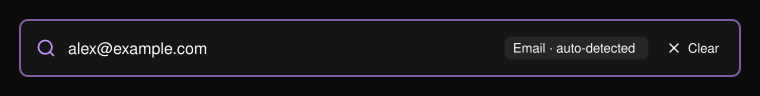
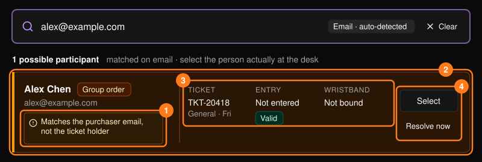
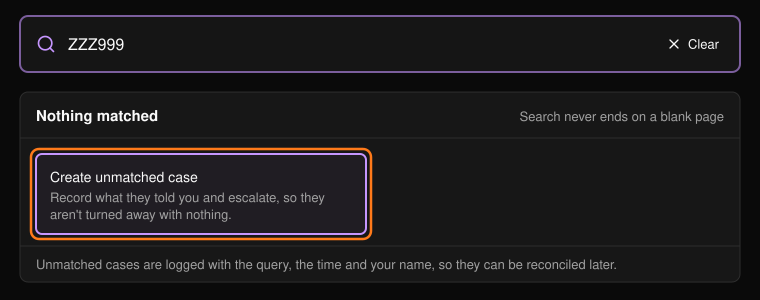

大多数服务台工作都从搜索开始。使用[指挥中心](/zh-hans/onsite/command-center)上的搜索框或 **Search results**（搜索结果）页面。输入至少三个字符后按 Enter。系统会自动识别类型并显示在搜索框中。

<Frame>
  
</Frame>

可按 Ticket ID、邮箱或姓名（参与者或购买者）、QR 码内容、订单号、支付参考号、充值或消费参考号，以及手环 ID 或 UID 进行搜索。

## 查看结果

每张卡片代表一个可能的人。请选择实际站在服务台前的那一位。

<Frame>
  
</Frame>

**Why it matched**（匹配原因）最为关键。匹配到持票人和匹配到购买者，在门口对应的是不同的人。匹配到购买者时会以琥珀色高亮显示。

<Warning>
不要因为某人购买了门票就放行。如果卡片显示匹配的是购买者，说明这张门票属于其他人。请改为打开持票人的资料。
</Warning>

- **Select**（选择）打开完整资料。参见[参与者](/zh-hans/onsite/participants)。
- **Resolve now**（立即处理）跳过资料页，直接打开该门票的引导式处理流程。参见[门票与入场](/zh-hans/onsite/tickets)。

## 未找到匹配时

在结果下方，**Nothing matched**（未找到匹配）或 **Not the right person?**（不是要找的人？）会建议下一步可以尝试的方法。**Create unmatched case**（创建未匹配工单）可记录对方提供的信息，避免对方空手而归。参见[服务工单](/zh-hans/onsite/cases)。

<Frame>
  
</Frame>

<Tip>
不要修正来宾提供的信息。对方出示的原始拼写和大小写是该工单唯一的证据。
</Tip>
