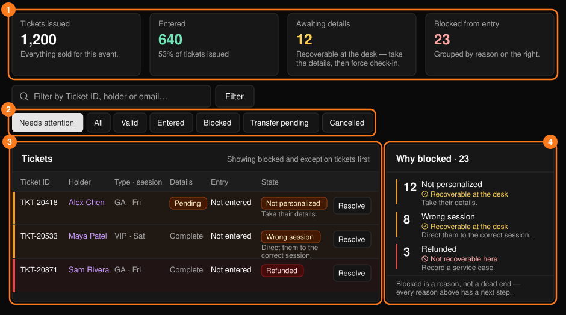
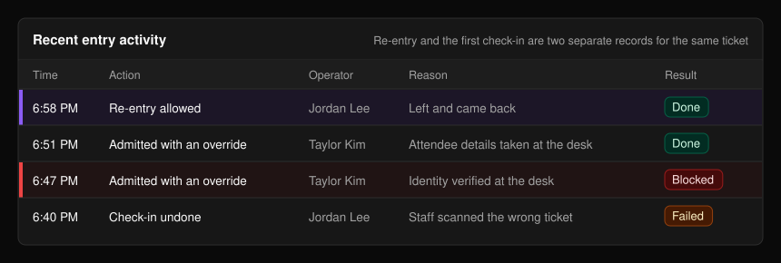
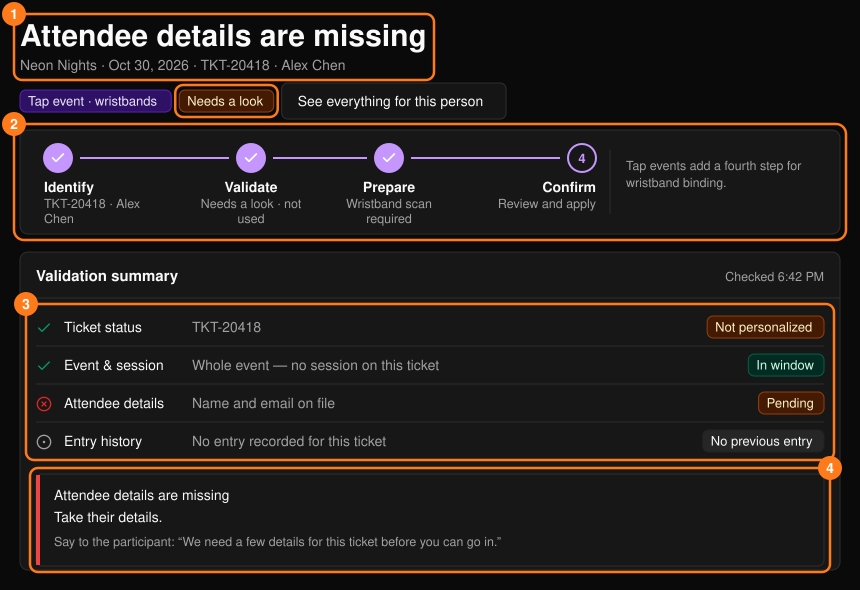
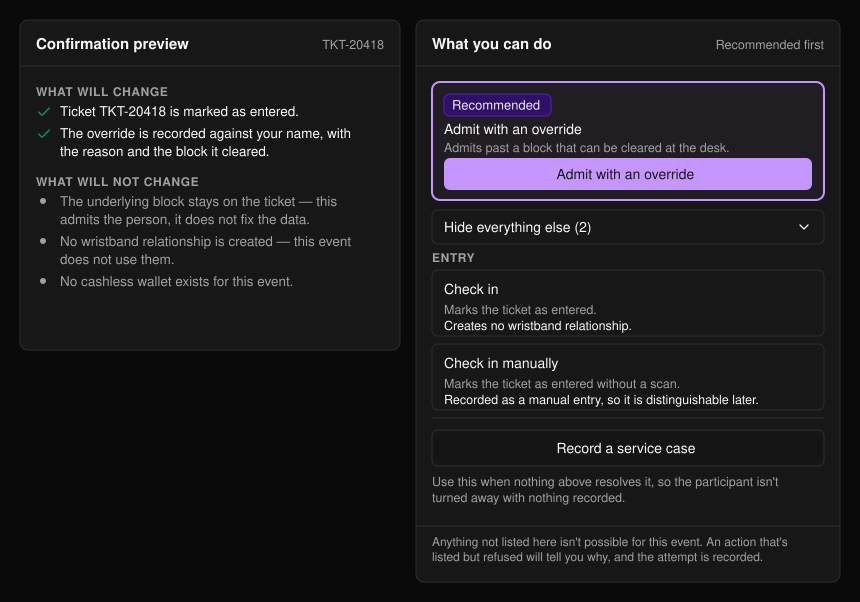
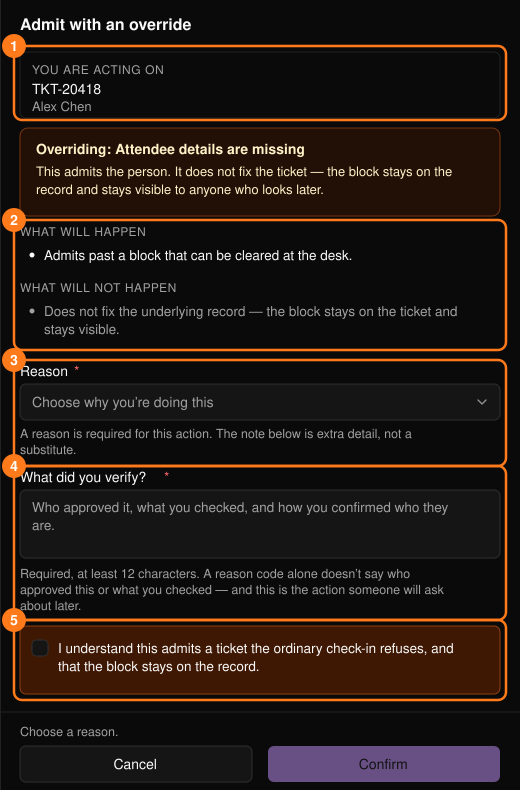

**Tickets & Entry**（门票与入场）显示门票是否有效、某人为何无法入场，以及如何解决。可从[指挥中心](/zh-hans/onsite/command-center)打开，或在搜索结果中选择 **Resolve**（处理）。

<Note>
票种、销售和赠票相关内容，请参阅[门票管理](/zh-hans/tickets/ticket-management)。
</Note>

## 门票列表

<Frame>
  
</Frame>

视图按钮（默认为 Needs attention，即需关注）和 **Filter**（筛选）可按状态、Ticket ID、持票人姓名或邮箱缩小列表范围。**Awaiting details**（待补充信息）的门票可在服务台处理：收集信息后，使用强制放行入场。

**Why blocked**（拦截原因）面板就是你的工作队列。每个原因都会显示数量和下一步操作，分为两类：

- **Recoverable at the desk**（可在服务台处理）：修正问题或使用强制放行。这类原因排在前面，请按此顺序处理。
- **Not recoverable here**（无法在此处理）：服务台的任何操作都无法解决。请记录一个[服务工单](/zh-hans/onsite/cases)。

点击某个原因，列表将筛选出对应的门票。

页面底部的 **Recent entry activity**（最近入场动态）记录服务台操作。**Done** 表示成功，**Blocked** 表示被拒绝，**Failed** 表示未完成。

<Frame>
  
</Frame>

## 处理单张门票

在门票上选择 **Resolve**。页面标题会说明当前情况，判定结果为 **Ready**（可入场）、**Needs a look**（需查看）或 **Blocked**（已拦截）。门票即使为 Valid（有效），也可能需要查看。

<Frame>
  
</Frame>

**Validation summary**（校验摘要）会检查门票状态、场次、参与者信息和入场记录。下方的提示框会说明问题所在、下一步操作，以及一句可直接念给参与者听的话。**See everything for this person**（查看此人的全部信息）会打开[参与者资料](/zh-hans/onsite/participants)。

在 Tap 活动中，由活动设置决定绑定手环时是否同时为此人签到（**Bind wristband & check in**，即绑定手环并签到；任一环节失败则两者都不生效），还是等待其在入口处轻触手环后再入场（**Bind wristband only**，即仅绑定手环）。此项无需你选择。

## 可执行的操作

首个推荐操作会显示在高亮框中。**Show everything else**（显示其他全部操作）可展开其余操作。活动中不可能存在的操作不会显示；被拒绝的操作会说明原因，且该尝试会被记录。当所有方法都无效时，可使用 **Record a service case**（记录服务工单）。

<Frame>
  
</Frame>

| 操作 | 说明 |
| --- | --- |
| **Check in** / **Check in manually** | 仅门票活动。将门票标记为已入场；手动签到会被单独标记记录。 |
| **Admit with an override** | 对可在服务台解除的拦截强制放行。门票上仍会保留拦截记录。 |
| **Allow re-entry** | 将再次入场记录为独立事件；首次签到记录不会被覆盖。 |
| **Undo check-in** | 将门票恢复为未使用状态。不会撤销之后的消费，也不会从日志中删除入场记录。 |

Tap 活动通过轻触手环入场，因此需通过手环进行恢复处理。参见[手环](/zh-hans/onsite/wristbands)；钱包相关操作请参阅[参与者](/zh-hans/onsite/participants)和[无现金](/zh-hans/onsite/cashless)。撤销前，**If you undo this entry**（如果撤销此次入场）会列出此后发生的所有相关操作。

## 操作面板

所有操作都会打开相同的侧边面板。

<Frame>
  
</Frame>

请首先核对 **You are acting on**（操作对象）(1)。选择一个 **Reason**（原因）(3)；仅填写备注是不够的。在所有必填项填写完成前，**Confirm**（确认）按钮保持禁用。如操作失败，不会产生任何更改，你可以重试或记录工单。

<Warning>
强制放行需要在 **What did you verify?**（你核实了什么？）中填写至少 12 个字符（由谁批准、核查了什么、如何确认对方身份），并勾选确认框。你的姓名会被记录。
</Warning>

## 权限

标记为 **Supervisor**（主管）的操作对所有人可见，但只有主管可以使用。否则请联系主管，或新建工单。

<Note>
控制台不支持退款或作废门票。请将此类需求记录为[服务工单](/zh-hans/onsite/cases)以供审核。
</Note>
