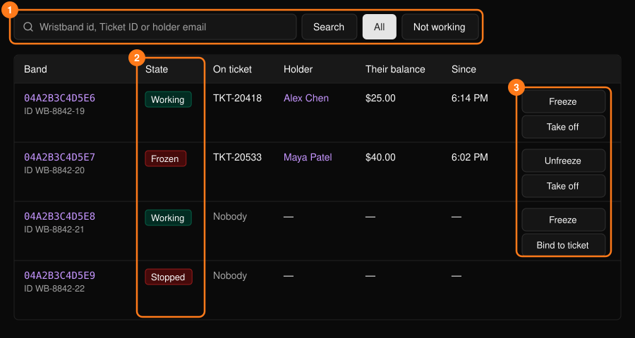
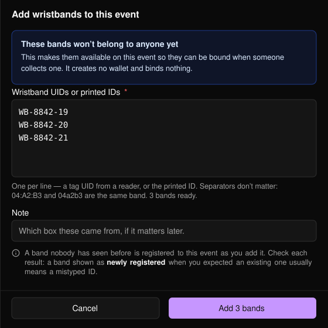
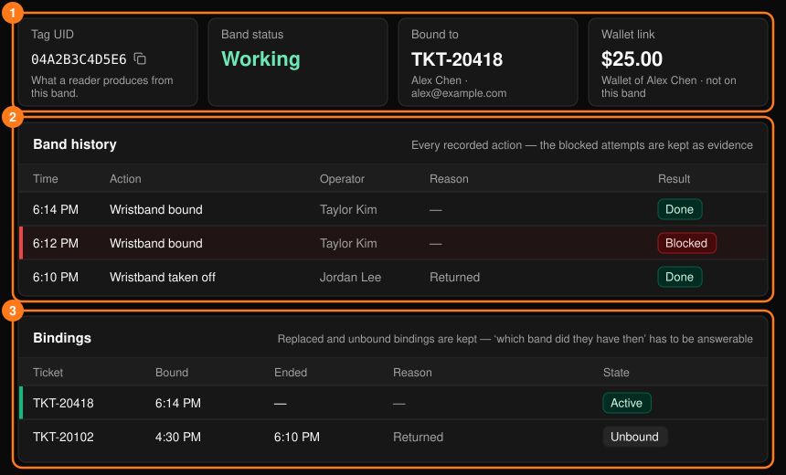
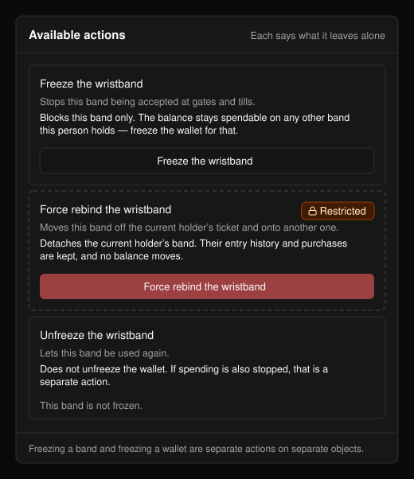
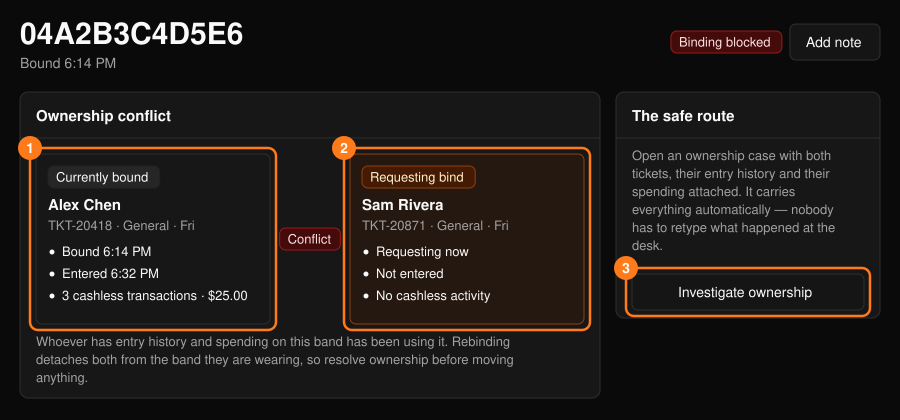

**Wristbands**（手环）工作区仅适用于 Tap 活动。可从[指挥中心](/zh-hans/onsite/command-center)打开。

<Warning>
余额属于人，而不属于手环。更换手环不会转移资金，冻结手环也不会冻结余额。如需阻止消费，请在参与者资料中冻结钱包。参见[参与者](/zh-hans/onsite/participants)。
</Warning>

## 手环列表

可按手环 ID、Ticket ID 或持有人邮箱搜索。**Not working**（无法使用）列出已停用的手环。

<Frame>
  
</Frame>

行操作：**Freeze** / **Unfreeze**（冻结/解冻，手环停止或恢复用于入场和支付）、**Take off**（解除绑定）以及 **Bind to ticket**（绑定到门票，需输入 Ticket ID）。这些操作均使用[操作面板](/zh-hans/onsite/tickets)。冻结不会影响余额和门票；解除绑定不会影响余额、入场记录和消费记录。

**Bind to ticket** 遵循活动设置：**Put a wristband on and check in**（佩戴手环并签到），或 **Put a wristband on**（佩戴手环，此人在入口轻触手环时入场）。

## 添加手环

开门前，选择 **+ Add wristbands**（添加手环）登记备用手环。

<Frame>
  
</Frame>

<Steps>
  <Step title="输入手环">
    每行一个 UID 或印刷 ID。每次扫描自动换行的扫描器会自动填充输入框。格式不限，重复项会被忽略。
  </Step>
  <Step title="添加备注（选填）">
    例如这批手环来自哪个箱子。
  </Step>
  <Step title="选择 Add">
    每次最多 200 个。
  </Step>
</Steps>

此操作不会创建钱包，也不会进行任何绑定。结果会将每个手环列为新登记、已可用，或被拒绝并附原因。请逐行检查：如果你预期是已有的手环却显示为新登记，通常意味着 ID 输入有误。

<Frame>
  
</Frame>

## 手环页面

点击某个手环可查看其摘要、**Band history**（手环记录）和 **Bindings**（绑定记录）。被拒绝的尝试和已被替换的绑定都会被刻意保留，以便随时回答“发生了什么”以及“当时他们持有的是哪个手环”。**Add note**（添加备注）会打开[工单表单](/zh-hans/onsite/cases)。

<Frame>
  
</Frame>

### 可用操作

每个操作都会说明其作用以及不会影响的内容；无法使用的操作会说明原因。

<Frame>
  
</Frame>

| 操作 | 说明 |
| --- | --- |
| **Put a wristband on** | 将手环绑定到门票。不涉及余额变动。 |
| **Replace the wristband** | 停用旧手环，并将新手环（输入其 ID）绑定到同一张门票。 |
| **Take the wristband off** | 解除绑定。不会为此人办理离场，也不影响余额。 |
| **Report the wristband lost or stolen** | 停用手环并解除所有绑定。不会发放替换手环，也不会冻结钱包。 |
| **Freeze** / **Unfreeze the wristband** | 仅停用或恢复此手环。余额在其持有的其他手环上仍可消费。 |
| **Put a wristband on anyway**（受限） | 在校验失败的情况下仍强制绑定。不会修正所提出的问题。 |
| **Force rebind the wristband**（受限） | 将手环从当前持有人的门票转移到另一张门票。原持有人的入场记录和消费记录保留。 |

大多数操作需要填写原因。**Restricted**（受限）操作仅限主管使用，会以你的姓名记录，并需要在 **What did you verify?**（你核实了什么？）中填写至少 12 个字符，同时勾选确认框。

### 归属冲突

如果某张门票试图绑定一个已绑定给他人的手环，页面会显示 **Binding blocked**（绑定被拦截）以及 **Ownership conflict**（归属冲突）面板，对比 **Currently bound**（当前绑定）和 **Requesting bind**（申请绑定）。手环上有入场和消费记录的一方，才是一直在使用该手环的人。

<Frame>
  
</Frame>

重新绑定会使双方都与其佩戴的手环解除关联，因此请先确认归属。选择 **Investigate ownership**（调查归属）记录工单并上报。之后主管可使用 **Force rebind the wristband**（强制重新绑定手环）。
