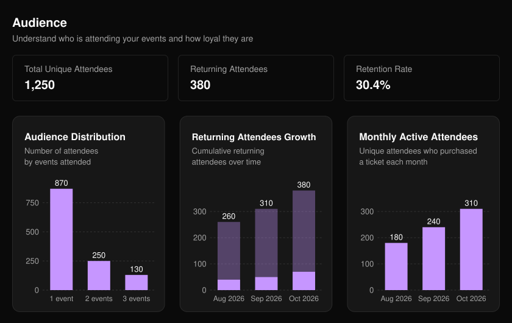
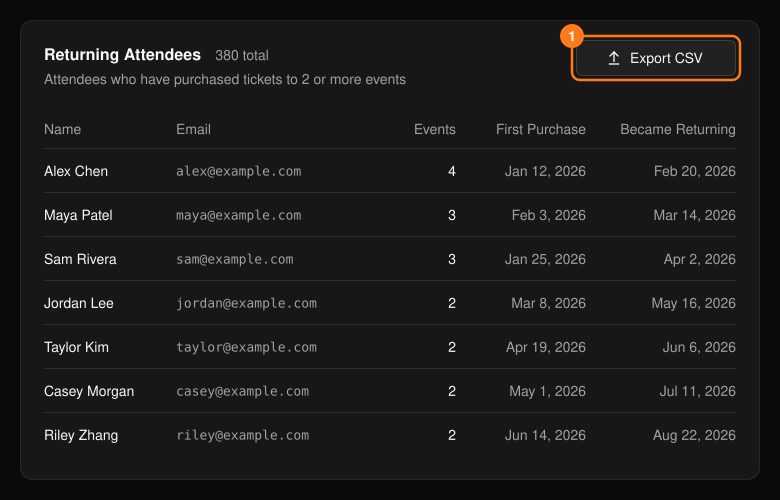

顶部导航栏中的 **Audience**（受众）展示的是整个组织（而非单场活动）的参与者忠诚度。Retention Rate（留存率）是回头客占全部去重参与者的百分比。

<Frame>
  
</Frame>

- **Audience Distribution**（受众分布）按参加活动的场数对参与者分组。
- **Returning Attendees Growth**（回头客增长）显示回头客人数随时间的累计变化。
- **Monthly Active Attendees**（月活跃参与者）统计每月购票的去重参与者人数。

## 回头客

**Returning Attendees**（回头客）表格列出了所有购买过你 2 场或以上活动门票的人。选择 **Export CSV**（导出 CSV）即可下载。

<Frame>
  
</Frame>

<Note>
  导出文件包含姓名和邮箱地址。请仅与需要的团队成员共享。
</Note>
