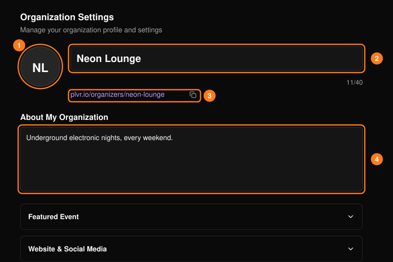
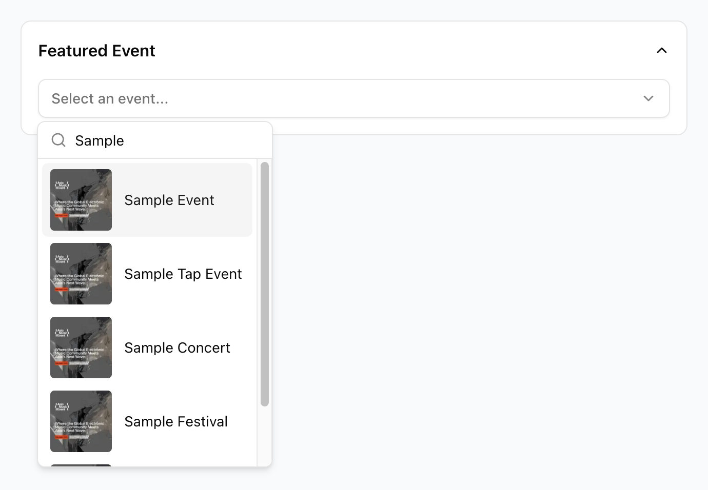
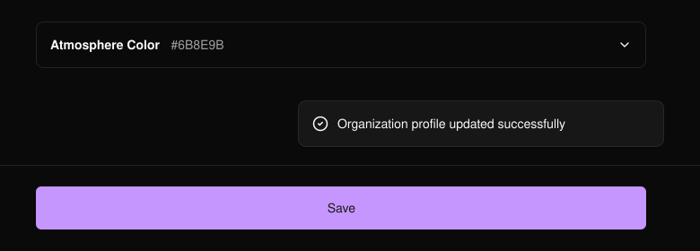

顶部导航栏中的 **Organization**（组织）用于控制你的组织在公开主办方页面上的展示方式。

<Note>
  只有所有者、管理员和经理可以打开此页面。
</Note>

<Frame>
  
</Frame>

- **Logo（1）：** PNG、WebP、JPG 或 JPEG，最大 4 MB。
- **Name（2）：** 必填，最多 40 个字符。
- **Page URL（3）：** 在创建组织时设定，无法在此处更改。
- **About（4）：** 显示在你的公开页面上。

## 可选板块

展开某个板块，为公开主办方页面添加更多信息。

- **Featured Event**（精选活动）：从下拉菜单中选择一个活动进行重点展示，然后保存。
  <Frame>
    
  </Frame>
- **Website & Social Media**（网站与社交媒体）：添加可公开访问的网站、Instagram、X / Twitter、Facebook、TikTok 和 YouTube 链接。网站地址必须以 `http://` 或 `https://` 开头。
- **Community Groups**（社群）：添加一个 WhatsApp 或 Telegram 邀请链接。保存其中一个会清除另一个。
- **Music**（音乐）：添加 SoundCloud 或 Spotify 的艺人或歌单链接。
- **Venue Information**（场馆信息）：如果你的组织经营实体场馆，请勾选此复选框。
- **Public Metrics**（公开数据）：使用 **Display Number of Attendees**（显示参与人数）来显示或隐藏参与人数。
- **Atmosphere Color**（氛围色）：选择组织的主题色。如需自定义颜色，请选择 **Apply Color**（应用颜色），然后保存。

## 保存

选择页面底部的 **Save**（保存）。如果在有未保存更改时离开，系统会要求你确认。

<Frame>
  
</Frame>
