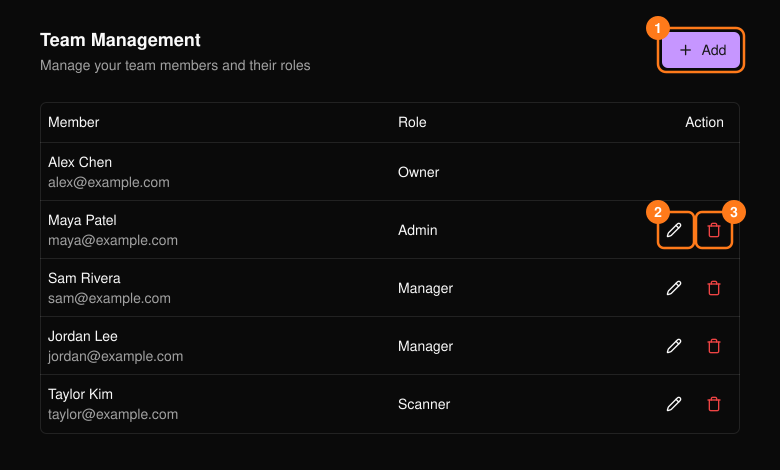
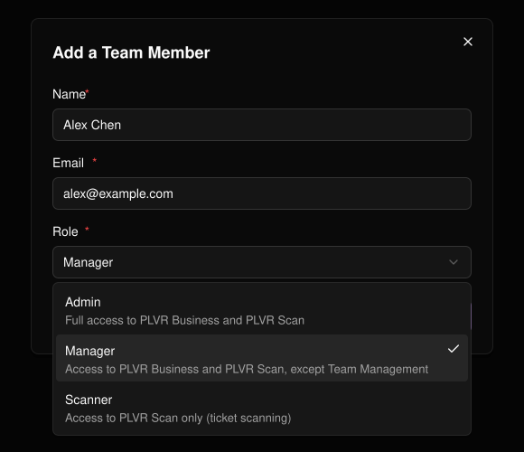

顶部导航栏中的 **Team**（团队）用于控制谁可以在你的组织中工作。

<Note>
  只有所有者和管理员可以打开此页面。
</Note>

| 角色 | 权限 |
| --- | --- |
| **Admin** | PLVR Business 和 PLVR Scan 中的所有功能。 |
| **Manager** | PLVR Business 和 PLVR Scan，但不含 Team Management（团队管理）。 |
| **Scanner** | 仅限 PLVR Scan（门票扫码）。 |

**所有者**（即创建该组织的人）会显示在列表中，但无法被编辑或移除。

<Frame>
  
</Frame>

## 添加成员

<Steps>
  <Step title="选择 Add（1）">
    填写对方的姓名、邮箱和角色。均为必填项。
  </Step>
  <Step title="选择 Save">
    该成员会出现在列表中。
  </Step>
</Steps>

<Frame>
  
</Frame>

## 更改角色或移除成员

使用铅笔图标（2）更改角色；姓名和邮箱不可修改。使用垃圾桶图标（3）移除成员，然后确认。

<Warning>
  如果你给自己分配了无法访问 Team 的角色，可能会立即失去对此页面的访问权限。
</Warning>
