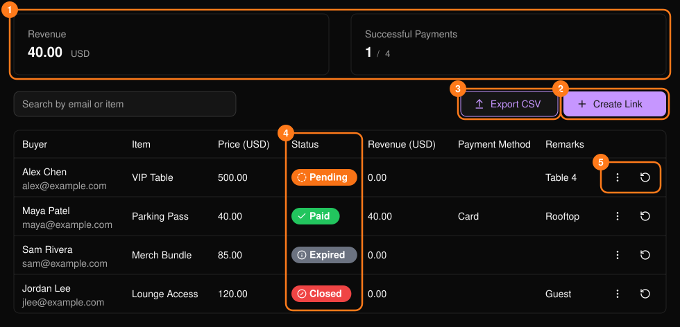
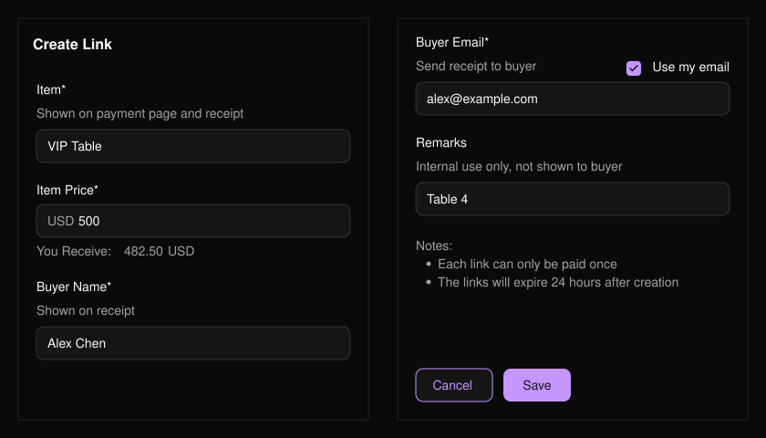
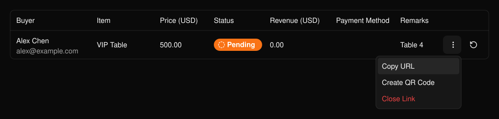
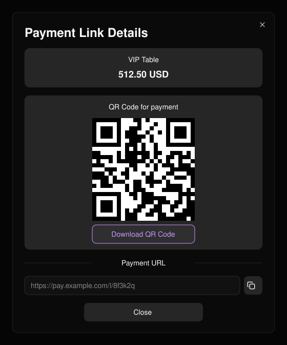

**Payment Links**（支付链接）可让你针对特定项目（例如 VIP 卡座）收取特定金额，无需创建门票。创建链接、发送给买家，并跟踪付款状态。

<Frame>
  
</Frame>

<Warning>
  每个链接仅可支付一次，并在创建 24 小时后失效。
</Warning>

## 创建链接

<Steps>
  <Step title="选择 Create Link (2)">
    输入 **Item**（项目）和 **Item Price**（项目价格，须大于零）。**You Receive**（你的收入）显示扣除费用后你将收到的金额。
  </Step>
  <Step title="填写买家信息">
    买家姓名和邮箱为必填项，收据将发送至该邮箱。**Remarks**（备注）仅供内部使用。
  </Step>
  <Step title="选择 Save">
    然后分享该链接。
  </Step>
</Steps>

<Frame>
  
</Frame>

## 管理链接

使用行菜单 (5) 可执行 **Copy URL**（复制链接）、**Create QR Code**（生成二维码）或 **Close Link**（关闭链接，适用于待支付链接），或 **Download Receipt**（下载收据，适用于已支付链接）。已关闭的链接无法重新开启。使用刷新按钮可查看链接是否已支付。

<Frame>
  
</Frame>

<Frame>
  
</Frame>
