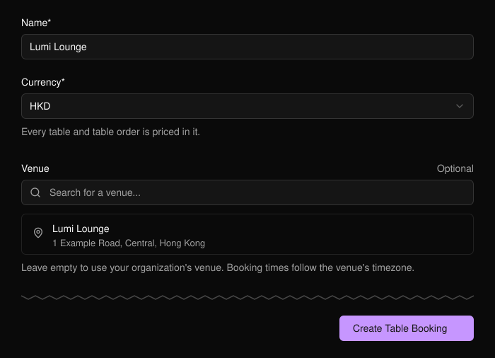
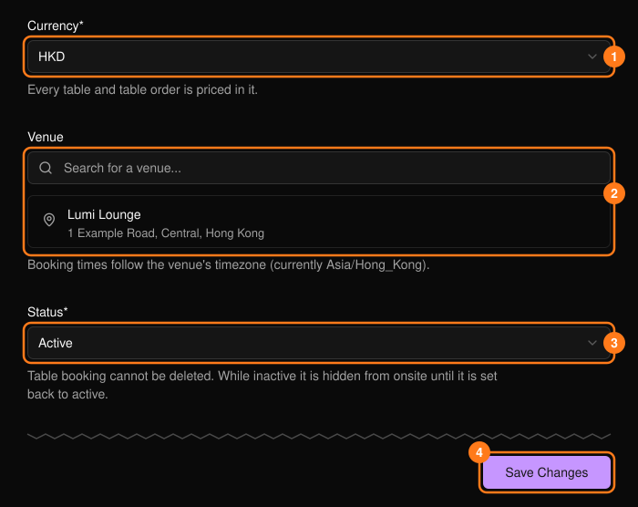
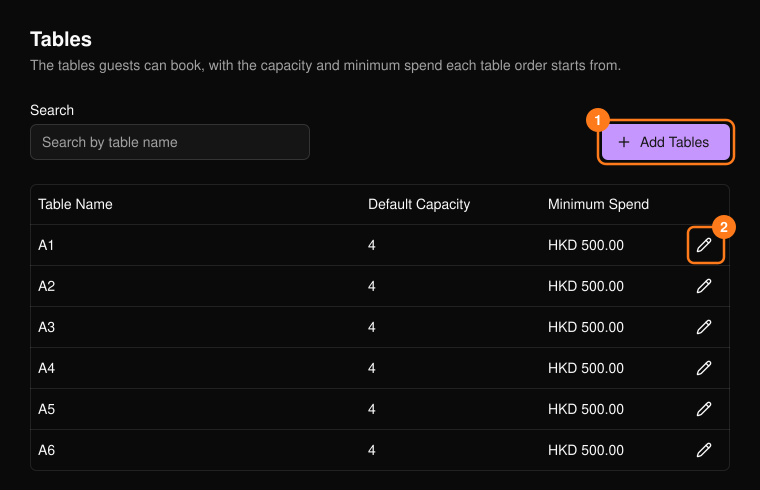
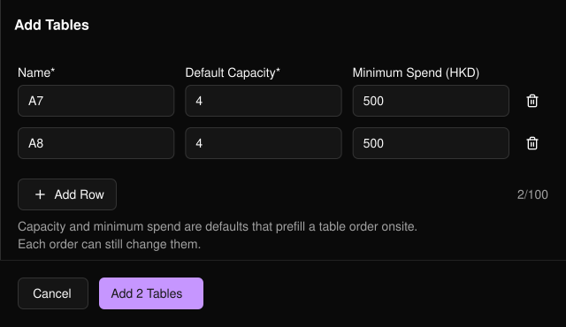

订台功能让来宾可以预订卡座。它按组织设置一次，而不是按活动设置，包含 **Settings**（设置）和 **Tables**（卡座）两部分。

<Note>
  **Table Booking**（订台）仅对所有者、管理员和经理显示在顶部导航中。
</Note>

## 设置

<Steps>
  <Step title="打开 Table Booking">
    填写设置表单。**Name**（名称）和 **Currency**（币种）为必填项。
  </Step>
  <Step title="选择 Create Table Booking">
    选择 **Create Table Booking**（创建订台）后，将直接进入 **Tables**。
  </Step>
  <Step title="添加卡座">
    添加卡座之后才能开放预订。
  </Step>
</Steps>

<Frame>
  
</Frame>

## 设置项

设置内容包括你的 Logo、名称、币种、场地、座位图、酒水单和规则。

<Frame>
  
</Frame>

- **Venue**（场地）留空则使用你组织的场地。预订时间遵循该场地的时区。
- 将 **Status**（状态）(3) 设为 Inactive 可在现场隐藏订台功能。订台无法删除。

<Warning>
  更改币种 (1) 不会换算已有金额。定价为 500 的卡座仍为 500。
</Warning>

## 卡座

每个卡座都有默认容纳人数和最低消费，用于预填现场订台订单；每个订单都可单独修改。卡座无法删除。

<Frame>
  
</Frame>

**Add Tables**（添加卡座）(1) 可一次添加多个卡座。填写第一行后使用 **Add Row**（添加行）：名称会自动递增（A1、A2），容纳人数和最低消费会沿用上一行。每次最多 100 行。

<Frame>
  
</Frame>

- 名称必须唯一（不区分大小写和空格），最多 64 个字符。
- 容纳人数为 1 至 100。最低消费不能为负数。
- 使用铅笔图标 (2) 编辑卡座。已有订单保留各自的数值。
