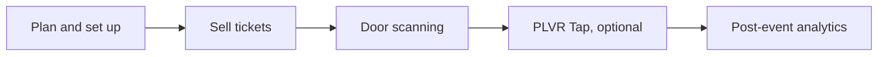

每场活动都会经历三个阶段。通过这些页面了解下一步该做什么。

<Steps>
  <Step title="活动前">
    策划活动、设置门票和表单、开展推广并让团队做好准备。可选：如果活动采用无现金支付，请设置 PLVR Tap。
  </Step>
  <Step title="活动中">
    扫码让嘉宾入场、在门口售票、值守服务台，并处理无现金问题和工单。
  </Step>
  <Step title="活动后">
    查看报表、核对消费和优惠码效果，并跟进你的受众。
  </Step>
</Steps>

<CardGroup cols={3}>
  <Card title="活动前" icon="calendar-check" href="/zh-hans/phases/before">
    策划与售票。
  </Card>
  <Card title="活动中" icon="ticket" href="/zh-hans/phases/during">
    扫码、现场售票与现场运营。
  </Card>
  <Card title="活动后" icon="chart-line" href="/zh-hans/phases/after">
    报表与后续跟进。
  </Card>
</CardGroup>

## 实战手册

- [上线检查清单](/zh-hans/guides/launch-checklist)
- [推广你的活动](/zh-hans/guides/promote-your-event)
- [无现金音乐节设置](/zh-hans/guides/cashless-festival-setup)
- [活动当天执行手册](/zh-hans/guides/event-day-runbook)
- [活动结束后](/zh-hans/guides/after-the-event)

## 在找适合你活动类型的内容？

请参阅[小型活动](/zh-hans/organizers/small-events)、[中型活动](/zh-hans/organizers/mid-size-events)、[音乐节](/zh-hans/organizers/festivals)或[周期性社群活动](/zh-hans/organizers/recurring-community)。如果想按岗位查看，请参阅[按团队查看指南](/zh-hans/roles)。
