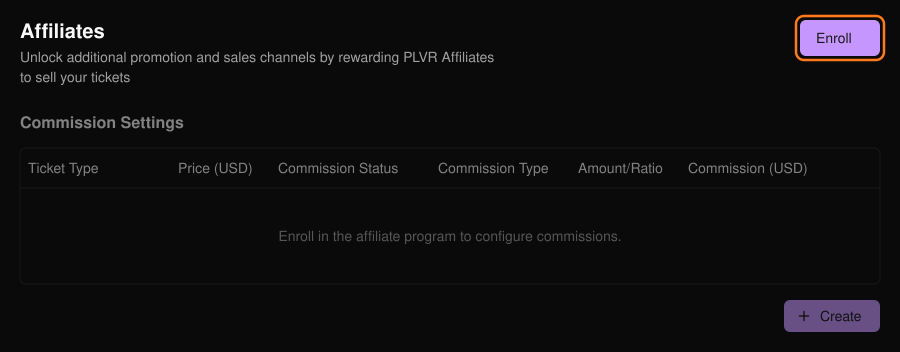
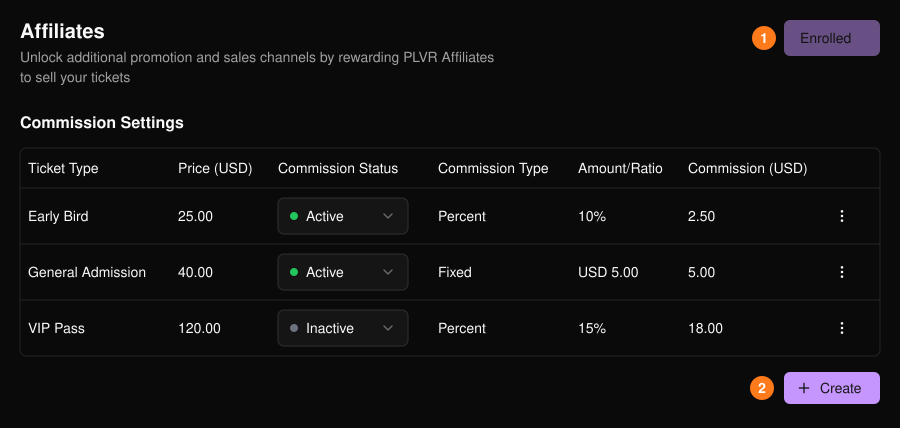
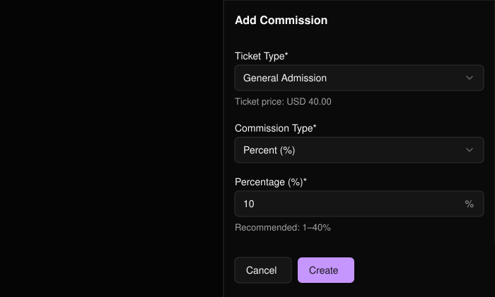

奖励帮你销售门票的 PLVR 推广伙伴（PLVR Affiliates）。只需为活动加入一次计划，然后为每个票种设置佣金。

<Warning>
  加入后无法撤销。加入之前，佣金设置将保持灰色不可用。
</Warning>

<Frame>
  
</Frame>

## 添加佣金

<Steps>
  <Step title="加入计划">选择 **Enroll**（加入）(1)。</Step>
  <Step title="创建">在 Commission Settings（佣金设置）表格下方选择 **Create**（创建）(2)。</Step>
  <Step title="选择门票">已设置佣金的门票不会出现在选项中。</Step>
  <Step title="设置佣金">选择 **Percent (%)**（百分比）或 **Fixed Amount**（固定金额），输入数额，然后选择 **Create**。百分比须为不超过 100 的整数（建议 1% 至 40%）。</Step>
</Steps>

<Frame>
  
</Frame>

<Frame>
  
</Frame>

## 编辑或暂停

使用行末的菜单并选择 **Edit**（编辑）以更改佣金类型或数额。如需暂停某项佣金，将其 **Commission Status**（佣金状态）设为 **Inactive**（停用）。

<Tip>
  如需用你自己的链接追踪合作伙伴，请创建带有推广伙伴 ID 的[追踪链接](/zh-hans/promotions/tracking-links)。推广伙伴代码也会显示在[门票报表](/zh-hans/tickets/ticket-report)中。
</Tip>
