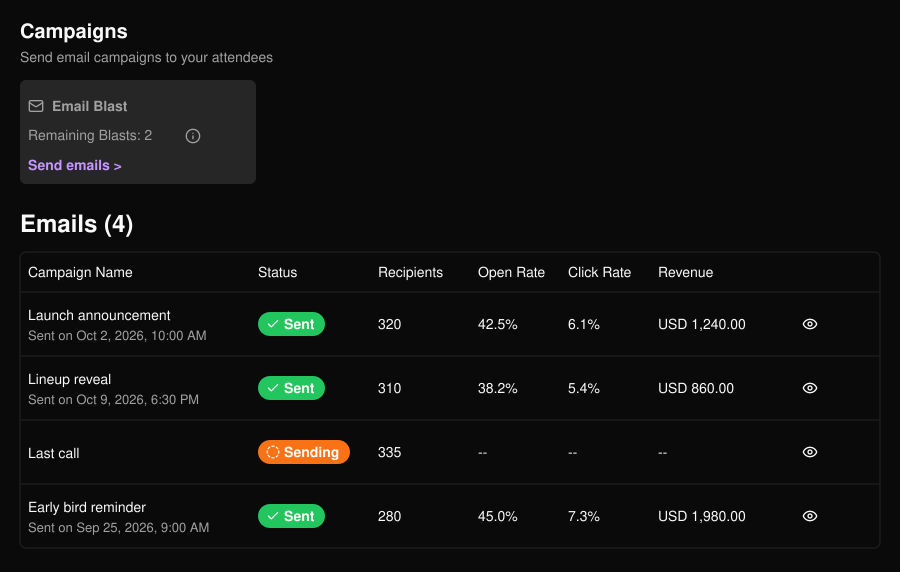
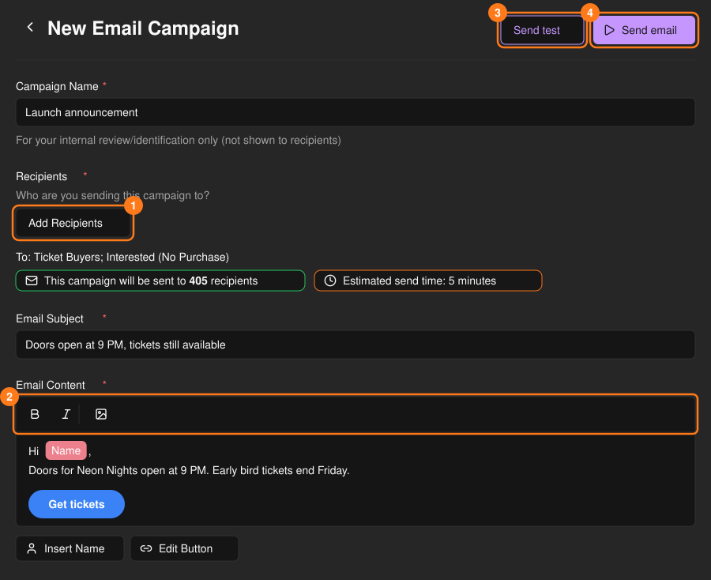
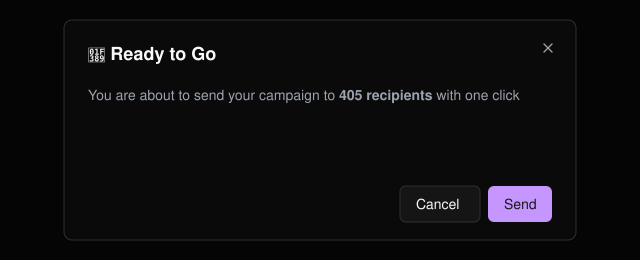
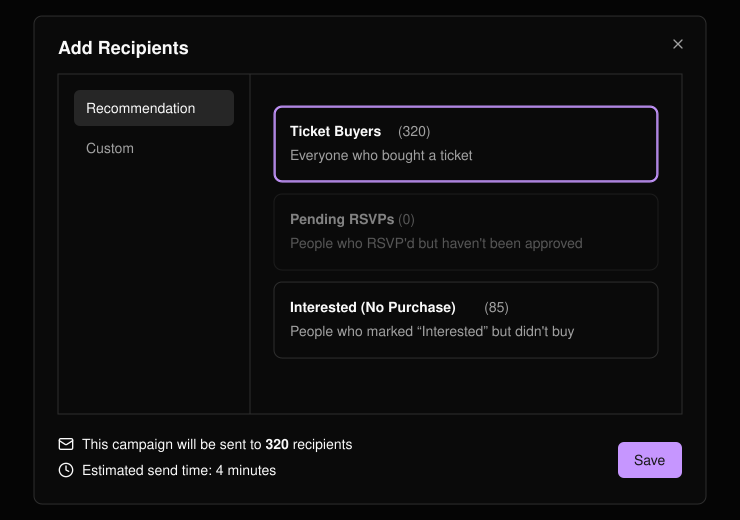
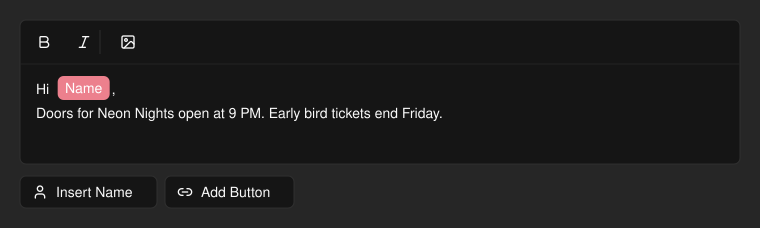
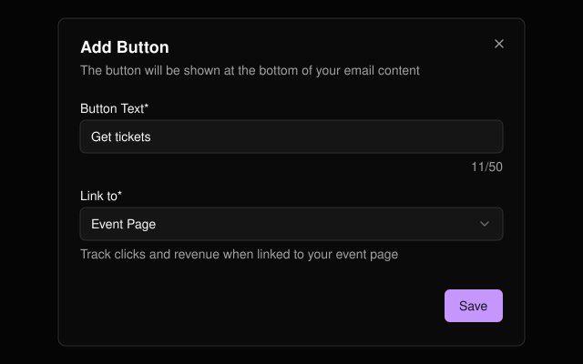

发送关于活动的群发邮件，并在同一页面跟踪打开、点击和收入。确认后邮件会立即发送。不支持草稿，已发送的邮件无法编辑。

<Note>
  每个活动每周的群发次数有限。**Remaining Blasts**（剩余群发次数）显示剩余额度，归零后将无法发送。
</Note>

<Frame>
  
</Frame>

## 创建并发送邮件

选择 **Send emails >**（发送邮件）。

<Steps>
  <Step title="命名">营销活动名称仅供你自己查看，收件人看不到。</Step>
  <Step title="添加收件人">选择发送对象（见下文）。</Step>
  <Step title="撰写邮件">输入主题和正文。</Step>
  <Step title="发送测试邮件">选择 **Send test**（发送测试）将预览发送到你自己的邮箱。</Step>
  <Step title="发送">选择 **Send email**（发送邮件），确认收件人数后再确认发送。</Step>
</Steps>

<Frame>
  
</Frame>

<Frame>
  
</Frame>

<Warning>
  主题或正文中含有限制词时将无法发送，测试邮件也不例外。提示信息会列出需要修改的词语。
</Warning>

## 选择收件人

保存时仅使用当前所在标签页的设置。

<Tabs>
  <Tab title="推荐">
    选择一个或多个群组：**Ticket Buyers**（购票者）、**Pending RSVPs**（待处理 RSVP）或 **Interested (No Purchase)**（感兴趣但未购票）。空群组无法选择。
  </Tab>
  <Tab title="自定义">
    上传 CSV（使用 **Download Template** 下载模板，需包含 **Email** 列），或逐个输入邮箱地址。无效和重复的地址会被跳过。
  </Tab>
</Tabs>

<Frame>
  
</Frame>

选择完成后，会立即显示预估收件人数和发送时间。

## 邮件编辑器

可设置文本格式、插入图片，或使用 **Insert Name**（插入姓名）按姓名称呼每位收件人。**Add Button**（添加按钮）会在邮件底部添加一个行动号召按钮。

<Frame>
  
</Frame>

<Frame>
  
</Frame>

<Tip>
  将按钮的 **Link to**（链接到）设为 **Event Page**（活动页面），即可在营销列表中跟踪点击和收入。**Custom URL**（自定义链接）无法跟踪。
</Tip>
