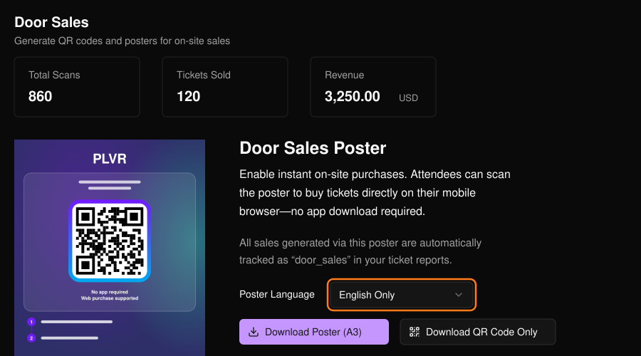
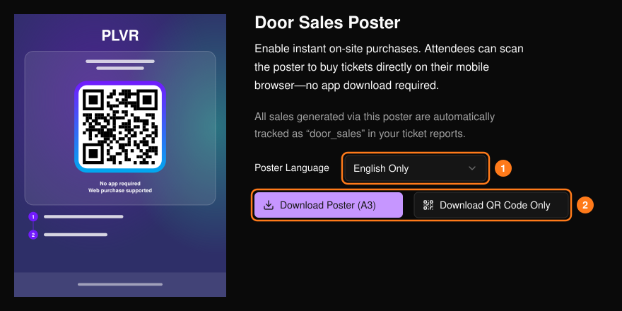

来宾扫描二维码后进入你的活动页面，用手机完成购票。这些购买会计为现场售票，扫码次数、已售门票和收入显示在页面顶部。通过海报二维码完成的购买会在[门票报表](/zh-hans/tickets/ticket-report)中记为 `door_sales`。

<Frame>
  
</Frame>

## 获取海报或二维码

<Steps>
  <Step title="选择语言">选择海报语言 (1)，预览会随之更新。</Step>
  <Step title="下载">选择 **Download Poster (A3)**（下载 A3 海报）获取可直接打印的海报，或选择 **Download QR Code Only**（仅下载二维码）(2)。</Step>
</Steps>

<Frame>
  
</Frame>

<Tip>
  打印前，请先用手机扫描海报，确认活动页面能正常打开、需要销售的门票可购买，且结账流程正常。

  将海报张贴在入口或售票处。二维码可单独用于桌卡、屏幕或工作人员胸牌。安排工作人员引导来宾前往海报处、协助结账，并按活动的入场流程核验电子票。其他渠道请参阅[追踪链接](/zh-hans/promotions/tracking-links)。
</Tip>
