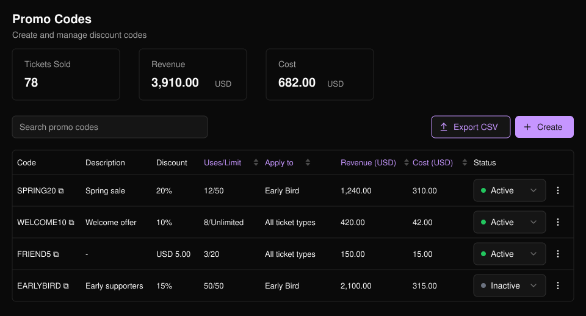
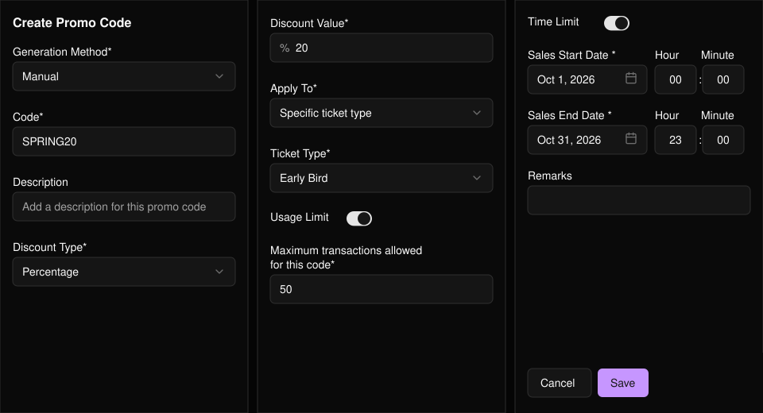
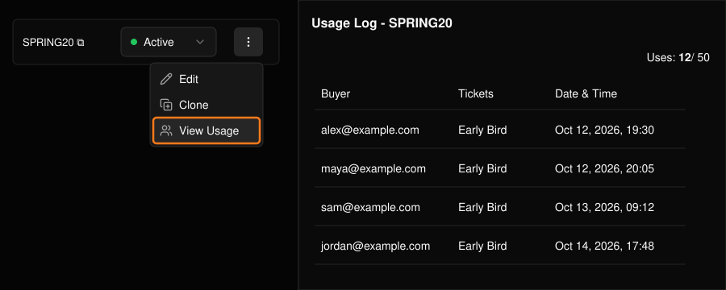

提供百分比折扣或固定金额折扣。可逐个创建优惠码，也可一次批量生成。

<Frame>
  
</Frame>

列表显示每个优惠码相对其上限的使用情况，以及收入和成本。可直接在表格中更改优惠码的 **Status**（状态），或选择 **Export CSV**（导出 CSV）下载列表。

## 创建优惠码

选择 **Create**（创建）。

<Steps>
  <Step title="选择创建方式">
    **Manual**（手动）用于创建一个自行输入的优惠码；**Bulk Generate**（批量生成）可一次生成最多 100 个优惠码，并可设置前缀（选填）。

    <Frame>
      
    </Frame>
  </Step>
  <Step title="设置折扣">
    选择 **Percentage**（百分比）或 **Fixed Amount**（固定金额），并输入数值。
  </Step>
  <Step title="选择适用范围">
    适用于全部票种，或指定的场次和门票。
  </Step>
  <Step title="添加限制（选填）">
    开启 **Usage Limit**（使用上限，即最大订单数）和/或 **Time Limit**（时间限制，即开始和结束时间）。不设置时，优惠码不会用完或过期。
  </Step>
  <Step title="保存">
    **Description**（描述）会显示在列表中，**Remarks**（备注）供你自己记录。
  </Step>
</Steps>

<Frame>
  
</Frame>

## 编辑、复制或查看使用记录

使用行末的菜单。

- **Edit**（编辑）：更改设置或启用/停用优惠码。优惠码文本本身无法更改。
- **Clone**（复制）：以相同设置新建一个优惠码。
- **View Usage**（查看使用记录）：查看使用该优惠码的每一笔订单。

<Frame>
  
</Frame>

<Tip>
  如需查看单笔订单使用的优惠码，请在[门票报表](/zh-hans/tickets/ticket-report)中添加 **Promo Code** 列。
</Tip>
