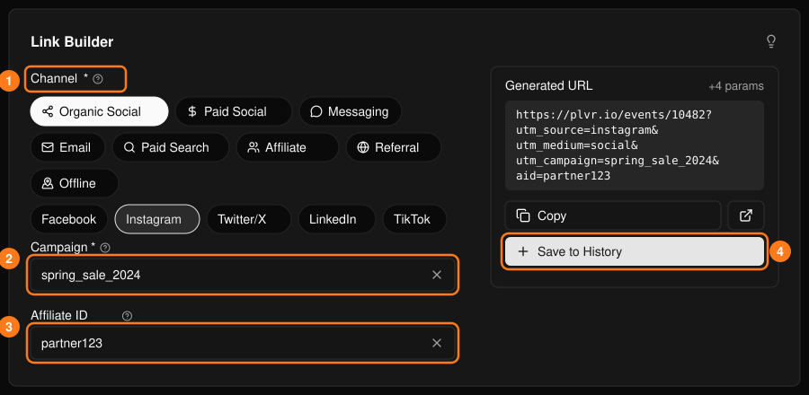
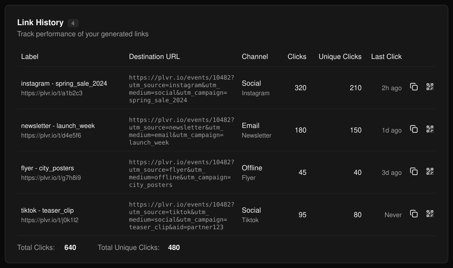
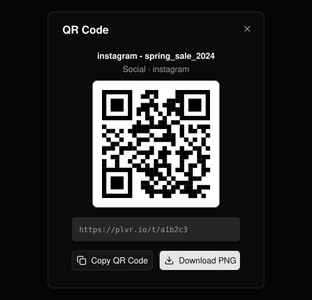

通过 Instagram、邮件通讯或传单等渠道分享活动页面，了解哪些渠道带来了访客。

## 生成链接

<Steps>
  <Step title="选择渠道">先选择类别，再选择子渠道 (1)。</Step>
  <Step title="命名营销活动">必填。各渠道请使用统一的命名，并用下划线代替空格 (2)。</Step>
  <Step title="添加推广伙伴 ID（选填）">用于追踪特定合作伙伴带来的推荐 (3)。</Step>
  <Step title="保存">选择 **Copy**（复制）使用该链接，选择 **Save to History**（保存到历史记录）(4) 保存链接并开始统计点击。</Step>
</Steps>

<Frame>
  
</Frame>

<Note>
  只有已保存的链接才会生成短链接并统计点击。请保存所有计划分享的链接。
</Note>

## 链接历史

已保存的链接会显示在此处，并附带总点击数和独立点击数。使用行内按钮可复制短链接或打开其 **QR Code**（二维码），二维码可复制或下载为 PNG。

<Frame>
  
</Frame>

<Frame>
  
</Frame>

现场售票请参阅[现场售票](/zh-hans/promotions/door-sales)。
