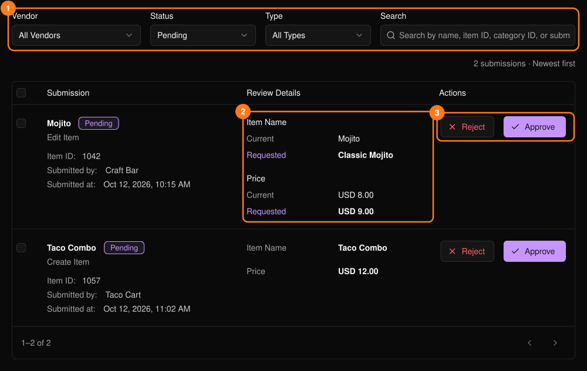
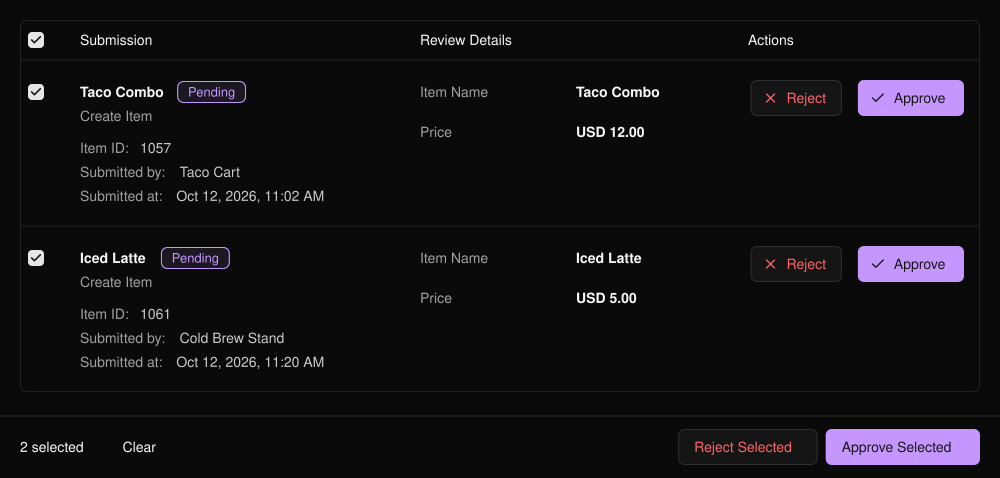

商户新增或修改商品、分类后，内容会在此处等待审核，经你批准后才会在其菜单中生效。该页面位于活动侧边栏的 **PLVR Tap** 下。

<Frame>
  
</Frame>

页面默认显示 **Pending**（待处理）的提交。使用筛选项 (1) 可按状态、类型或商户查找其他提交。对于修改类提交，可对比 **Current**（当前值）和 **Requested**（申请值）(2)。

## 审核单条提交

<Steps>
  <Step title="查看详情">点击图片可放大查看。</Step>
  <Step title="批准或拒绝 (3)">**Approve**（批准）会使提交内容生效。**Reject**（拒绝）需要填写原因，商户可以看到该原因。</Step>
</Steps>

## 批量审核

勾选多行或表头复选框，即可显示 **Approve Selected**（批准所选）和 **Reject Selected**（拒绝所选）。最多可选择 50 条，批量拒绝时所有提交使用同一个原因。期间已发生变更的提交会被跳过。

<Frame>
  
</Frame>

<Tip>
停用商户的提交仍可审核。批准前请留意 **Inactive**（停用）标签。
</Tip>

## 相关内容

- [商户](/zh-hans/tap/vendors)
- [PLVR Tap 概览](/zh-hans/tap/introduction)
