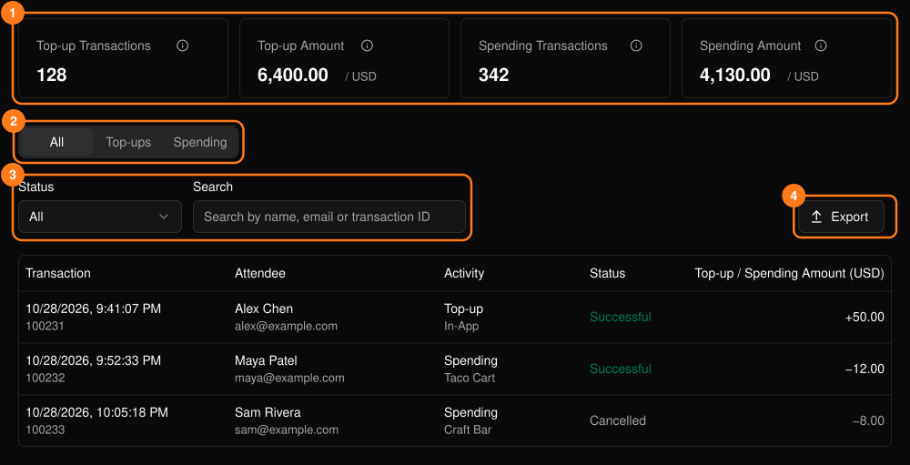
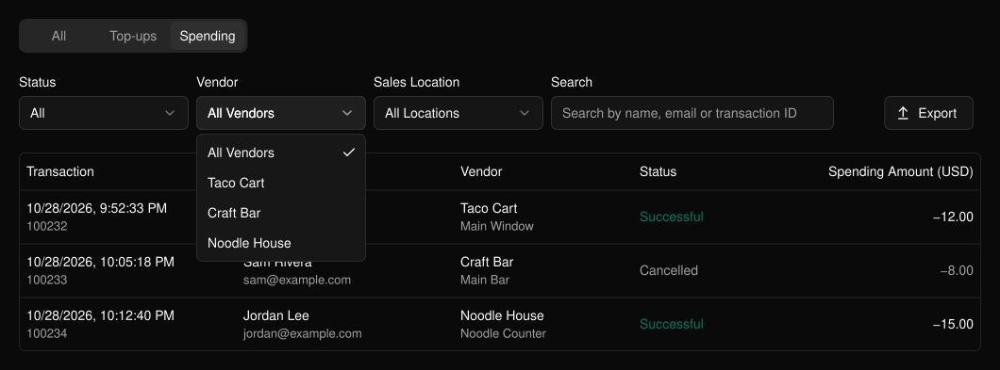

列出参与者钱包的充值记录以及在商户处的消费记录。该页面位于活动侧边栏的 **PLVR Tap** 下。

<Frame>
  
</Frame>

汇总卡片 (1) 仅统计成功的交易。Top-up Amount（充值金额）不含服务费和税费。

## 筛选和导出

在 **All**（全部）、**Top-ups**（充值）和 **Spending**（消费）之间切换 (2)。每个标签页都有各自的筛选项 (3)，例如状态、充值渠道和充值站、商户和销售点，或按姓名、邮箱、交易 ID 搜索。

已取消的交易显示为灰色。选择 **Export**（导出）(4) 可按当前筛选条件下载当前标签页的 CSV。

<Frame>
  
</Frame>

## 相关内容

- [消费报表](/zh-hans/tap/spending-report)：按商户和商品查看汇总
- [现场无现金交易](/zh-hans/onsite/cashless)：处理单笔交易
