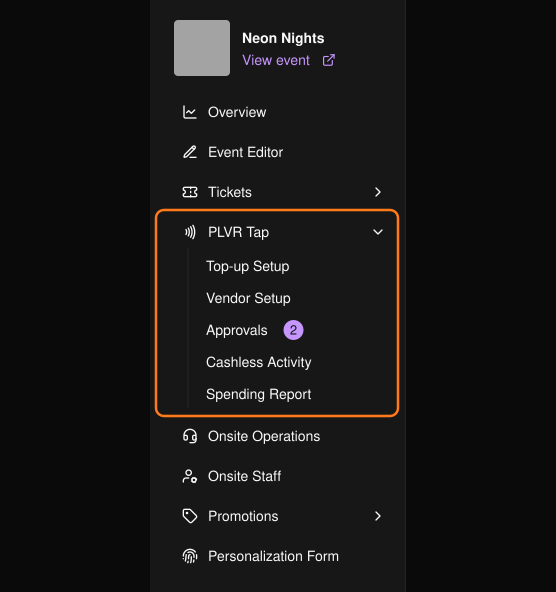

PLVR Tap 让参与者只需轻触手环即可付款。每位参与者都有一个 Event Wallet（活动钱包）：先充值，再到商户摊位消费。你在活动前完成设置，活动后进行查看和对账。

<Note>
只有启用了 PLVR Tap 的活动才会显示 PLVR Tap 相关页面。
</Note>

<Frame>
  
</Frame>

## 运作方式

<Steps>
  <Step title="活动前">
    创建[充值站](/zh-hans/tap/top-up-setup)，设置[商户](/zh-hans/tap/vendors)并发放登录码，选择[个性化信息表](/zh-hans/tap/personalization-form)中向参与者询问的问题，并[审核商户菜单](/zh-hans/tap/approvals)。
  </Step>
  <Step title="活动中">
    工作人员在入场时为每张门票绑定手环。参与者可在线充值，也可在充值站使用现金或银行卡充值。商户扫描手环完成收款。
  </Step>
  <Step title="活动后">
    查看[无现金交易记录](/zh-hans/tap/cashless-activity)和[消费报表](/zh-hans/tap/spending-report)，然后与商户进行结算。
  </Step>
</Steps>

## 下一步

<CardGroup cols={2}>
  <Card title="充值设置" icon="wallet" href="/zh-hans/tap/top-up-setup">充值站和支付方式。</Card>
  <Card title="商户" icon="store" href="/zh-hans/tap/vendors">商户、销售点、商品和登录码。</Card>
  <Card title="审核" icon="circle-check" href="/zh-hans/tap/approvals">审核商户提交的内容。</Card>
  <Card title="现场手环管理" icon="nfc" href="/zh-hans/onsite/wristbands">在活动期间管理手环。</Card>
</CardGroup>
