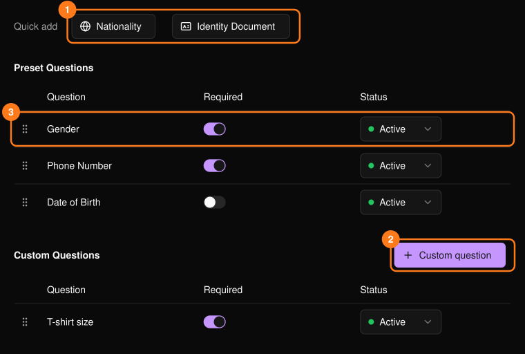
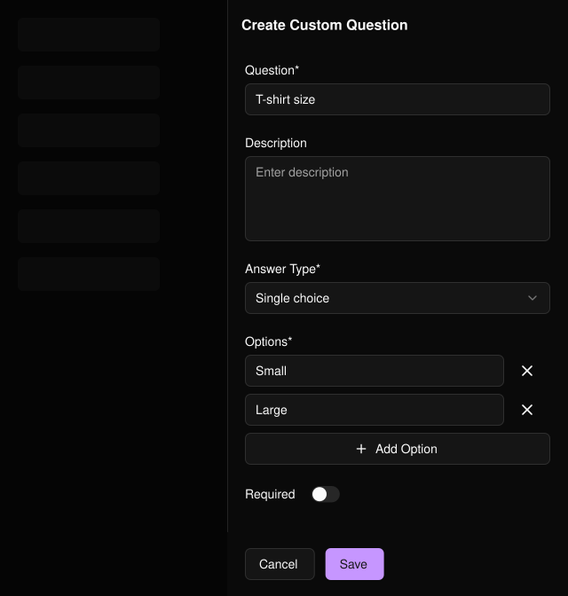

参与者在填写门票个性化信息或认领门票时回答这些问题。它与[报名表](/zh-hans/events/registration-form)相互独立。姓名和邮箱始终会收集，因此不在列表中显示。

<Frame>
  
</Frame>

## 添加问题

- **Quick add**（快速添加）(1)：添加标准问题（Gender 性别、Nationality 国籍、Phone Number 电话号码、Date of Birth 出生日期、Identity Document 身份证件），默认为必填。
- **Custom question**（自定义问题）(2)：选择答案类型（文本、数字、单选或多选）。选择题类型至少需要一个选项。

<Frame>
  
</Frame>

## 管理问题

在每一行 (3) 中，可切换 **Required**（必填），将 **Status**（状态）设为 **Inactive**（停用）以停止询问该问题，或拖动手柄调整顺序。

## 相关内容

- [PLVR Tap 概览](/zh-hans/tap/introduction)
- [手环](/zh-hans/onsite/wristbands)
