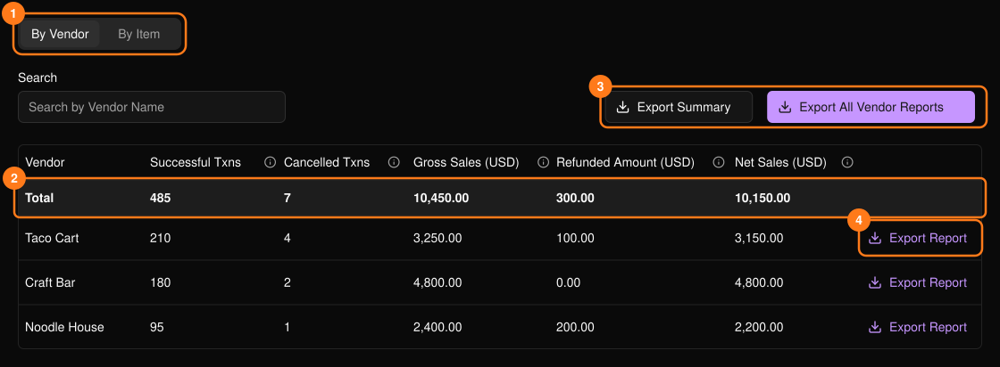
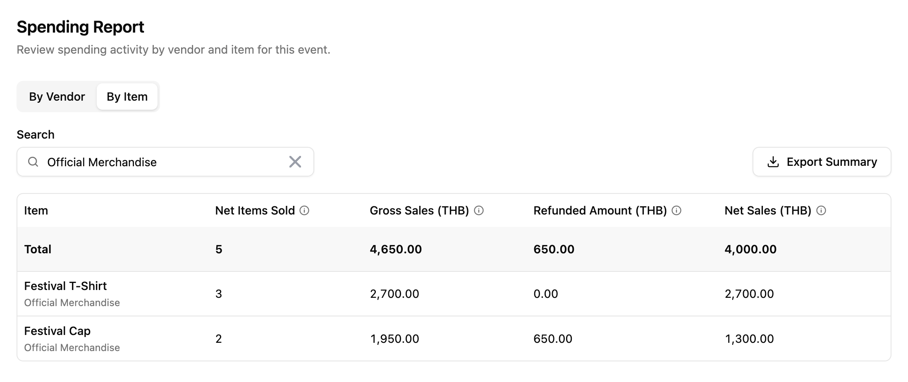

显示活动中的消费金额。该页面位于活动侧边栏的 **PLVR Tap** 下。

<Frame>
  
</Frame>

在 **By Vendor**（按商户）和 **By Item**（按商品）之间切换 (1)，并使用 **Search**（搜索）进行筛选。**Total**（合计）行 (2) 涵盖所有符合搜索条件的数据，而不仅是当前页。Net Sales（净销售额）为 Gross Sales（总销售额）减去退款。将鼠标悬停在列的信息图标上可查看其定义。

<Frame>
  
</Frame>

## 导出

导出文件为 Excel 格式。

- **Export Summary**（导出汇总）(3)：当前标签页的数据，已应用你的搜索条件。
- **Export Report**（导出报表）(4)：单个商户的结算报表。与该商户结算时使用。
- **Export All Vendor Reports**（导出全部商户报表）(3)：每个商户各一份报表。文件准备好后即会下载。

## 相关内容

- [无现金交易记录](/zh-hans/tap/cashless-activity)
- [商户](/zh-hans/tap/vendors)
