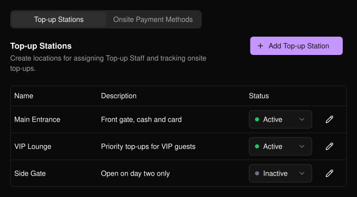
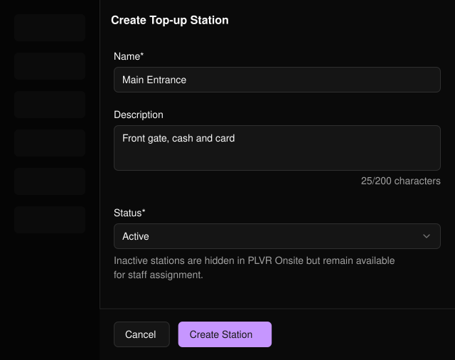
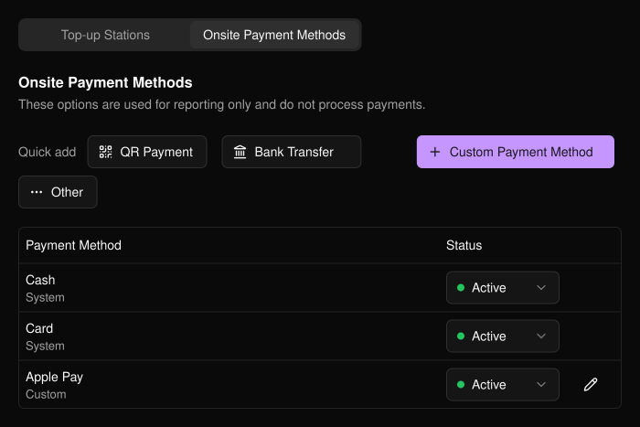

提前规划参与者在现场充值的地点和方式。该页面位于活动侧边栏的 **PLVR Tap** 下。

## 充值站

充值站是工作人员为参与者充值的实际地点，例如主入口或 VIP 区。通过充值站，你可以将工作人员分配到具体地点，并按地点统计充值情况。

<Frame>
  
</Frame>

<Steps>
  <Step title="Add Top-up Station">选择 **Add Top-up Station**（添加充值站）打开表单。</Step>
  <Step title="填写详情">名称为必填项。描述和状态（默认为 Active）为选填。</Step>
  <Step title="Create Station">选择 **Create Station**（创建充值站）。之后可通过铅笔图标编辑，或在表格中更改 **Status**（状态）。</Step>
</Steps>

<Frame>
  
</Frame>

<Note>
停用的充值站在 PLVR Onsite 中会被隐藏，但仍可用于分配工作人员。
</Note>

## 现场支付方式

这些是工作人员用于记录参与者付款方式的选项。

<Warning>
它们仅用于报表统计，不会处理任何付款。请使用你自己的收款终端、现金或其他方式收款。
</Warning>

使用 **Quick add**（快速添加）添加 Cash（现金）、Card（银行卡）、QR Payment（扫码支付）、Bank Transfer（银行转账）或 Other（其他），或使用 **Custom Payment Method**（自定义支付方式）添加你自己的方式，例如 Apple Pay。只有自定义支付方式可以编辑。任何支付方式都可设为 **Active**（启用）或 **Inactive**（停用）。

<Frame>
  
</Frame>

## 相关内容

- [PLVR Tap 概览](/zh-hans/tap/introduction)
- [无现金交易记录](/zh-hans/tap/cashless-activity)
