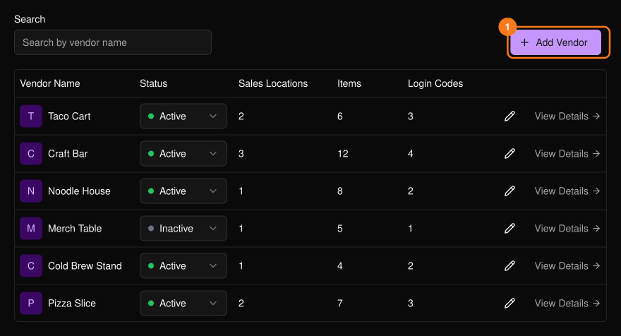
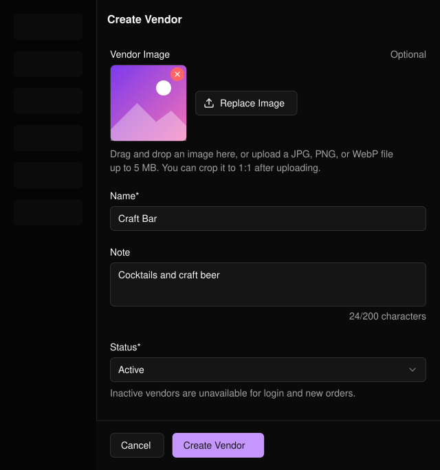
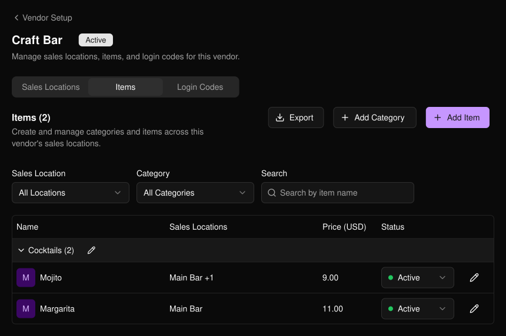
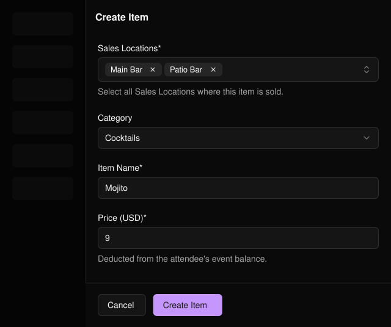
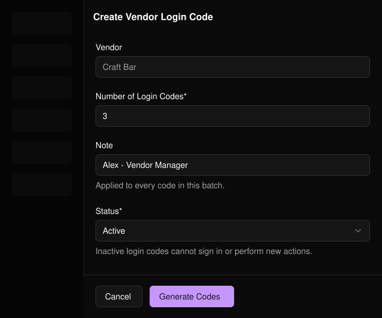

商户是通过扫描手环向参与者收款的摊位。**Vendor Setup**（商户设置）位于活动侧边栏的 **PLVR Tap** 下。

<Frame>
  
</Frame>

## 添加商户

<Steps>
  <Step title="Add Vendor (1)">选择 **Add Vendor**（添加商户）打开表单。</Step>
  <Step title="填写详情">名称为必填项。图片、内部备注和状态为选填。</Step>
  <Step title="Create Vendor">选择 **Create Vendor**（创建商户）。点击商户名称即可打开该商户。</Step>
</Steps>

<Frame>
  
</Frame>

<Note>
停用的商户、销售点和商品无法用于登录和新订单。停用分类中的商品在所有地方均不可用。
</Note>

## 设置商户

<Frame>
  
</Frame>

<Steps>
  <Step title="Sales Locations">在 **Sales Locations**（销售点）中添加商户的每个销售地点，例如 "Main Bar"。</Step>
  <Step title="Items">在 **Items**（商品）中添加分类和商品。每个商品的价格须大于 0，且至少关联一个销售点。</Step>
  <Step title="Login Codes">在 **Login Codes**（登录码）中一次可生成 1 至 200 个登录码。备注适用于整批登录码。</Step>
</Steps>

<Frame>
  
</Frame>

商户自行提交的商品和分类需先经过[审核](/zh-hans/tap/approvals)。在 Items 和 Login Codes 标签页中使用 **Export**（导出）可下载 CSV。

<Frame>
  
</Frame>

<Warning>
停用的登录码无法登录。如有人离开摊位或登录码被误分享，请将该登录码设为 Inactive。
</Warning>

## 相关内容

- [审核](/zh-hans/tap/approvals)
- [消费报表](/zh-hans/tap/spending-report)
- [PLVR Tap 概览](/zh-hans/tap/introduction)
