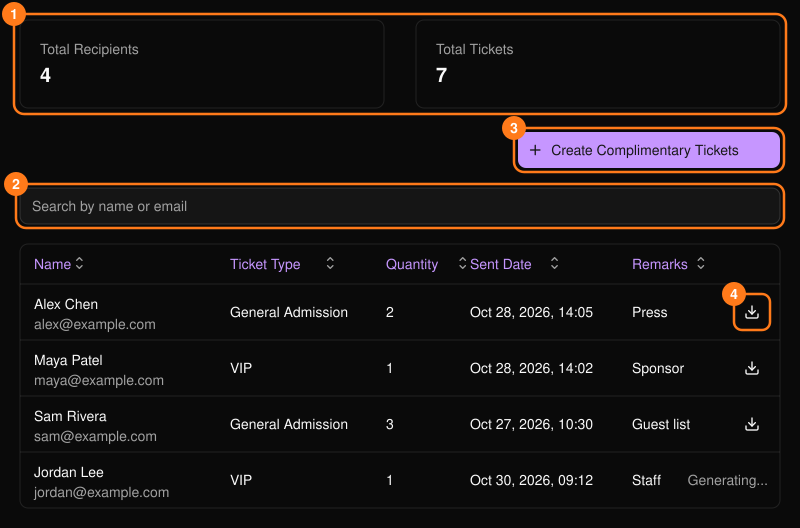
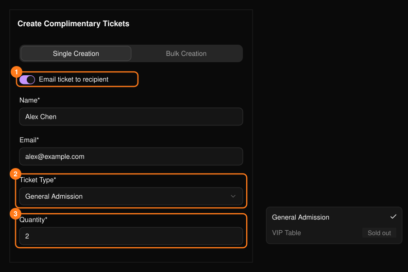
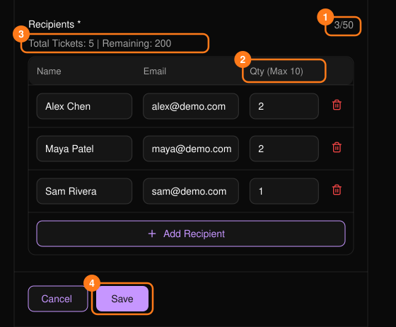
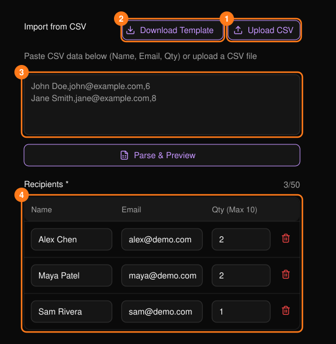

使用 **Complimentary Tickets**（赠票）向嘉宾、赞助商、媒体或工作人员发放免费门票。赠票与其他门票一样计入门票库存。

<Frame>
  
</Frame>

可按姓名或邮箱搜索，点击任意列标题进行排序。使用下载图标可将收件人的门票下载为 PDF。显示 **Generating...**（生成中）的行仍在准备中，请稍后再查看。

## 单张发放

选择 **Create Complimentary Tickets**（创建赠票），然后使用 **Single Creation**（单张发放）标签页。

<Frame>
  
</Frame>

- 姓名和有效邮箱为必填项。
- 已售罄的票种显示为灰色。
- 数量最多 50 张，且不超过剩余库存。
- **Email ticket to recipient**（通过邮件发送给收件人）仅适用于 10 张及以下的数量。
- **Remarks**（备注，最多 200 个字符）仅供你自己参考。

## 批量发放

一次可向最多 **50 位收件人**发放同一票种。

<Frame>
  
</Frame>

<Steps>
  <Step title="选择发送方式和门票">
    选择是否通过邮件发送门票，然后选择 **Session**（场次）和 **Ticket Type**（票种）。
  </Step>
  <Step title="添加收件人">
    添加行或导入 CSV。每位收件人需填写姓名、邮箱和数量。
  </Step>
  <Step title="检查数量">
    每位收件人最多 50 张，通过邮件发送时最多 10 张；如剩余门票更少，则上限相应降低。如总数超过剩余库存，系统会提示你调整。
  </Step>
  <Step title="保存">
    **Remarks**（备注）适用于整批门票。
  </Step>
</Steps>

### 从 CSV 导入

使用 **Upload CSV**（上传 CSV），或粘贴行内容后选择 **Parse & Preview**（解析并预览）。**Download Template**（下载模板）可获取一份起始文件。列的顺序如下：

```csv
Name,Email,Quantity
John Doe,john@example.com,1
```

- 表头行为可选。姓名中不能包含逗号。
- 如某一行无效，导入会停止并指出需要修正的行号。
- 导入的行计入 50 人上限，保存前可进行编辑。

<Frame>
  
</Frame>
