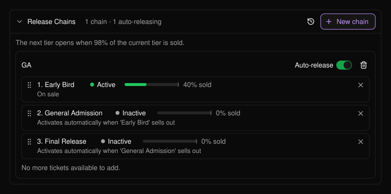
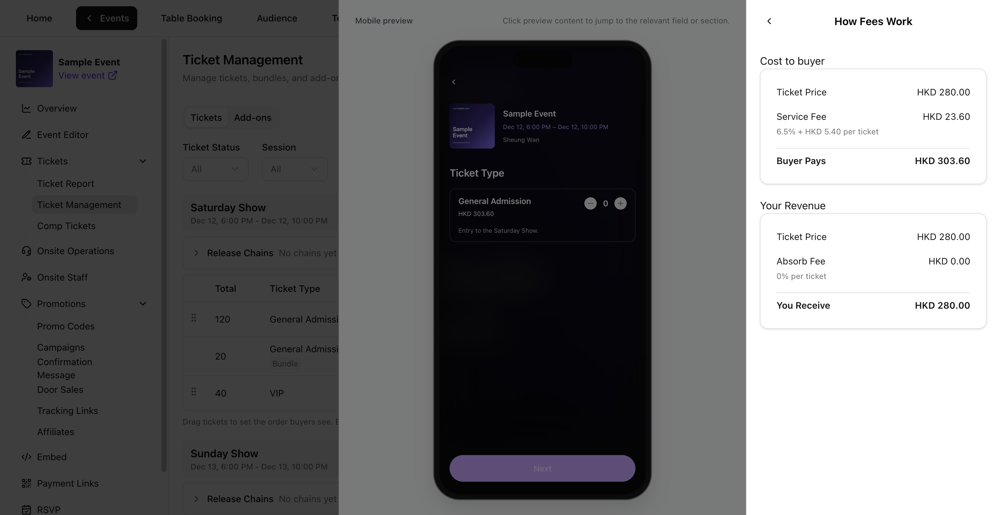

```text
Event
 └── Session (a day, a show, a time slot)
      ├── Tickets  (Early Bird, General Admission, VIP ...)
      │     └── optionally in a Release Chain (one tier opens after another)
      ├── Bundles  (a ticket sold as a pack)
      └── Add-ons  (parking, merchandise, extras)
```

以上所有内容均在[门票管理](/zh-hans/tickets/ticket-management)中进行管理。

## 场次

**场次**（session）是参与者可以参加的一次具体活动时段，例如周五晚场或某一天的演出。每张门票和套票都隶属于一个场次。例如，周五门票仅在周五场次有效。只有当活动包含多个场次时，才会显示场次筛选和场次列。参见[多日音乐节](/zh-hans/tickets/scenario-multi-day-festival)。

## 票种

**票种**（ticket type）是一类门票，拥有独立的价格、数量、销售时段、状态以及必填的购买限制。

<Frame>
  
</Frame>

| 状态 | 含义 |
| --- | --- |
| **Active**（启用） | 销售开始日期到达后即开售并对买家可见。 |
| **Inactive**（停用） | 对买家隐藏。可用于暂缓或暂停销售某票种。 |
| **Ended**（已结束） | 销售结束时间过后自动设置，无法重新启用。 |

- **Total ticket quantity**（门票总量）是该门票的库存上限。请结合场地容量规划各票种的数量，并在库存中为赠票预留名额。
- **Tickets per order**（每单限购，1–10）和 **Tickets per buyer**（每人限购，1–20）为必填项，以门票张数计算。限制对每个票种分别生效。
- 该门票库存产生首笔销售或发放后，**Ticket name**（门票名称）和 **Price per ticket**（单价）将被锁定。锁定和库存规则详见[编辑门票或套票](/zh-hans/tickets/ticket-management)。

## 放票链

**放票链**（release chain）将多个票种按顺序排列，例如早鸟票、普通票、最终批次，当前票种即将售罄时自动开放下一档。参见[放票链](/zh-hans/tickets/ticket-management)和[分档销售普通票](/zh-hans/tickets/scenario-ga-tiers)。

<Frame>
  
</Frame>

## 套票

**套票**（bundle）将同一场次的多张同种门票打包，例如四人套票。套票与所含门票共享库存。**Bundle sales limit**（套票销售上限）限制可售出的套票总数。**Available now**（当前可售）同时反映剩余套票上限和剩余共享门票库存。

**Bundles per order**（每单限购套数）和 **Bundles per buyer**（每人限购套数）以套为单位设置。PLVR 会将其换算为门票张数，以执行每单 10 张、每人 20 张的上限。以四人套票为例，即每单最多 2 套、每人最多 5 套。**Sold**（已售）对套票按套计数，对票种按张计数。

参见[创建套票](/zh-hans/tickets/ticket-management)和[团体套餐](/zh-hans/tickets/scenario-bundles)。

## 附加项

**附加项**（add-on）是随门票一同购买的额外项目，例如停车位。每个附加项都与可搭配购买的门票关联，可设置独立数量，也可与某个门票共享库存。参见 [VIP 与附加项](/zh-hans/tickets/scenario-vip-addons)。

## 费用

**Price per ticket**（单价）和 **Price per bundle**（套票价格）是你输入的基础价格，不含买家手续费和税费。套票价格为整套价格。

- **All-in pricing**（全包价）在一开始就向买家展示包含适用买家手续费和税费的完整价格。
- **Split pricing**（分项定价）先展示基础价格，在结账时再加收适用的买家手续费和税费。

在 **Pricing**（定价）下查看 **Buyer pays**（买家支付）和 **You receive**（你的收入），然后打开 **How fees work**（费用说明）查看买家服务费、由你承担的费用以及税费。启用税费后，**You Receive (incl. tax)** 包含代收的税款；不含税的金额请查看 **Revenue excluding tax**（不含税收入）。套票的费用明细显示整套金额。以下示例使用 Sample Event 的费用设置。

<Frame>
  
</Frame>

## 优惠码与赠票

[优惠码](/zh-hans/promotions/promo-codes)可对全部门票或某一门票、套票提供折扣。[赠票](/zh-hans/tickets/comp-tickets)是发放给指定人员的免费门票，与付费门票共用同一库存。参见[折扣活动](/zh-hans/tickets/scenario-promo-discounts)和[为嘉宾发放赠票](/zh-hans/tickets/scenario-comp-guests)。
