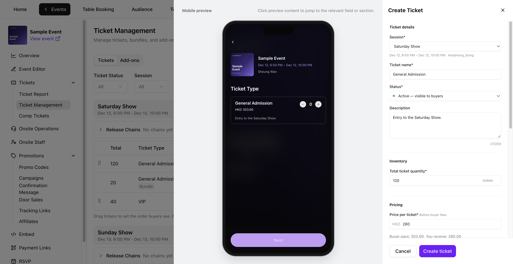
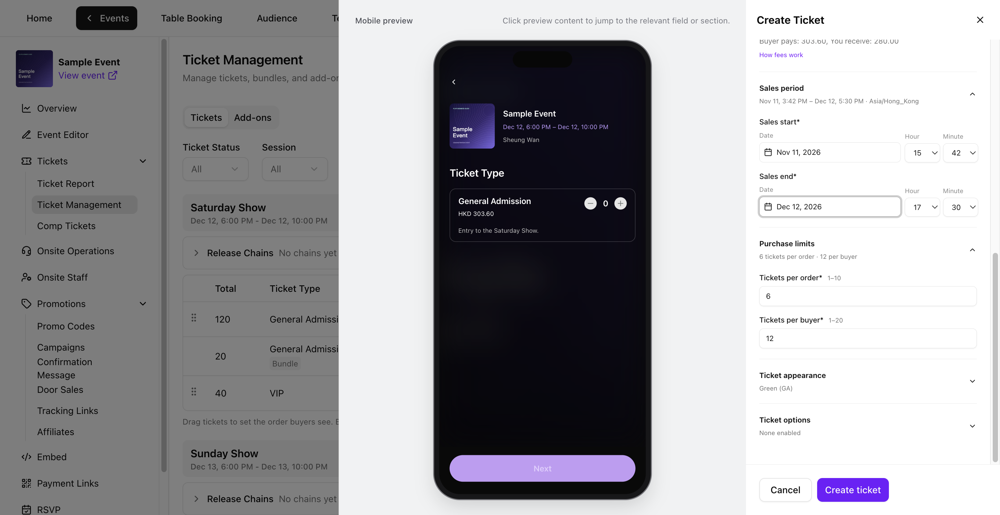
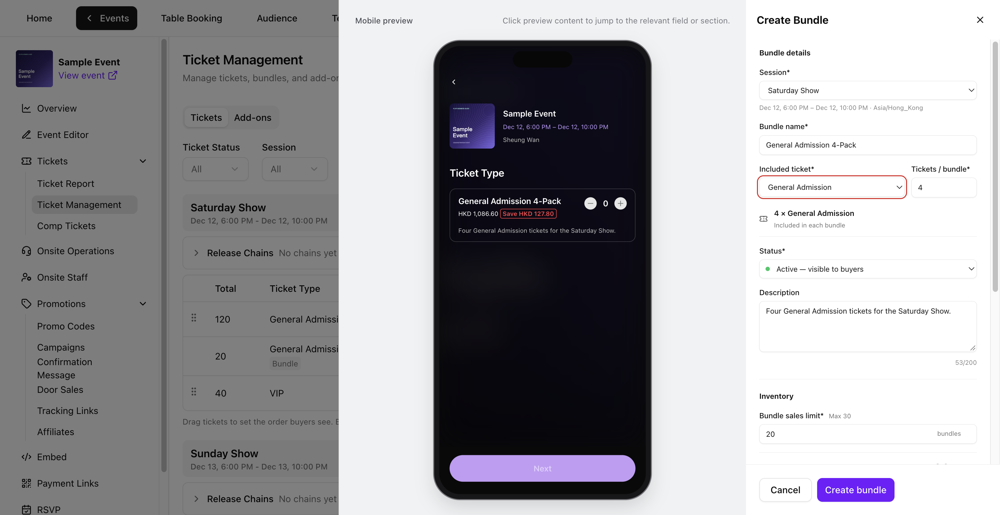
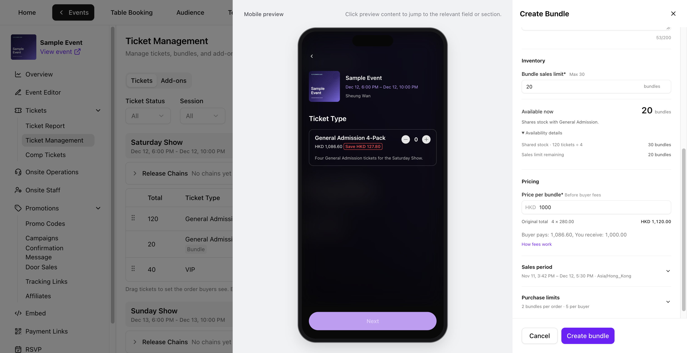
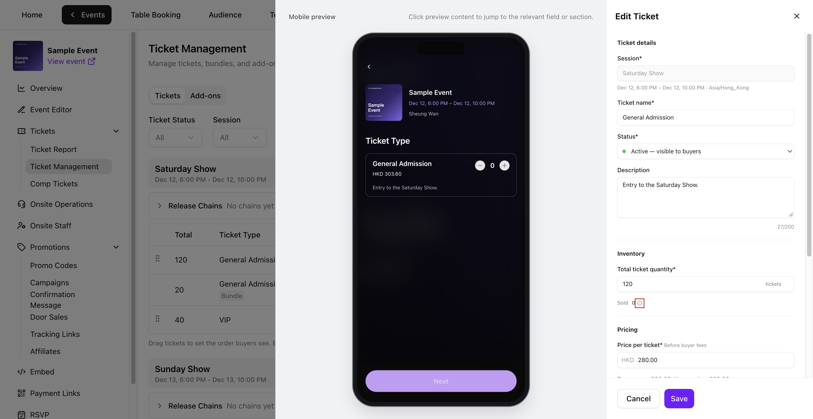
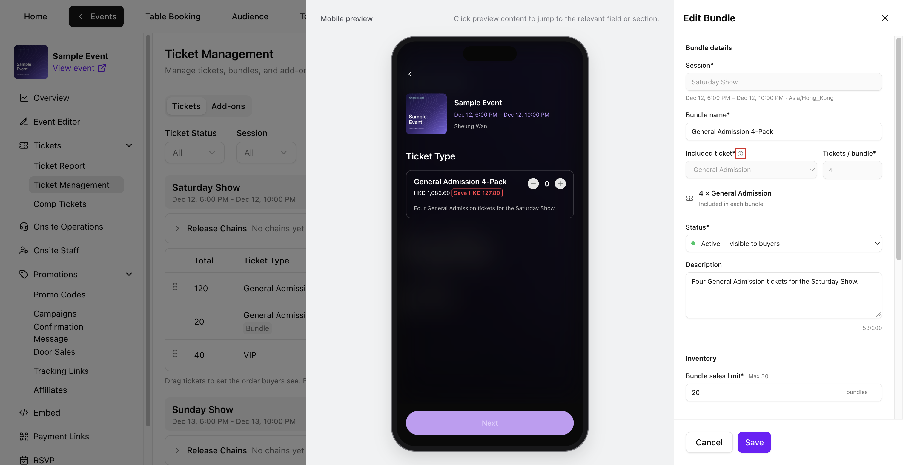
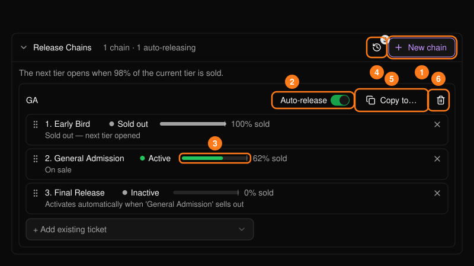
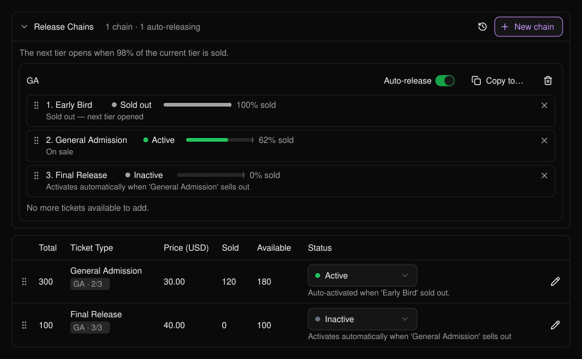
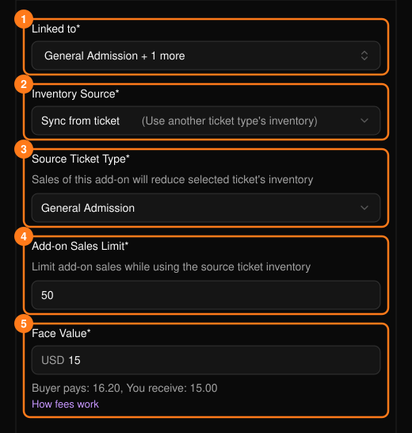
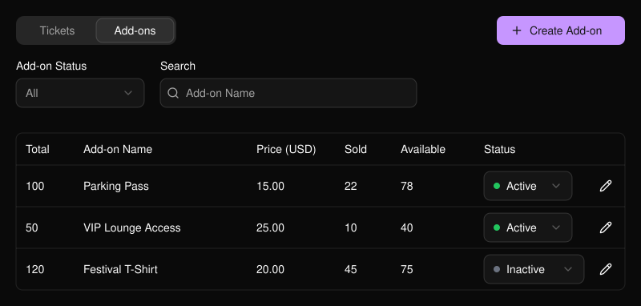

打开活动，进入 **Tickets → Ticket Management**（门票 → 门票管理）。在 **Tickets** 标签页中，可按 **Ticket Status**（门票状态）筛选，或按门票、套票名称搜索。对于多场次活动，可使用 **Session**（场次）筛选或展开某个场次。附加项位于 **Add-ons** 标签页。

<Frame>
  
</Frame>

## 创建门票

在 **Tickets** 标签页中选择 **Create ticket**（创建门票）。在 **Mobile preview**（移动端预览）中点击名称、描述或价格，即可跳转到对应字段。

<Frame>
  
</Frame>

<Steps>
  <Step title="填写门票详情">
    - 如活动有多个场次，请选择 **Session**（场次）。
    - 输入 **Ticket name**（门票名称）并选择 **Status**（状态）。**Inactive** 会使门票保持隐藏。
    - 可添加最多 200 个字符的 **Description**（描述），选填。
  </Step>
  <Step title="设置库存和价格">
    - 在 **Inventory**（库存）下，输入至少为 1 的 **Total ticket quantity**（门票总量）。
    - 在 **Pricing**（定价）下，以活动币种输入基础 **Price per ticket**（单价）。免费门票请输入 **0**。
    - 查看 **Buyer pays**（买家支付）和 **You receive**（你的收入）。选择 **How fees work**（费用说明）可查看费用和税费明细。参见[费用](/zh-hans/tickets/concepts)。
  </Step>
  <Step title="设置购买时间和数量">
    - 打开 **Sales period**（销售时段），以活动时区设置 **Sales start**（开售时间）和 **Sales end**（停售时间）的日期和时间。停售时间须晚于开售时间、晚于当前时间，且不晚于场次结束时间。
    - 打开 **Purchase limits**（购买限制），设置 **Tickets per order**（每单限购，1–10）和 **Tickets per buyer**（每人限购，1–20）。两者均为必填项。
  </Step>
  <Step title="检查门票设置并创建">
    - 在 **Ticket appearance**（门票外观）下选择颜色，并查看 QR 预览。
    - 在 **Ticket options**（门票选项）下，按需设置 **Require Personalization**（需填写个性化信息）或 **Allow ticket transfer**（允许转让门票）。个性化问题在[个性化信息表](/zh-hans/tap/personalization-form)中配置。启用 PLVR Tap 后，还可开启 **Support wristband binding**（支持绑定手环）。
    - 检查 **Mobile preview**，然后选择 **Create ticket**。新门票将出现在列表中。
  </Step>
</Steps>

<Frame>
  
</Frame>

## 创建套票

如需将同一门票打包销售，请先创建该门票。在 **Tickets** 中选择 **Create bundle**（创建套票）。

<Steps>
  <Step title="选择所含门票">
    如有提示，请选择 **Session**（场次）。输入 **Bundle name**（套票名称），从该场次中选择一个 **Included ticket**（所含门票），并设置 **Tickets / bundle**（每套张数，1–10）。设置 **Status**（状态），并可添加最多 200 个字符的 **Description**（描述），选填。
  </Step>
  <Step title="设置套票上限和价格">
    设置 **Bundle sales limit**（套票销售上限）以及整套的基础 **Price per bundle**（套票价格）。**Original total**（原价合计）显示同等数量单张门票的基础价格。
  </Step>
  <Step title="设置销售时段和购买限制">
    设置必填的 **Sales period**（销售时段）、**Bundles per order**（每单限购套数）和 **Bundles per buyer**（每人限购套数）。停售时间不得晚于场次结束时间。上限为每单 10 张、每人 20 张。四人套票即每单最多 2 套、每人最多 5 套。
  </Step>
  <Step title="检查并创建">
    检查 **Mobile preview**，然后选择 **Create bundle**。套票将与其所含门票一同显示。
  </Step>
</Steps>

<Frame>
  
</Frame>

### 查看共享库存

每个套票都使用所含门票的库存。**Bundle sales limit** 的最大值为所含门票总量除以 **Tickets / bundle**，向下取整。

**Available now**（当前可售）取剩余套票上限与共享库存可覆盖的完整套数中的较小值。展开 **Availability details**（库存详情）可同时查看两者。在 Sample Event 中，120 张门票可组成 30 套四人套票，而销售上限还剩 20 套，因此 **Available now** 显示 20。

<Frame>
  
</Frame>

## 启用或停用门票

使用 **Status**（状态）列中的下拉菜单。**Active** 会在销售时段开放时让该项对买家可见。**Inactive** 会对买家隐藏该项。**Ended** 在停售后自动设置，无法通过状态下拉菜单更改。

如需暂停某个场次的全部销售，请将该场次内的每个门票和套票设为 **Inactive**。如需恢复，将需要继续销售的项改回 **Active**。

## 编辑门票或套票

点击行内的铅笔图标，打开 **Edit Ticket**（编辑门票）或 **Edit Bundle**（编辑套票）。选择 **Save**（保存）以应用更改。点击 **Cancel**（取消）后，如有提示，请选择 **Keep editing**（继续编辑）或 **Discard changes**（放弃更改）。

<Frame>
  
</Frame>

| 字段 | 锁定时间 |
| --- | --- |
| **Ticket name** 和 **Price per ticket** | 该门票库存产生首笔销售或发放后，包括免费门票、赠票以及通过套票或同步附加项占用的库存。 |
| **Bundle name** 和 **Price per bundle** | 该套票首次售出或发放后。 |
| **Session** | 门票或套票创建时。 |
| **Included ticket** 和 **Tickets / bundle** | 套票创建时。 |

即使之后销售被退款或库存被恢复，名称和价格仍保持锁定。

<Frame>
  
</Frame>

### 调整数量和销售设置

- **Total ticket quantity** 可调整为不低于 **Sold**（已售）的整数，最小为 1。门票的 **Sold** 按单张计算已售出或已发放的门票，包括赠票以及套票和同步附加项占用的库存。点击 **Sold** 旁的信息图标可查看详情。
- **Bundle sales limit** 可调整为不低于该套票 **Sold** 的整数，最小为 1。套票的 **Sold** 按套计算。套票上限仅作用于该套票本身。
- 你可以更新 **Status**、**Description**、**Sales period** 和 **Purchase limits**。更改 **Sales end** 时，请选择晚于当前时间且不晚于场次结束时间的时间点。

## 放票链

放票链（release chain）会依次销售各档门票，当前档即将售罄时自动开放下一档。下一档在面板显示的百分比（例如 98%）时开放，不一定要等到最后一张售出。实战示例：[分档销售普通票](/zh-hans/tickets/scenario-ga-tiers)。

<Frame>
  
</Frame>

<Steps>
  <Step title="创建放票链">
    打开 **Release Chains**（放票链），选择 **New chain**（新建放票链），输入名称后选择 **Create**（创建）。新建的放票链默认处于暂停状态。
  </Step>
  <Step title="按顺序添加门票">
    使用 **+ Add existing ticket**（添加已有门票），然后拖动调整顺序。一个门票只能加入一条放票链。套票和附加项无法加入。
  </Step>
  <Step title="开启 Auto-release">
    **Auto-release**（自动放票）关闭时，放票链处于暂停状态，后续档位不会自动开放。
  </Step>
</Steps>

每一档都会显示其状态：等待中、**On sale**（在售）、已售罄并已开放下一档，或警告。加入放票链的门票会在表格中显示类似 "GA - 2/3" 的标记，已全部售完的放票链显示 **Exhausted**（已售罄）。

<Frame>
  
</Frame>

需要留意的两种警告：

- 标记为 "won't auto-activate" 的档位表示后面的某一档已经在售。请手动启用该档或将其移除。
- 每一档都需要设置未过期的停售时间，且顺序合理。修正被标记的档位后，重新开启 Auto-release。

其他控件：**Activity log**（活动日志，记录售罄和开放历史）、**Copy to...**（将放票链复制到其他场次，按门票名称匹配，复制后默认暂停）以及 **Delete**（删除，门票保留其原有状态）。

## 附加项

在 **Add-ons** 标签页中选择 **Create Add-on**（创建附加项）。

<Frame>
  
</Frame>

- **Linked to**（关联门票）：可搭配购买该附加项的门票。
- **Inventory Source**（库存来源）：**Own inventory**（独立库存）为附加项设置独立数量。**Sync from ticket**（同步门票库存）从某个门票的库存中扣减，每售出一个附加项，该门票的可售数量就相应减少。
- **Face Value**（面值）：价格。
- 销售日期为选填。库存来源创建后无法更改。

<Frame>
  
</Frame>

另请参阅[票务基础概念](/zh-hans/tickets/concepts)、[门票报表](/zh-hans/tickets/ticket-report)和[赠票](/zh-hans/tickets/comp-tickets)。
