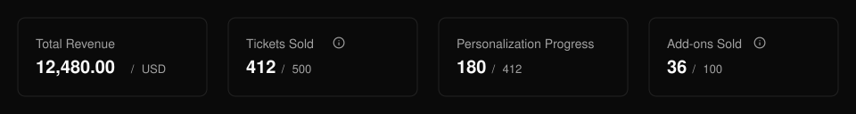
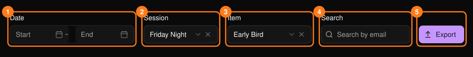
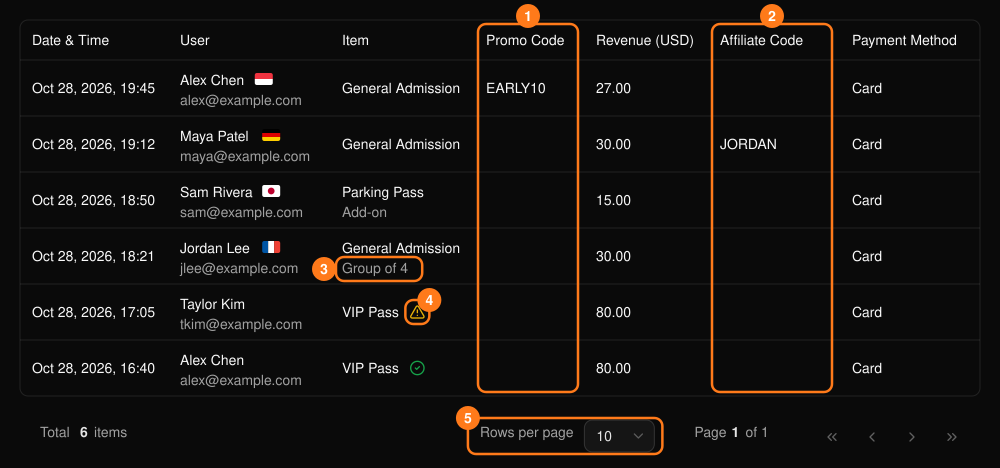

**Ticket Report**（门票报表）列出每一张已售门票和附加项，包括买家、时间和收入。

<Frame>
  
</Frame>

汇总卡片显示收入、已售门票、个性化信息进度和已售附加项。后两项仅在活动使用相应功能时显示。

## 筛选

<Frame>
  
</Frame>

- 使用 **Start** 和 **End** 日期选择器聚焦某一统计周期。
- **Session**（场次）仅在多场次活动中显示。
- 先选择场次，再选择 **Item**（项目）。更改场次会清空已选项目。
- **Search**（搜索）按买家邮箱匹配，支持部分匹配。

## 查看表格

<Frame>
  
</Frame>

每一行代表一张门票或一个附加项。附加项带有标签，套票内的门票会显示套票名称。对于需要填写个性化信息的活动，警告图标表示 **Personalization Required**（需填写个性化信息），绿色对勾表示 **Personalized**（已填写）。

表格包含：

- **交易详情：** 日期和时间、买家、票种、收入和支付方式。
- **Promo Code（优惠码）和 Affiliate Code（推广伙伴代码）：** 标识与该笔销售关联的促销或推广伙伴。

## 导出

**Export**（导出）会按当前筛选条件下载 CSV，因此请先设置日期范围、场次、项目或搜索条件。

如需了解销售的驱动因素，请查看 **Promo Code** 和 **Affiliate Code** 列。参见[优惠码](/zh-hans/promotions/promo-codes)和[推广伙伴](/zh-hans/promotions/affiliates)。
