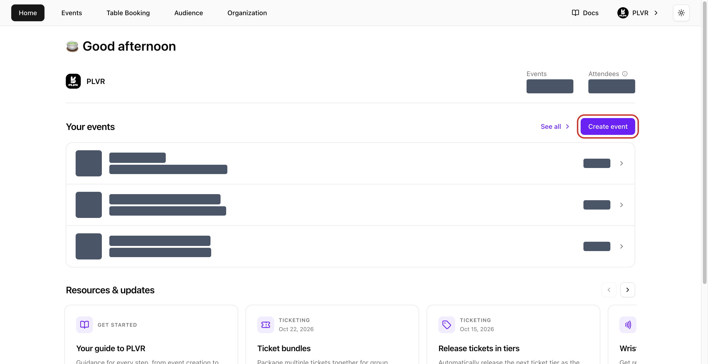
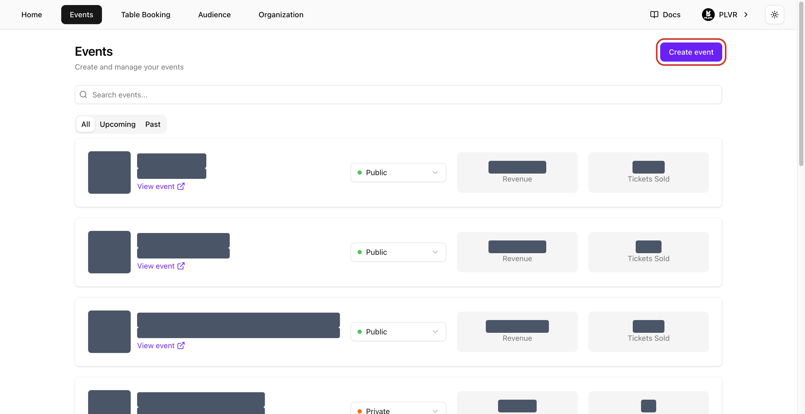
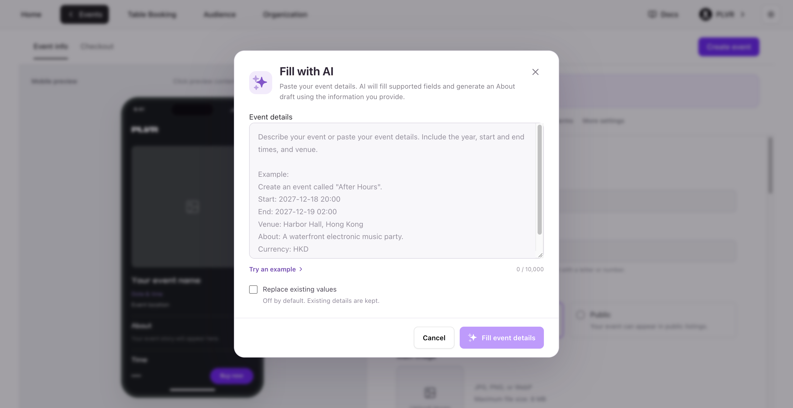
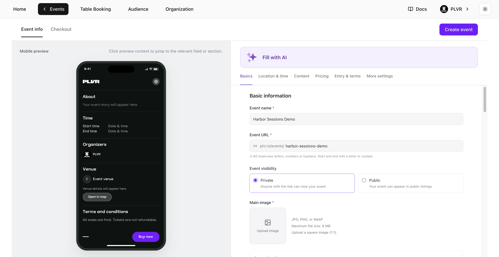
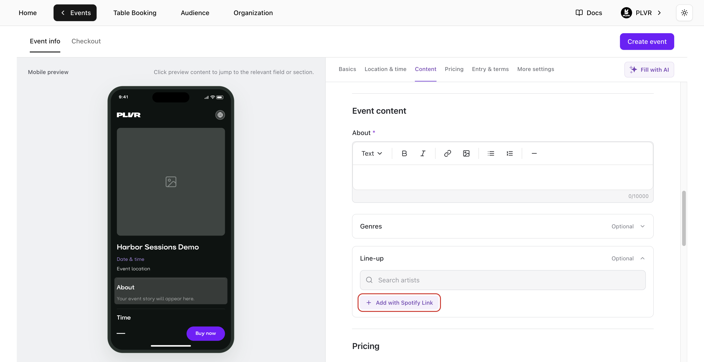
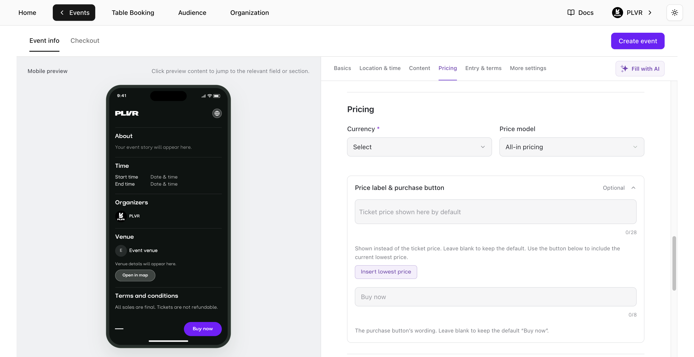
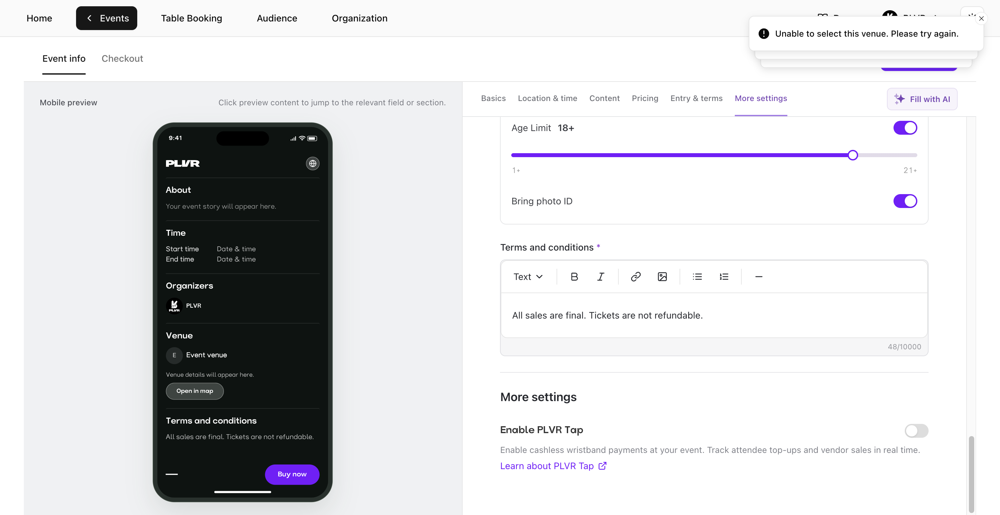
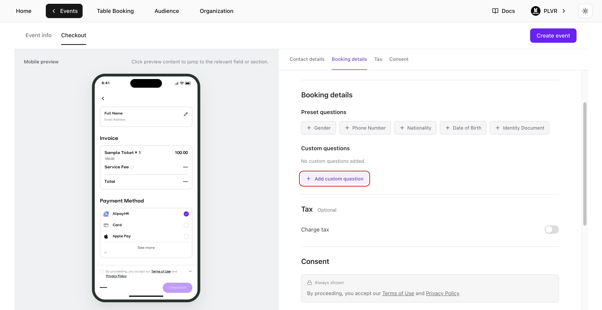
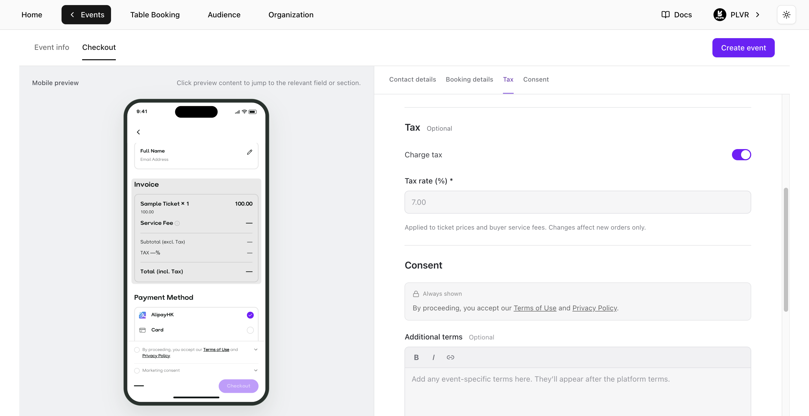
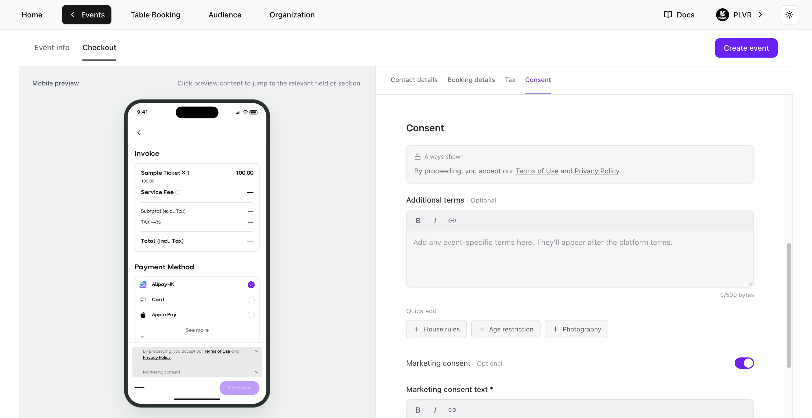

## 開啟 Create event

在 **Home**（首頁）或 **Events**（活動）中選擇 **Create event**（建立活動）。組織的擁有者、管理員與經理都可以建立標準售票活動。

在 **Home** 上，按鈕位於 **Your events**（你的活動）下方、**See all**（查看全部）旁邊。

<Frame>
  
</Frame>

在 **Events** 上，按鈕位於活動列表的右上角。

<Frame>
  
</Frame>

## 填寫 Event info

使用 **Event info**（活動資訊）上方的區塊捷徑在表單中移動。**Mobile preview**（手機預覽）會在你編輯時即時顯示購票者看到的頁面。點選預覽中的某個區塊，即可跳到對應的設定。標有星號的欄位為必填。

### Fill with AI

如果你已經有活動簡介，可以使用 **Fill with AI**（AI 自動填寫）快速開始。

1. 選擇 **Fill with AI** 並貼上活動細節，包括年份、開始與結束時間，以及場地。選擇 **Try an example**（試用範例）可查看範例。
2. 選擇 **Fill event details**（填入活動資訊）。AI 會填寫 **Event info** 中支援的欄位，並可根據你的資訊草擬 **About**（簡介）。除非你開啟 **Replace existing values**（取代現有內容），否則會保留既有的內容。
3. 檢查 AI 填寫的內容，再補齊缺少的欄位。圖片需手動上傳，**Checkout**（結帳）也需手動設定。

<Frame>
  
</Frame>

### 基本資訊

- **Event name**（活動名稱）— 輸入購票者會看到的名稱。
- **Event URL**（活動網址）— 輸入名稱後，請檢查系統建議的連結。如果 `plvr.io/events/` 後面的部分是空白或已被使用，請自行修改。使用 3 到 60 個小寫英文字母、數字或連字號，開頭與結尾須為字母或數字。
- **Event visibility**（活動公開狀態）— 預設為 **Private**（不公開）。任何擁有連結的人都能開啟活動。選擇 **Public**（公開）後，活動才有機會出現在 PLVR 的活動列表中。
- **Main image**（主圖）— 選擇 **Upload image**（上傳圖片），並選擇一張正方形（1:1）的 JPG、PNG 或 WebP 檔案，大小上限 8 MB。
- **Secondary images**（次要圖片）— 展開這個選填區塊並選擇 **Add**（新增），最多可上傳 15 張相簿圖片。拖曳圖片即可調整順序。

<Frame>
  
</Frame>

### 地點與時間

1. 在 **Venue**（場地）下搜尋場地或地址並選擇結果。這會設定時區，並啟用日期與時間欄位。
2. 在 **Time**（時間）下為 **Start**（開始）與 **End**（結束）都設定日期與時間。請使用場地時區的今天或未來日期。結束時間必須晚於開始時間。如果你變更了場地，請重新檢查時間：時區會更新，但你輸入的日期與時間會維持不變。
3. 若活動有多個場次，請選擇 **Add session**（新增場次）。為每個場次設定不同的 **Session name**（場次名稱），並各自設定開始與結束時間。使用 **Remove**（移除）可刪除多餘的場次。

<Frame>
  
</Frame>

### 內容

- **About**（簡介）— 撰寫購票者會看到的活動說明。使用工具列調整文字格式，並加入連結或圖片。
- **Genres**（曲風）— 選填。搜尋或瀏覽曲風。選擇子曲風會取代其上層曲風。
- **Line-up**（演出陣容）— 選填。搜尋藝人並選擇要列出的人選。如適用，可將主打藝人標記為 **Headliner**（壓軸）。若要從 Spotify 匯入藝人，請選擇 **Add with Spotify Link**（以 Spotify 連結新增），貼上藝人的 Spotify 個人頁面連結，再選擇 **Add**。

<Frame>
  
</Frame>

### 價格

- **Currency**（幣別）— 選擇活動使用的幣別。
- **Price model**（價格模式）— 選擇 **All-in pricing**（含費總價），顯示包含購票者手續費與稅金的完整價格；或選擇 **Split pricing**（分開計價），先顯示票券基本價格，於結帳時再加上手續費與稅金。
- **Price label & purchase button**（價格標籤與購買按鈕）— 展開這個選填區塊，自訂價格與購買按鈕的呈現方式。使用 **Insert lowest price**（插入最低價）可在標籤中帶入目前的最低價格。標籤上限為 28 個字元，最低價標記算作 16 個字元。**Button text**（按鈕文字）最多 8 個字元。任一欄位留空即使用預設值。預設按鈕文字為 **Buy now**（立即購買）。

<Note>
  成功建立第一個 **Ticket**（票券）、**Bundle**（套票）或 **Add-on**（加購項目）後，活動幣別就會鎖定。
</Note>

<Frame>
  
</Frame>

### 入場與條款

- **Entry requirements**（入場條件）— 選填。如適用，請開啟 **Age Limit**（年齡限制）並設定最低年齡。開啟 **Bring photo ID**（攜帶附照片證件）以告知購票者入場時必須出示有效的附照片證件。
- **Terms and conditions**（條款與細則）— 檢查預先填入的條款，並依你的活動進行修改。這些條款會顯示在活動頁面上。

### 更多設定

如果你打算使用無現金手環支付，請開啟 **Enable PLVR Tap**（啟用 PLVR Tap）。此設定預設為關閉。如需詳細資訊，請使用表單中的 **Learn about PLVR Tap**（了解 PLVR Tap）。

<Frame>
  
</Frame>

## 設定 Checkout

選擇 **Checkout**（結帳）分頁。使用 **Mobile preview** 查看問題、費用與同意事項在購票者端的呈現方式。

### 聯絡資訊與訂購資訊

- **Contact details**（聯絡資訊）— **Full Name**（全名）與 **Email Address**（電子郵件地址）一律為必填。
- **Booking details**（訂購資訊）— 加入 **Phone Number**（電話號碼）等預設問題，或選擇 **Add custom question**（新增自訂問題）。輸入問題，並選擇 **Text**（文字）、**Number**（數字）、**Single choice**（單選）或 **Multiple choice**（多選）。選擇題至少需加入一個選項，然後選擇 **Add question**（新增問題）。使用 **Required**（必填）與 **Show at checkout**（在結帳時顯示）控制購票者會看到及必須回答的內容。問題類型、編輯與排序請參閱[報名表單](/zh-hant/events/registration-form)。

<Frame>
  
</Frame>

### 稅金

如需收取稅金，請開啟 **Charge tax**（收取稅金）並輸入 **Tax rate (%)**（稅率）。在預覽中檢查範例發票。稅率會套用於新訂單的票券價格與購票者服務費。

<Frame>
  
</Frame>

### 同意事項

- **PLVR terms**（PLVR 條款）— 平台的 **Terms of Use**（使用條款）與 **Privacy Policy**（隱私權政策）一律會顯示。
- **Additional terms**（其他條款）— 如有需要，可加入活動專屬的結帳條款。使用 **Quick add**（快速新增）套用 **House rules**（場內規則）或 **Photography**（攝影）等範本。
- **Marketing consent**（行銷同意）— 預設為關閉。開啟後請輸入 **Marketing consent text**（行銷同意文字）。購票者會看到一個未勾選的核取方塊，可自行選擇是否同意。

<Frame>
  
</Frame>

## 預覽並建立

1. 檢查表單中的 **Event URL** 與 **Event visibility**。在兩個分頁中都使用 **Mobile preview**，確認場地、場次時間、活動頁面與結帳流程。
2. 選擇 **Create event**。如果表單標示了某個欄位，請修正後再試一次。活動頁面會以你選擇的公開狀態上線。你可以在新增任何票券之前就先建立活動。
3. 建立完成後會開啟[票券管理](/zh-hant/tickets/ticket-management)，讓你新增第一張票券。之後若要更新活動頁面或結帳設定，請開啟[活動編輯器](/zh-hant/events/event-editor)。
