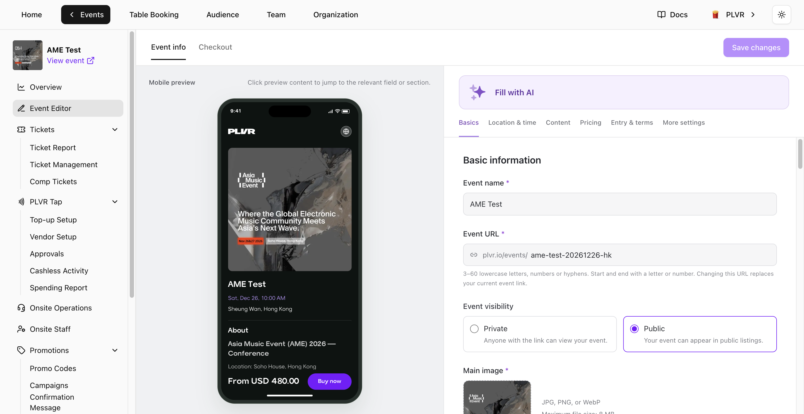

開啟活動，並在活動選單中選擇 **Event Editor**（活動編輯器）。在右側編輯表單，並在左側查看 **Mobile preview**（行動版預覽）。點選預覽中的任一區塊即可跳到對應設定。

<Frame>
  
</Frame>

## Event info（活動資訊）

- **Basics**（基本資料）— 編輯 **Event name**（活動名稱）、**Event URL**（活動網址）、能見度與正方形的 **Main image**（主圖）。可上傳並調整次要圖片的順序。變更 **Event URL** 會取代目前的活動連結。
- **Location & time**（地點與時間）— 先選擇 **Venue**（場地），再設定場次日期與時間。時間採用場地所在的時區。若新增多個場次，請為每個場次取不同的名稱。至少須保留一個場次。已連結票券或訂單的場次無法移除。
- **Content**（內容）— 更新 **About**（簡介）、曲風與演出陣容。使用 **Add with Spotify Link** 新增藝人。
- **Pricing**（定價）— 選擇 **Currency**（幣別）與費用的顯示方式。**All-in pricing**（含費總價）會顯示已含買家手續費與稅金的價格。關閉此設定時，買家手續費與稅金會在結帳時另外加收。可在選填的 **Price label**（價格標籤）中使用 **Insert lowest price**（插入最低價）。**Button text**（按鈕文字）留白時會使用 **Buy now**。
- **Entry & terms**（入場與條款）及 **More settings**（更多設定）— 設定入場條件、更新 **Terms and conditions**（條款與細則），並視需要啟用 **PLVR Tap**。

<Note>
  第一個 **Ticket**、**Bundle** 或 **Add-on** 成功建立後，活動幣別即會鎖定。免費及停用的項目也會鎖定幣別。
</Note>

使用 **Fill with AI** 可從你貼上的文字自動填入 **Event info**。預設只會填入空白欄位。開啟 **Replace existing values**（取代既有值）即可更新已填寫的欄位，儲存前請先檢查結果。

## Checkout（結帳）

- **Contact details**（聯絡資料）與 **Booking details**（訂購資料）— **Full Name** 與 **Email Address** 一律必填。使用[報名表單](/zh-hant/events/registration-form)新增或編輯訂購問題。
- **Tax**（稅金）— 如有需要，開啟稅金並輸入稅率。變更僅適用於新訂單。
- **Consent**（同意事項）— PLVR 的使用條款與隱私權政策為固定內容。可在 **Additional terms**（附加條款）下加入你自己的條款。**Marketing consent**（行銷同意）預設為關閉。啟用後，買家可自行選擇是否同意。

## 儲存

選擇 **Save changes**（儲存變更）即可儲存兩個分頁的編輯內容。若編輯器標示有內容需要審查，請修改標示的欄位後再次儲存。

<Warning>
  選擇 **Leave without saving**（不儲存並離開）會捨棄尚未儲存的編輯內容。
</Warning>
