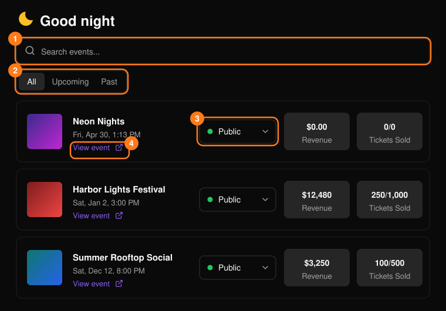
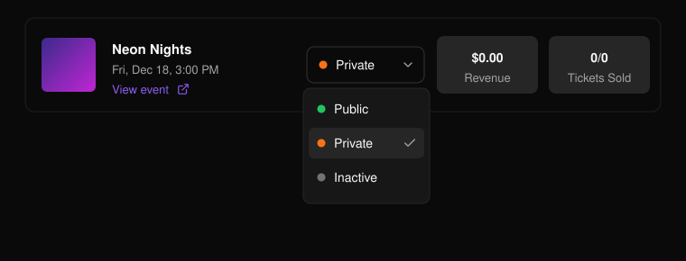
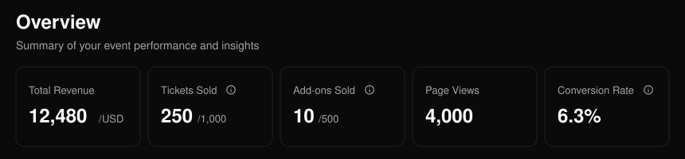
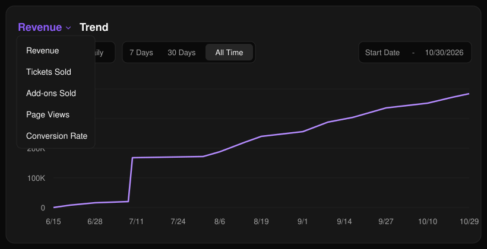
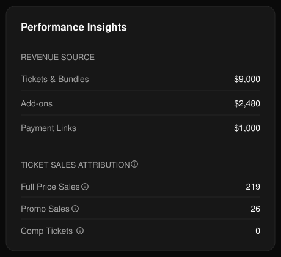
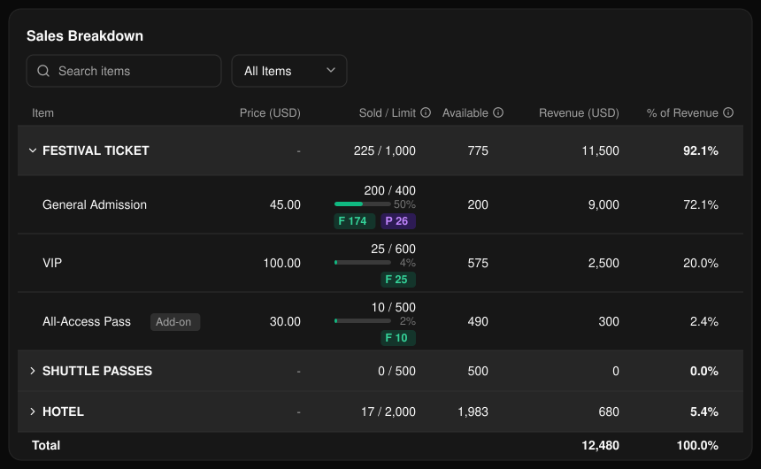

## 活動列表

在頁首開啟 **Events**（活動），或在 **Home**（首頁）的 **Your events** 下選擇 **See all**。可依名稱搜尋（1），在 **All**、**Upcoming** 與 **Past** 之間切換（2），並點選任一列開啟該活動。**View event**（4）會開啟公開的活動頁面。

<Frame>
  
</Frame>

使用狀態選單（3）將活動設為 **Public**（公開）、**Private**（不公開）或 **Inactive**（停用）。狀態為 **Ended**（已結束）的活動會被鎖定。

<Frame>
  
</Frame>

要建立新活動，請在 **Home** 或 **Events** 選擇 **Create event**（建立活動）。請參閱[建立活動](/zh-hant/events/create-an-event)。

## 活動概覽

開啟活動後會顯示其 **Overview**（概覽）。使用側邊選單前往該活動的其他頁面。

<Frame>
  
</Frame>

Total Revenue（總營收）合計票券、加購項目與付款連結的收入。Conversion Rate（轉換率）為已付款訂單數除以頁面瀏覽數。Personalization Progress（個人化進度）與 Add-ons Sold（加購售出數）僅在適用時顯示。

**Trend**（趨勢）圖表會呈現單一指標隨時間的變化。可在 **Cumulative**（累計）與 **Daily**（每日）之間切換。選擇預設區間（**7 Days**、**30 Days** 或 **All Time**），或自訂日期範圍。

<Frame>
  
</Frame>

**Performance Insights**（成效洞察）依來源拆分營收，並依類型拆分銷售：原價、優惠碼或招待票（直接發送，不經結帳）。

<Frame>
  
</Frame>

**Ticket Breakdown**（票種明細）顯示各票種的銷售量與營收。

<Frame>
  
</Frame>

<Tip>
  如需更詳細的銷售資訊，請參閱[票券報表](/zh-hant/tickets/ticket-report)。
</Tip>
