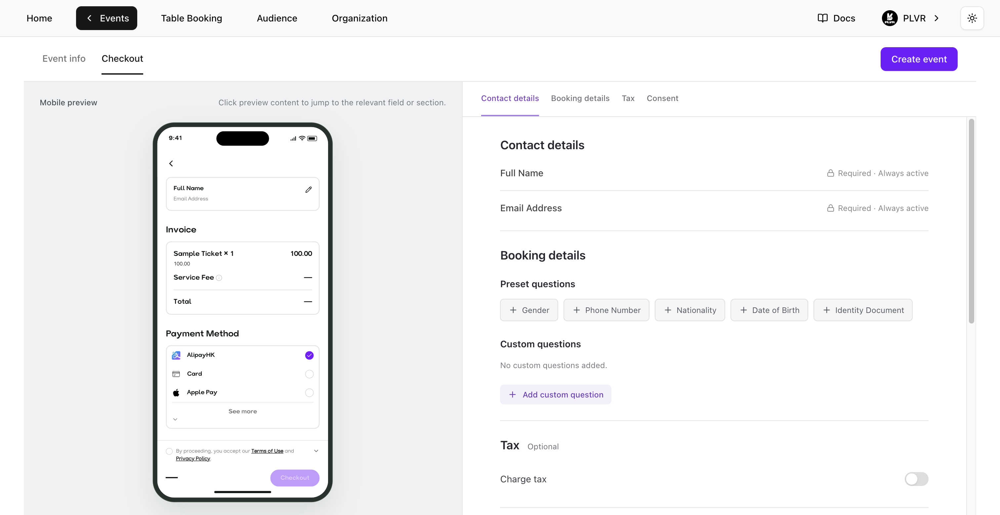
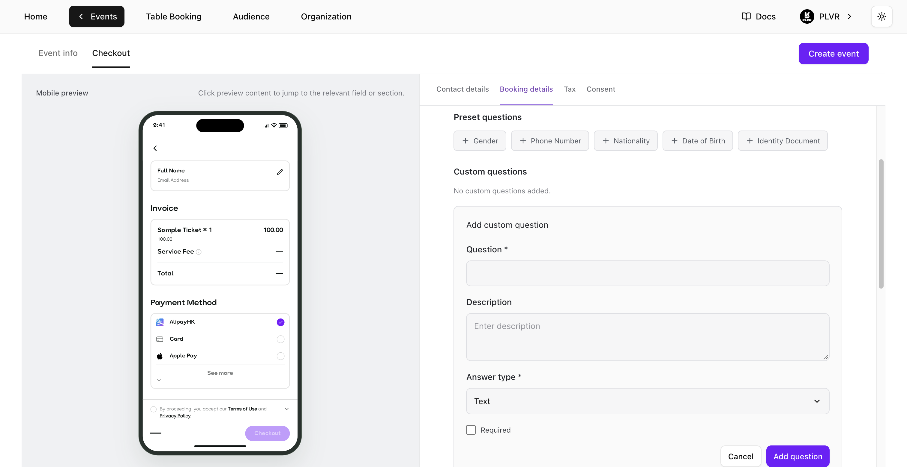

開啟 **Event Editor**（活動編輯器），選擇 **Checkout**，然後前往 **Booking details**（訂購資料）。你也可以在[建立活動](/zh-hant/events/create-an-event)時於 **Checkout** 分頁設定這些問題。

<Frame>
  
</Frame>

## 新增問題

- **Preset questions**（預設問題）— 在 **Preset questions** 下選擇問題。
- **Custom questions**（自訂問題）— 選擇 **Add custom question**，輸入問題，並選擇 **Text**（文字）、**Number**（數字）、**Single choice**（單選）或 **Multiple choice**（複選）。選擇題類型須至少輸入一個選項。選擇 **Add question** 將問題套用到表單。

<Frame>
  
</Frame>

## 管理問題

- 選擇自訂問題旁的 **Edit**，完成後選擇 **Save question**。
- 選擇 **Required**（必填）將問題設為必答。關閉 **Show at checkout**（在結帳時顯示）可隱藏問題並保留其設定。
- 拖曳問題即可在 **Preset questions** 或 **Custom questions** 中調整順序。

在 **Event Editor** 中選擇 **Save changes**，或在建立新活動時選擇 **Create event**，即可將問題套用到結帳流程。

<Note>
  **Contact details** 下的 **Full Name** 與 **Email Address** 一律必填。
</Note>

## 查看回覆

- **RSVP 申請** — 在 [RSVP](/zh-hant/events/rsvp) 頁面的 **Form Responses**（表單回覆）下查看答案。
- **未使用 RSVP 的活動** — 在[票券報表](/zh-hant/tickets/ticket-report)頁面查看答案。

<Tip>
  使用 PLVR Tap 的活動另有獨立的[個人化表單](/zh-hant/tap/personalization-form)。
</Tip>
