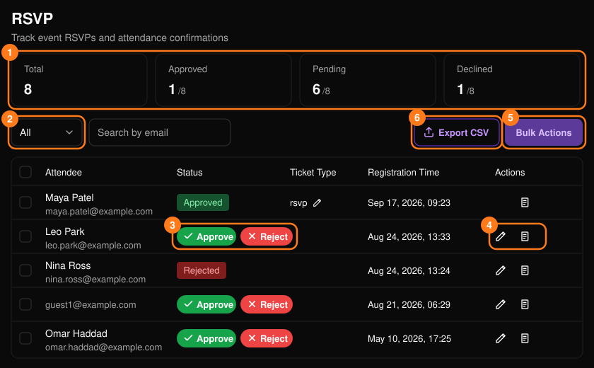
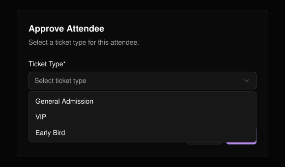
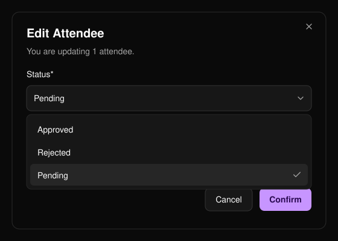
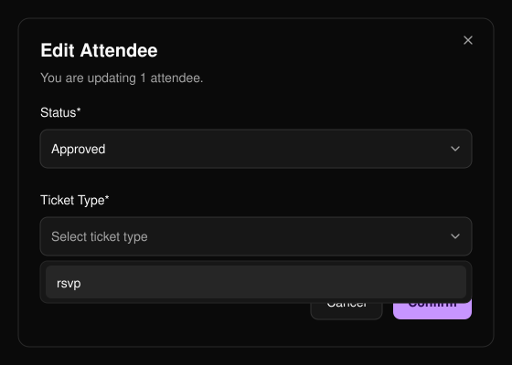
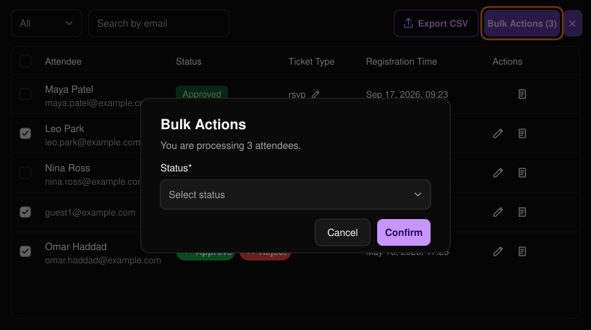

**RSVP**（位於活動選單中）是你審核參加申請的地方。

<Note>
  RSVP 需提出申請後才會啟用。
</Note>

<Frame>
  
</Frame>

**Total**（總計）、**Approved**（已核准）、**Pending**（待審核）與 **Declined**（已婉拒）卡片顯示申請數量，列表下方的控制項可用來切換頁面。

可依 **Pending**、**Approved** 或 **Rejected**（已拒絕）篩選（2）。摘要卡片將已拒絕的申請稱為「Declined」，兩者意思相同。

## 核准或拒絕

在待審核的列上選擇 **Approve**（核准）或 **Reject**（拒絕）（3）。若有多個票種，核准時需選擇 **Ticket Type**（票種）。活動至少須有一個票種才能核准。

<Frame>
  
</Frame>

## 編輯狀態

鉛筆圖示（4）會開啟 **Edit Attendee**（編輯參加者）。核准時須選擇票種。

- 已核准的參加者無法編輯。
- 已拒絕的參加者只能改回待審核。

書本圖示（4）會開啟該參加者在[報名表單](/zh-hant/events/registration-form)中的 **Form Responses**（表單回覆）。

<Frame>
  
</Frame>

<Frame>
  
</Frame>

## 批次操作

勾選列，然後選擇 **Bulk Actions**（批次操作）（5），選擇狀態（核准時另需選擇票種），再選擇 **Confirm**（確認）。

- 一次最多 50 位參加者。
- 所有選取的參加者狀態必須相同，且無法選取已核准的參加者。

<Frame>
  
</Frame>

選擇 **Export CSV**（6）即可下載名單。
