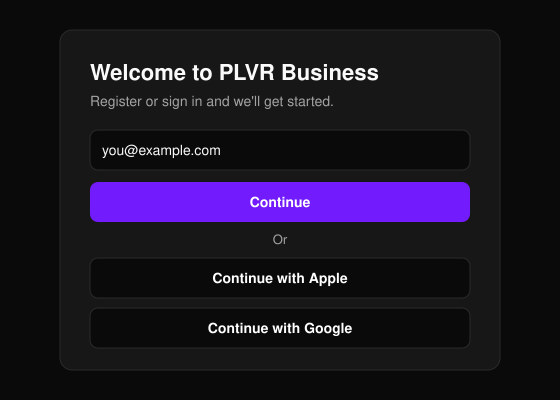
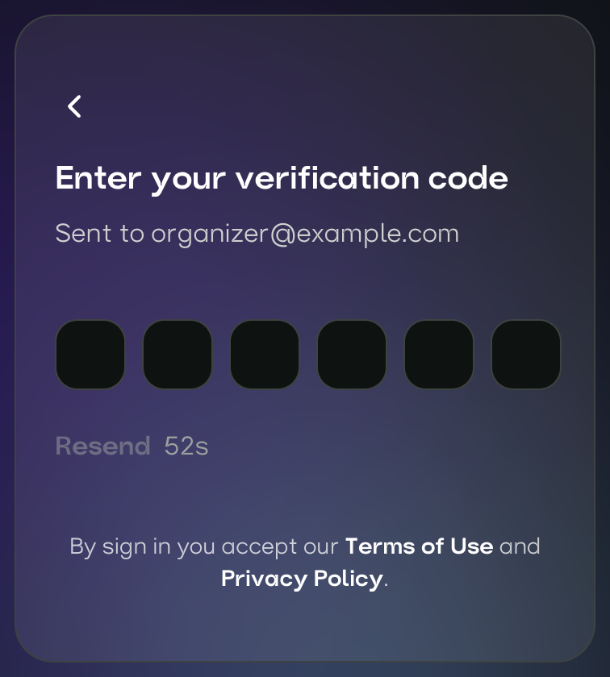
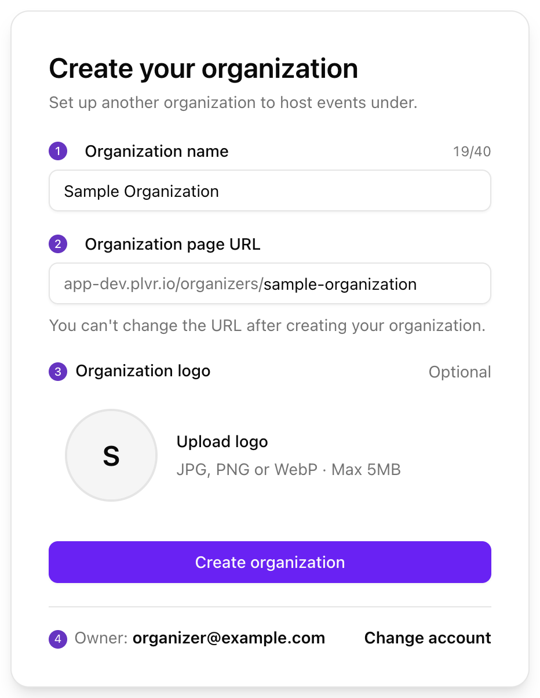
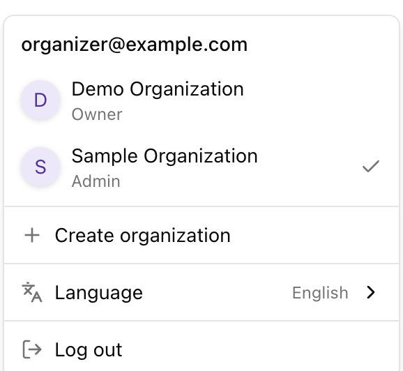

從零開始到組織就緒的快速路徑。任何人都可以建立帳號。

## 設定流程

<Steps>
  <Step title="登入">
    開啟 [Business Portal](https://business.plvr.io)（商家後台），使用電子郵件、Apple 或 Google 登入。第一次登入時會自動建立帳號。
  </Step>
  <Step title="建立組織">
    輸入名稱、頁面網址，以及選填的標誌。
  </Step>
  <Step title="完善組織資料">
    開啟 **Organization**（組織），填寫參加者會在你公開頁面上看到的資訊。
  </Step>
  <Step title="加入你的團隊">
    開啟 **Team**（團隊），選擇 **Add**（新增），並為每位成員指派角色。
  </Step>
  <Step title="建立第一個活動">
    聯絡 PLVR 合作夥伴團隊。
  </Step>
</Steps>

## 登入

<Frame>
  
</Frame>

使用電子郵件登入時，我們會寄送一組 6 位數驗證碼，請在下一個畫面輸入。

<Frame>
  
</Frame>

<Tip>
  請一律使用相同的登入方式與電子郵件地址，否則可能會找不到你的組織。
</Tip>

## 建立組織

組織是你舉辦活動所使用的帳號主體。第一次登入後會進入這個表單。之後若要新增其他組織，請使用帳號選單中的 **Create organization**（建立組織）。

<Frame>
  
</Frame>

- **Name（1）**（名稱）：最多 40 個字元，且不可重複。
- **Page URL（2）**（頁面網址）：3 到 60 個小寫英文字母、數字與連字號，開頭與結尾須為字母或數字。不可使用 `admin`、`support`、`help` 等保留字。
- **Logo（3）**（標誌）：選填，JPG、PNG 或 WebP 格式，最大 5 MB。
- **Owner（4）**（擁有者）：你目前登入的帳號會成為擁有者。若帳號不對，請選擇 **Change account**（切換帳號）。

<Warning>
  組織建立後就無法變更頁面網址，請先確認無誤。
</Warning>

## 完善組織資料

在頁首開啟 **Organization**，填寫標誌、名稱與 **About My Organization**（關於我的組織），然後選擇 **Save**（儲存）。所有選項請參閱[組織設定](/zh-hant/organization/settings)。

## 加入你的團隊

{/* SCREENSHOT: images/getting-started/onboarding-team-add-button.png | Team Management page (Team in the header) with a few members listed; highlight the Add button at the top. Crop to the page title, Add button and the top of the member table. */}

| 角色 | 權限 |
| --- | --- |
| **Admin**（管理員） | 可完整使用 PLVR Business 與 PLVR Scan。 |
| **Manager**（經理） | 可使用 PLVR Business 與 PLVR Scan，但不含 Team Management（團隊管理）。 |
| **Scanner**（掃碼員） | 僅可使用 PLVR Scan。 |

請給每個人最低但足夠的角色。入口工作人員只需要 **Scanner**。請參閱[團隊與角色](/zh-hant/organization/team)。

## 建立第一個活動

目前尚無法自行建立活動。請在空白的 **Events**（活動）頁面上，寄信至 partners@plvr.io 聯絡合作夥伴團隊，為你設定活動。設定完成後，活動就會出現在你的列表中。請參閱[活動總覽](/zh-hant/events/overview)。

{/* SCREENSHOT: images/getting-started/onboarding-no-events-yet.png | Events page for a brand-new organization showing the 'No events yet' empty state with the 'contact partners@plvr.io' message. Crop to the empty state card. */}

## 正式上線前

<Steps>
  <Step title="製作活動頁面">
    在 **Event Editor**（活動編輯器）中檢查頁面，然後選擇 **Save Event**（儲存活動）。在你儲存之前，任何內容都不會發布。請參閱[活動編輯器](/zh-hant/events/event-editor)。
  </Step>
  <Step title="設定票券">
    在 **Tickets**（票券）下確認票種與價格。請參閱[票券管理](/zh-hant/tickets/ticket-management)。
  </Step>
  <Step title="新增結帳問題（選用）">
    使用[報名表單](/zh-hant/events/registration-form)。
  </Step>
  <Step title="選擇活動狀態">
    在 **Events** 頁面設定為 **Public**（公開）、**Private**（不公開）或 **Inactive**（停用）。請參閱[活動狀態](/zh-hant/events/overview)。
  </Step>
  <Step title="以參加者身分預覽">
    選擇 **View event**（檢視活動）查看公開頁面。
  </Step>
  <Step title="邀請入口團隊">
    在[團隊頁面](/zh-hant/organization/team)將掃碼人員加入為 **Scanner**。
  </Step>
</Steps>

## 常見問題

| 問題 | 解決方式 |
| --- | --- |
| **Access denied**（拒絕存取） | 你的角色無權存取該頁面，或你目前位於其他組織。請選擇 **Back to home**（返回首頁）、檢查帳號選單，或請擁有者檢查你的角色。 |
| 找不到我的組織，或被要求建立新組織 | 你登入的帳號與團隊使用的不同。請登出，再以原本的電子郵件或登入方式登入。 |
| 已被加入團隊，卻看不到對方的組織 | 請用對方加入的電子郵件登入，再從帳號選單切換組織。 |
| 名稱或頁面網址已被使用或為保留字 | 取一個更有辨識度的名稱，例如加上你的城市。 |
| 標誌上傳被拒 | 請使用 5 MB 以下的 JPG、PNG 或 WebP。 |
| 沒有收到驗證碼 | 檢查垃圾郵件匣，等倒數結束後選擇 **Resend**（重新寄送）。也請確認電子郵件地址沒有打錯。 |
| Apple 或 Google 登入失敗 | 請再試一次，或改用電子郵件登入。 |
| 需要不同的頁面網址 | 頁面網址無法變更。請從帳號選單建立新的組織。 |

<Frame>
  
</Frame>

## 接下來

<Columns cols={2}>
  <Card title="推出你的第一個活動" icon="rocket" href="/zh-hant/getting-started/quickstart">
    從活動設定到賣出第一張票。
  </Card>

  <Card title="後台導覽" icon="compass" href="/zh-hant/getting-started/portal-tour">
    了解各項功能的位置。
  </Card>
</Columns>
