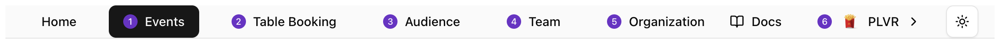
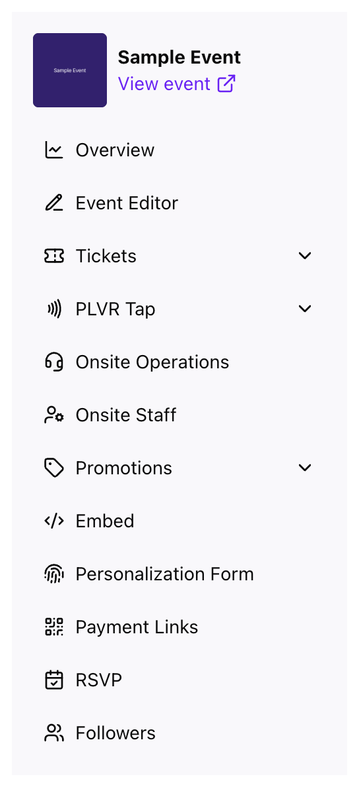

導覽分為兩層：**頁首**放置整個組織層級的頁面，**側邊選單**則位於單一活動內。

## 頁首

<Frame>
  
</Frame>

| 連結 | 頁面 | 可見對象 |
| --- | --- | --- |
| **Events**（活動） | [活動總覽](/zh-hant/events/overview) | 所有人 |
| **Table Booking**（訂桌） | [訂桌](/zh-hant/other/table-booking) | 擁有者、管理員、經理 |
| **Audience**（受眾） | [受眾](/zh-hant/organization/audience) | 所有人 |
| **Team**（團隊） | [團隊與角色](/zh-hant/organization/team) | 擁有者、管理員 |
| **Organization**（組織） | [組織設定](/zh-hant/organization/settings) | 擁有者、管理員、經理 |

## 帳號選單

在這裡切換組織、建立新組織、變更外觀或登出。

<Frame>
  
</Frame>

<Tip>
  如果有尚未儲存的變更，後台會在你離開頁面、切換組織或登出前先詢問你。
</Tip>

## 活動選單

進入活動後，左側選單會列出該活動的工具。最上方的 **View event**（檢視活動）會開啟公開頁面。

<Frame>
  
</Frame>

- **Overview**（總覽）：[銷售與成效](/zh-hant/events/overview)
- **Event Editor**（活動編輯器）：[公開活動頁面](/zh-hant/events/event-editor)
- **Tickets**（票券）：[票券報表](/zh-hant/tickets/ticket-report)、票券管理與招待票
- **PLVR Tap**：[無現金設定與交易動態](/zh-hant/tap/introduction)
- **Onsite Operations**（現場營運）：[指揮中心](/zh-hant/onsite/command-center)
- **Onsite Staff**（現場人員）：[活動的現場工作人員](/zh-hant/onsite/onsite-staff)
- **Promotions**（促銷）：[優惠碼](/zh-hant/promotions/promo-codes)、行銷活動、追蹤連結等
- **Registration Form**（報名表單）：[結帳問題](/zh-hant/events/registration-form)
- **Personalization Form**（個人化表單）：[個人化表單](/zh-hant/tap/personalization-form)
- **Payment Links**（付款連結）：[付款連結](/zh-hant/other/payment-links)
- **RSVP** 與 **Followers**（追蹤者）：[RSVP](/zh-hant/events/rsvp)、[追蹤者](/zh-hant/events/followers)

<Note>
  **PLVR Tap** 與 **Personalization Form** 只會出現在使用 PLVR Tap 的活動中。
</Note>

在頁首選擇 **Events** 即可離開活動。
