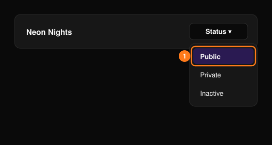

本頁假設你已經有組織。如果還沒有，請先從[新手上路](/zh-hant/getting-started/onboarding)開始。

<Steps>
  <Step title="開啟你的活動">
    在頁首選擇 **Events**（活動），再點選你的活動。還沒有活動？請參閱[建立第一個活動](/zh-hant/getting-started/onboarding)。
  </Step>
  <Step title="製作活動頁面">
    在 **Event Editor**（活動編輯器）中逐一檢查各區塊，然後選擇 **Save Event**（儲存活動）。請參閱[活動編輯器](/zh-hant/events/event-editor)。
  </Step>
  <Step title="設定票券">
    在 **Tickets**（票券）下檢查票種與價格。請參閱[票券管理](/zh-hant/tickets/ticket-management)。
  </Step>
  <Step title="讓活動上線">
    在 **Events** 頁面的狀態選單中選擇 **Public**（公開）。請參閱[活動狀態](/zh-hant/events/overview)。
  </Step>
  <Step title="宣傳活動">
    分享[優惠碼](/zh-hant/promotions/promo-codes)或[追蹤連結](/zh-hant/promotions/tracking-links)。
  </Step>
  <Step title="追蹤銷售">
    關注[總覽](/zh-hant/events/overview)與[票券報表](/zh-hant/tickets/ticket-report)。
  </Step>
</Steps>

<Frame>
  
</Frame>

<Note>
  將活動設為 **Public** 之前，請先完成[正式上線前](/zh-hant/getting-started/onboarding)的檢查。
</Note>
