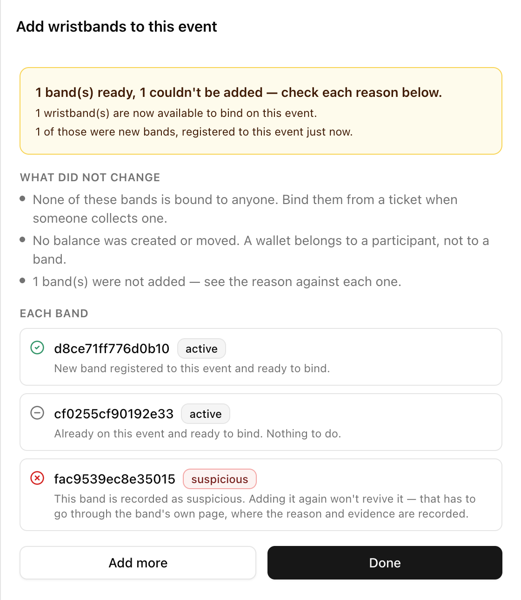

請至少在開放入場前幾天完成：商家需要時間建立菜單，你也需要時間審核。

<Note>
**PLVR Tap** 與 **Personalization Form**（個人化表單）只會出現在 Tap 活動中。請參閱 [PLVR Tap 總覽](/zh-hant/tap/introduction)。
</Note>

| 步驟 | 頁面 | 完成條件 |
| --- | --- | --- |
| 1 | **Top-up Setup**（儲值設定） | 已建立儲值站與付款方式 |
| 2 | **Personalization Form** | 已選定問題 |
| 3 | **Vendor Setup**（商家設定） | 已建立商家、地點、品項與登入碼 |
| 4 | **Approvals**（審核） | 沒有待審項目 |
| 5 | **Onsite Staff**（現場人員） | 每位團隊成員都有代碼 |
| 6 | **Wristbands**（手環） | 已加入備用手環 |

## 1. 儲值站與付款方式

在 **PLVR Tap > Top-up Setup** 中，為每個工作人員會收取儲值金的地點新增一個儲值站（例如 Main Entrance 主入口、VIP Area 貴賓區），並只加入團隊會接受的付款方式。請參閱[儲值設定](/zh-hant/tap/top-up-setup)。

<Warning>
付款方式僅用於報表統計。工作人員必須使用你自己的錢箱或刷卡機收款。
</Warning>

{/* SCREENSHOT: images/guides/cashless-topup-setup.png | PLVR Tap > Top-up Setup with stations Main Entrance, VIP Area, Campsite and Cash and Card added. Callouts: 1 Add Top-up Station, 2 Quick add, 3 Onsite Payment Methods list. */}

## 2. 個人化表單

選擇參加者在綁定手環前、個人化或領取票券時要回答的問題。只把真正需要的欄位標為 **Required**（必填）。這與結帳時的[報名表單](/zh-hant/events/registration-form)是分開的。請參閱[個人化表單](/zh-hant/tap/personalization-form)。

{/* SCREENSHOT: images/guides/cashless-personalization-form.png | Personalization Form with Phone Number (Required), Date of Birth, one custom question and one Inactive question. Callouts: 1 Quick add, 2 Custom question, 3 drag handles. */}

## 3. 商家

在 **Vendor Setup** 中，每個攤位或吧台都是一個商家。針對每個商家：先新增 **Sales Locations**（銷售地點），再新增 **Items**（品項）（每個品項都需要指定地點且價格大於零，或讓商家自行提交送審），最後產生 **Login Codes**（登入碼），每位值班人員一組，並在 **Note**（備註）中註明持有者。請參閱[商家](/zh-hant/tap/vendors)。

{/* SCREENSHOT: images/guides/cashless-vendor-setup.png | Vendor Setup > 'Noodle Bar'. Callouts: 1 tabs (Sales Locations, Items, Login Codes), 2 Login Codes with Notes like 'Alex - Vendor Manager'. Two crops fine (add -items suffix for the second). */}

## 4. 審核

商家的品項與修改在你核准前都不會出現在菜單上。逐一檢視後選擇 **Approve**（核准），或選擇 **Reject**（退回）並填寫商家看得到的原因。勾選多列即可批次處理。請參閱[審核](/zh-hant/tap/approvals)。

<Warning>
商家無法販售待審中的菜單。目標是在活動前一天讓 Pending（待審）列表清空。
</Warning>

{/* SCREENSHOT: images/guides/cashless-approvals.png | Approvals with a few pending submissions, one edit showing Current vs Requested. Callouts: 1 checkboxes, 2 Approve Selected / Reject Selected, 3 menu badge. */}

## 5. 現場人員

在 **Onsite Staff** 中選擇 **Add Staff**（新增人員）。儲值團隊請選擇 **Top-up staff**（儲值人員）以及一個 **Top-up Station**（儲值站）（每個儲值站各建一批）。使用 **CSV Import**（CSV 匯入）或 **Manual Creation**（手動建立）產生代碼，並在班次結束時將代碼設為 **Inactive**（停用）。請參閱[現場人員](/zh-hant/onsite/onsite-staff)。

{/* SCREENSHOT: images/guides/cashless-onsite-staff.png | Onsite Staff > Add Staff with 'Top-up staff' role and a Top-up Station selected. Callouts: 1 role, 2 Top-up Station, 3 CSV Import / Manual Creation. */}

## 6. 手環

在 Onsite Operations（現場營運）> **Wristbands** 中選擇 **+ Add wristbands**（新增手環）：每行一個 ID（最多 200 個），並加上 **Note**。如果你預期是既有的手環，系統卻回報為新登錄的手環，通常代表 ID 打錯了。請參閱[手環](/zh-hant/onsite/wristbands)。

<Frame>
  
</Frame>

## 7. 彩排

<Check>每個商家都是 **Active**（啟用）狀態，且已設定地點、品項與登入碼。</Check>
<Check>每組儲值人員代碼都顯示正確的儲值站。</Check>
<Check>測試參加者已綁定手環，且儲值後的餘額符合預期。</Check>
<Check>測試儲值與購買都出現在 **Cashless Activity**（無現金交易紀錄）中。</Check>

下一步：[活動當天執行手冊](/zh-hant/guides/event-day-runbook)、[活動結束後](/zh-hant/guides/after-the-event)。
