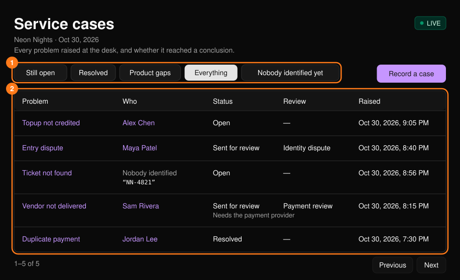
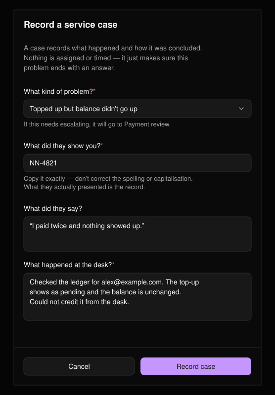
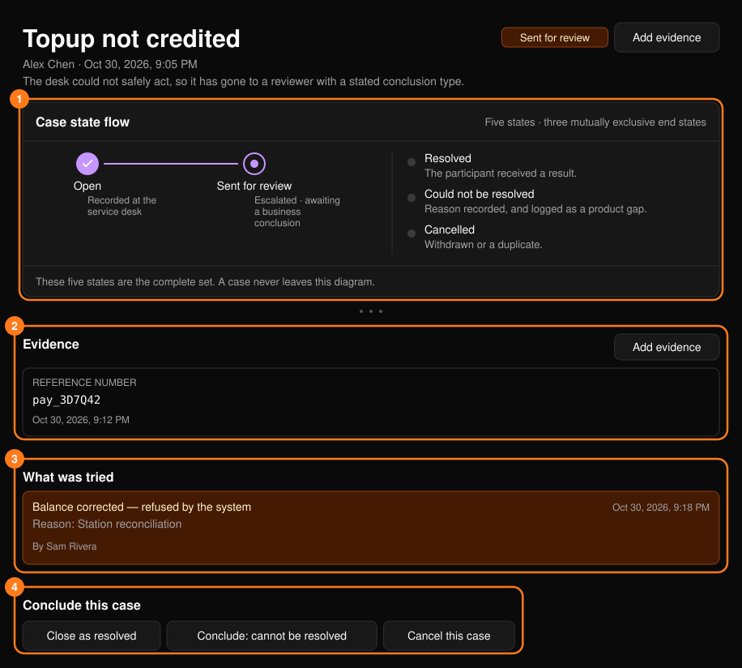
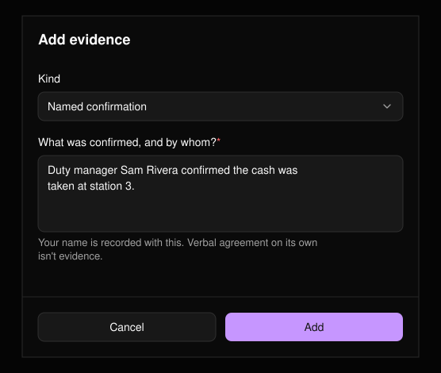
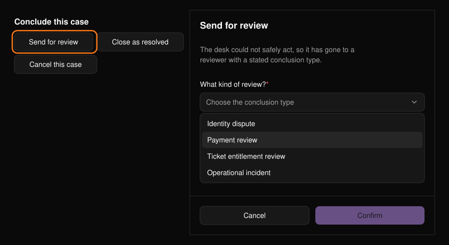

服務工單會記錄在服務台提出的問題及其最終處理結果，確保沒有人在毫無紀錄的情況下被打發離開。工單不會被指派，也不會計時。從[指揮中心](/zh-hant/onsite/command-center)的 **Service cases**（服務工單）開啟列表。

<Frame>
  
</Frame>

## 狀態

| 狀態 | 說明 |
| --- | --- |
| **Open**（處理中） | 仍在處理中。 |
| **Sent for review**（已送審） | 服務台無法安全處理，已交由審查人員處理。 |
| **Resolved**（已解決） | 參加者已獲得明確的答覆。 |
| **Could not be resolved**（無法解決） | 無法處理，並附上原因。會計為產品缺口。 |
| **Cancelled**（已取消） | 已撤回，或為重複工單。 |

風險等級（High、Medium、Normal）與狀態是分開的。審查類型包括 Identity dispute（身分爭議）、Payment review（付款審查）、Ticket entitlement review（票券權益審查）與 Operational incident（營運事故）。

## 記錄工單

選擇 **Record a case**（記錄工單）。從票券、交易與零結果的搜尋中也會開啟相同的表單，並盡可能預先填入資料。所附票券或交易當下的狀態會隨工單一併儲存，讓審查人員看到與你相同的內容。

<Frame>
  
</Frame>

- 若無法辨識對方身分，請依對方出示的內容原樣輸入。不要修正拼寫或大小寫。
- 描述你檢查了什麼、發現了什麼，以及無法處理的部分。

## 處理工單

工單頁面會顯示狀態、工單在流程中的位置、提出時 Portal 顯示的內容、證據，以及嘗試過的每項操作。被拒絕的嘗試會刻意保留：「我們試過但被拒絕」本身就是證據。

<Frame>
  
</Frame>

### 新增證據

選擇 **Add evidence**（新增證據），並選擇 **Reference number**（參考編號，如付款參考編號、訂單編號、現金盤點）、**Named confirmation**（具名確認，確認了什麼以及由誰確認）或 **Note**（備註）。

<Frame>
  
</Frame>

<Tip>
口頭同意不算證據。請記錄參考編號，或由誰確認了什麼。
</Tip>

### 連結至參加者

若工單尚未辨識對方身分，請在[搜尋](/zh-hant/onsite/search)中找到此人，然後選擇 **Link to a participant**（連結至參加者）並輸入對方的參加者使用者 ID。連結不會變更工單狀態。

### 結案

在 **Conclude this case**（結案）下，你只會看到自己可以執行的操作。例如，服務台人員無法選擇「Conclude: cannot be resolved」。

<Frame>
  
</Frame>

| 按鈕 | 必填內容 |
| --- | --- |
| **Send for review** | 審查類型。 |
| **Close as resolved** | 處理結果：告訴對方什麼、你做了什麼。 |
| **Conclude: cannot be resolved** | 原因，即主控台無法做到的部分。 |
| **Cancel this case** / **Reopen** | 無。 |

選擇 **Confirm**（確認）即可套用。
