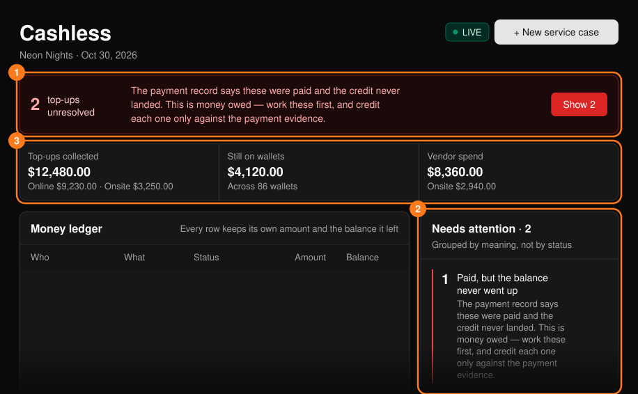
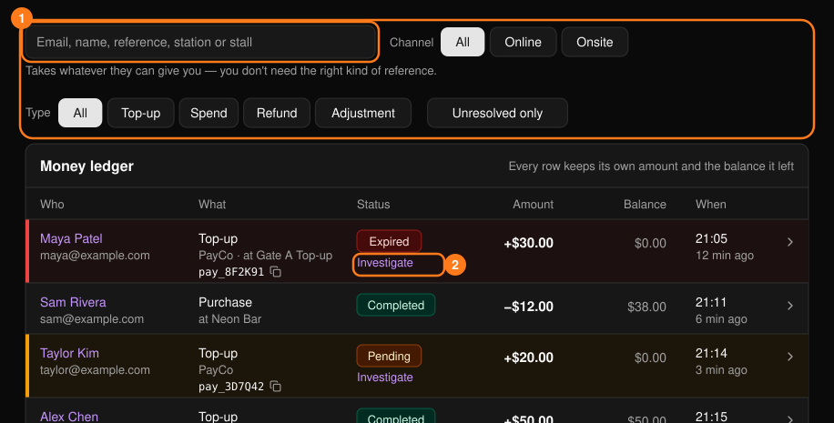
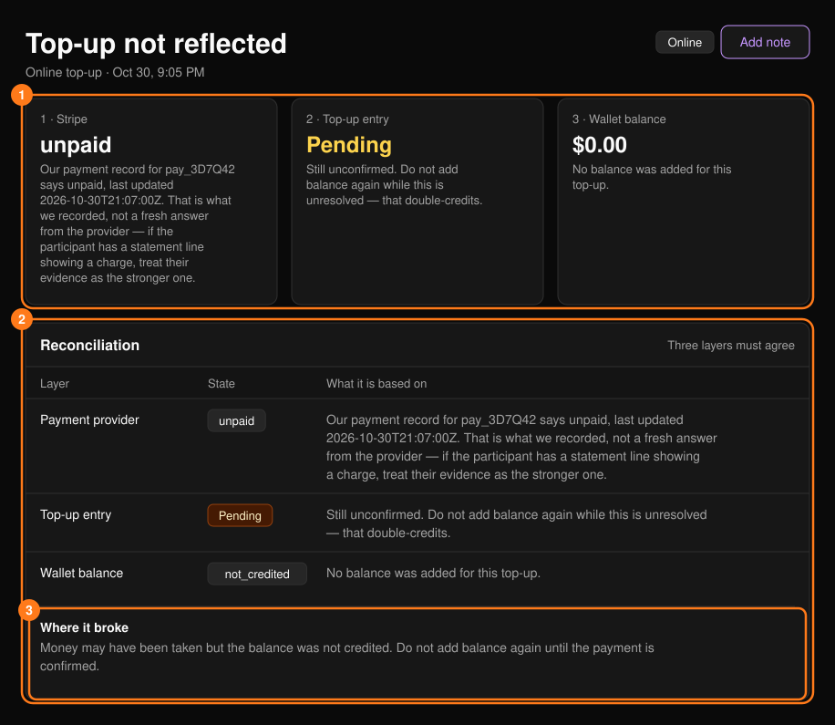
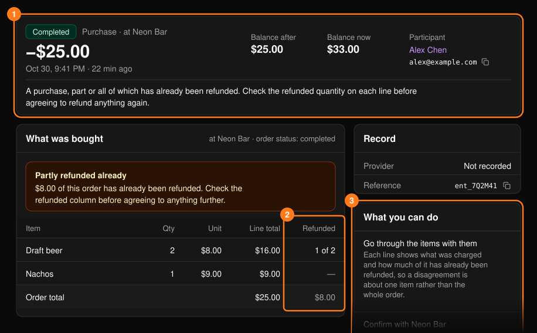

**Cashless**（無現金支付）工作區會顯示款項在哪裡收取、餘額是否已入帳，以及在哪裡消費。適用於已啟用無現金支付的 Tap 活動。可從[指揮中心](/zh-hant/onsite/command-center)開啟。

<Note>
全活動的報表請參閱[無現金交易紀錄](/zh-hant/tap/cashless-activity)。設定儲值請參閱[儲值設定](/zh-hant/tap/top-up-setup)。
</Note>

所有資料都依管道區分。**Online**（線上）儲值經由金流服務商處理，並有付款參考編號。**Onsite**（現場）儲值是在儲值站以現金或刷卡機登記，沒有付款參考編號；請依儲值站、付款方式與現金紀錄進行核對。

<Frame>
  
</Frame>

## 未解決的儲值

頂端的列會計算款項可能已扣但餘額未同步的儲值（待處理、已過期或失敗）。**Show N**（顯示 N 筆）會將帳本篩選為這些儲值。已過期的儲值不會被視為未扣款：在有人確認之前，它會一直保持標示狀態。

若有錢包被凍結，通知會顯示數量。凍結錢包會停止消費，但不影響入場；凍結手環是另一項獨立操作。

## 金流帳本

每一筆款項異動都是一列，包含金額與異動後的餘額。可依電子郵件、姓名、參考編號、儲值站或攤位搜尋，並依管道、類型或 **Unresolved only**（僅顯示未解決）篩選。選擇列上的箭頭即可查看交易明細（請參閱下方「交易明細」）。

<Frame>
  
</Frame>

**Top-up stations**（儲值站）面板會顯示各儲值站的動態，以及狀態標籤（Healthy、Watch、Degraded）。

## 主控台無法執行的操作

唯一能寫入金額的操作是從錢包執行的 **Correct the balance**（修正餘額）。請參閱[參加者](/zh-hant/onsite/participants)。為未確認的儲值入帳、在錢包之間移轉儲值，以及退還餘額或商家消費，都需要向金流服務商查核或做出政策決定，因此請將每一項記錄為[服務工單](/zh-hant/onsite/cases)。

## 儲值明細

在未解決的儲值上選擇 **Investigate**（調查），即可開啟 **Top-up not reflected**（儲值未反映）。頁面會顯示三個必須一致的層級：**Payment provider**（金流服務商）、**Top-up entry**（儲值紀錄）與 **Wallet balance**（錢包餘額）。**Where it broke**（問題發生處）會提供診斷結果。

<Frame>
  
</Frame>

<Warning>
已過期不代表未扣款。除非已經確認，否則不要告訴來賓沒有扣款。
</Warning>

- 若 PLVR 顯示金流服務商已收款但餘額從未增加，表示應為來賓補上入帳。請勿要求對方再次付款。
- 若儲值已過期，但來賓能出示帳單上的扣款紀錄，請相信對方並開立付款審查（**Open a payment review case**）。
- 原始付款尚未解決前，無法再次入帳。
- 若參考編號找不到任何符合項目，請檢查是否混淆了 0/O 與 1/I。若對方有收據，請以對方提供的參考編號原樣記錄一筆未比對工單。

## 交易明細

頂端區塊會顯示狀態、類型、金額、交易後與目前的餘額、參加者，以及一句可以直接念給對方聽的話。下方的 **What was bought**（購買內容）會列出品項與目前為止的退款，**What you can do**（可執行的操作）則會建議下一步。

<Frame>
  
</Frame>

在同意任何進一步處理前，請先查看已退款欄位。「Not on this event」（不屬於此活動）表示該參考編號屬於其他活動，或是輸入錯誤。
