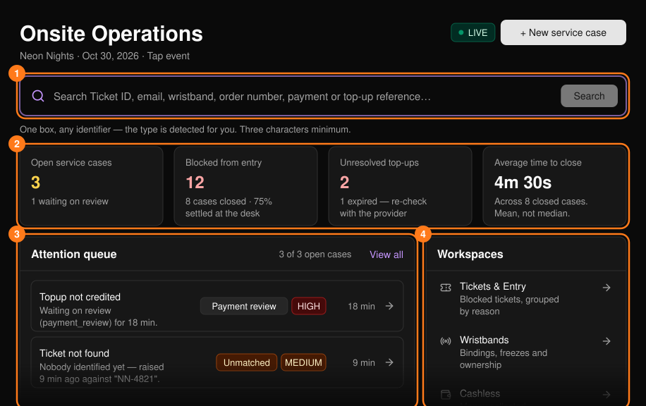
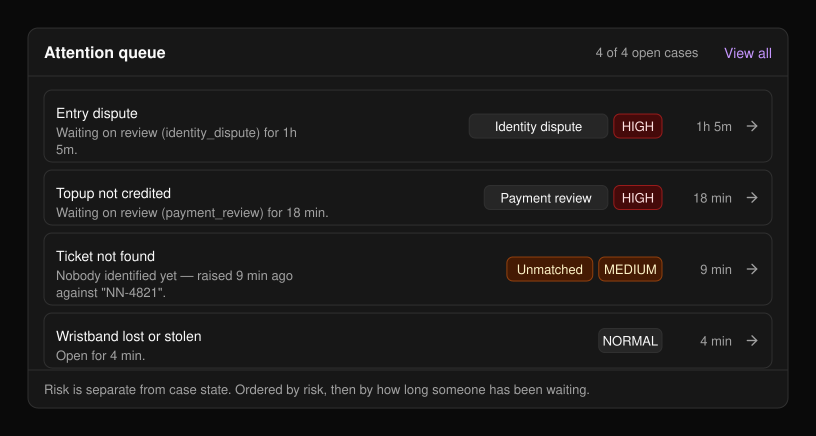
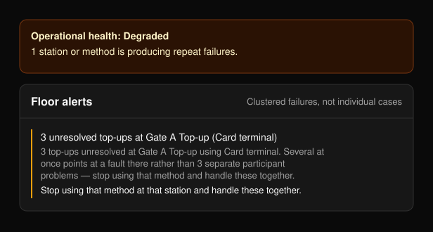

Onsite Operations（現場營運）是活動當天服務台使用的主控台。從活動側邊欄的 **Onsite Operations** 開啟。Command Center（指揮中心）會顯示現場是否運作正常，以及接下來需要處理的事項。

可用功能取決於活動類型：

- **純票券活動：** 以掃描 QR 入場，或在條碼無法掃描時手動報到。不使用手環與無現金支付。
- **Tap 活動：** 僅能感應手環入場。會顯示 Wristbands 與 Cashless 工作區。請參閱 [PLVR Tap](/zh-hant/tap/introduction)。

<Frame>
  
</Frame>

頁面大約每 30 秒會自動重新整理。

## 尋找來賓

輸入 Ticket ID、電子郵件、手環、訂單編號或付款／儲值參考編號（至少三個字元），然後選擇 **Search**（搜尋）。系統會自動判斷類型。結果會在[搜尋](/zh-hant/onsite/search)頁面開啟。

## 記錄問題

選擇 **+ New service case**（新增服務工單）記錄問題。請參閱[服務工單](/zh-hant/onsite/cases)。

## 摘要卡片與現場狀態

卡片會顯示未結案的服務工單、被阻擋入場的票券、尚未處理的儲值（僅限 Tap 活動），以及平均結案時間。點選卡片即可開啟對應列表。若現場運作不正常，會顯示 **Degraded**（效能降低）或 **Incident**（事故）橫幅；運作正常時則不會顯示。

## 待處理佇列

未結案的工單會依風險排序，再依等待時間排序。畫面會顯示前八筆，選擇 **View all**（查看全部）可查看其餘工單。點選任一列即可開啟該工單。

<Frame>
  
</Frame>

## 工作區

| 工作區 | 用途 | 顯示條件 |
| --- | --- | --- |
| [Tickets & Entry](/zh-hant/onsite/tickets) | 被阻擋的票券 | 一律顯示 |
| [Wristbands](/zh-hant/onsite/wristbands) | 綁定、凍結、持有權 | Tap 活動 |
| [Cashless](/zh-hant/onsite/cashless) | 收取、入帳與消費的金額 | 已啟用無現金支付 |
| [Guests](/zh-hant/onsite/guests) | 邀請名單、已核准的追加名單 | 一律顯示 |
| [Service cases](/zh-hant/onsite/cases) | 服務台提出的所有問題 | 一律顯示 |

**Desk activity**（服務台動態）會計算過去 30 分鐘內記錄的操作次數。搜尋不會被記錄，因此此數字代表已完成的工作，而非接待的人數。只有在多起失敗集中發生時才會出現 **Floor alerts**（現場警示）面板，並為每項警示提供建議動作。

<Frame>
  
</Frame>

## 相關頁面

<CardGroup cols={2}>
  <Card title="搜尋" href="/zh-hant/onsite/search" icon="magnifying-glass">
    以任何識別資訊尋找參加者。
  </Card>
  <Card title="服務工單" href="/zh-hant/onsite/cases" icon="file-lines">
    記錄、處理並結案服務台問題。
  </Card>
  <Card title="現場工作人員" href="/zh-hant/onsite/onsite-staff" icon="user-gear">
    為入口與儲值團隊建立登入碼。
  </Card>
</CardGroup>
