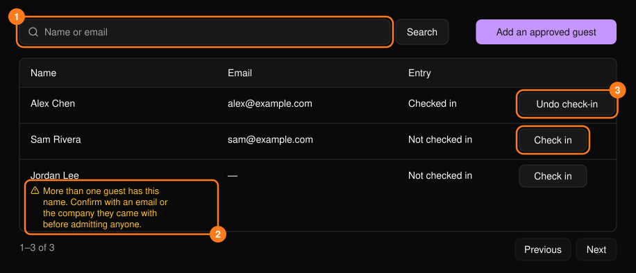
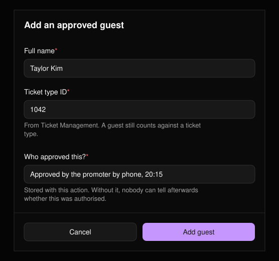

**Guests**（來賓）工作區用於邀請名單。可從[指揮中心](/zh-hant/onsite/command-center)開啟。可依姓名或電子郵件搜尋；列表每頁顯示 25 筆。

<Frame>
  
</Frame>

<Warning>
姓名不等於身分。若有多位來賓可能符合，姓名下方會顯示警告。讓對方入場前，請先確認對方的身分。
</Warning>

## 讓來賓入場

在來賓的列上選擇 **Check in**（報到）。不需要填寫原因。

## 撤銷報到

選擇 **Undo check-in**（撤銷報到），選擇 **Reason**（原因，必填），可選擇加入 **Note**（備註），然後選擇 **Confirm**（確認）。該來賓名單項目可再次使用，但原本的入場紀錄仍會保留在活動紀錄中。

## 新增已核准的來賓

針對不在名單上的人，選擇 **Add an approved guest**（新增已核准的來賓）。

<Frame>
  
</Frame>

三個欄位皆為必填：

- **Full name**（全名）：與對方在入口提供的一致。
- **Ticket type ID**（票種 ID）：該來賓計入的票種。可在[票券管理](/zh-hant/tickets/ticket-management)中找到。
- **Who approved this?**（由誰核准？）：誰以及何時核准，例如「主辦單位於 20:15 電話核准」。若未填寫，日後將無人能判斷此次追加是否經過授權。
