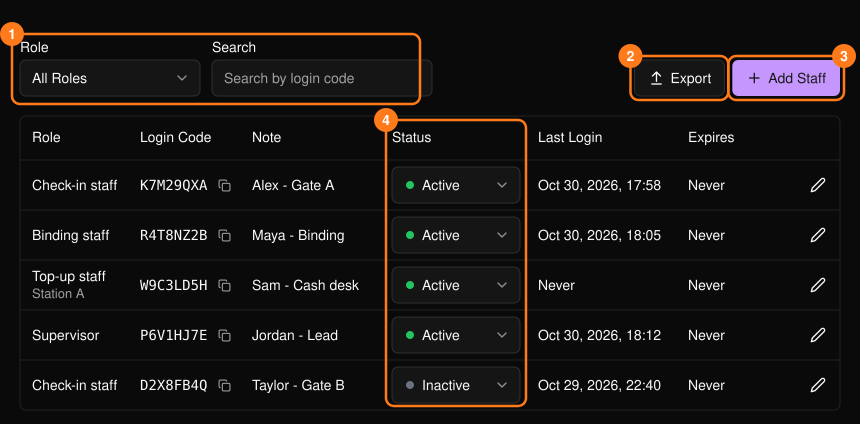
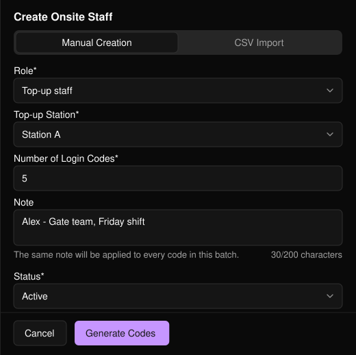
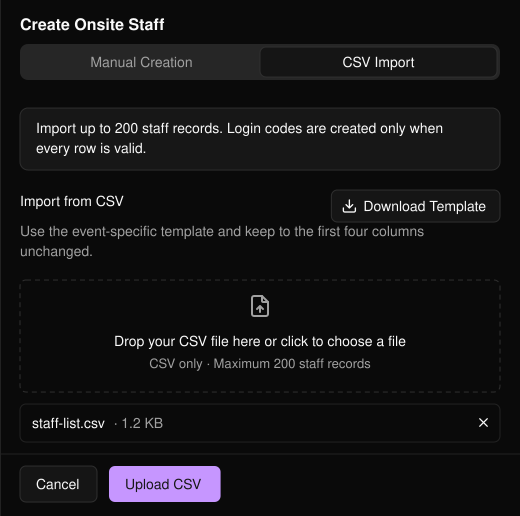

在活動側邊欄開啟 **Onsite Staff**（現場工作人員），即可管理活動當天工作人員的存取權限。每位工作人員都以登入碼登入，登入碼的角色決定其可執行的操作。

<Note>
若要改為邀請成員加入你的 Business Portal 組織，請參閱[團隊](/zh-hant/organization/team)。
</Note>

<Frame>
  
</Frame>

可依角色篩選或依登入碼搜尋。**Export**（匯出）會下載目前篩選結果的 CSV。**Status**（狀態）可直接在列表中變更。

活動前，請在工作人員列表中檢查 **Status** 與 **Expires**（到期時間）。使用 **Last Login**（最後登入）確認登入碼是否已被用來登入。每組登入碼只應分享給被指派的工作人員。

## 新增工作人員

選擇 **Add Staff**（新增工作人員），然後使用以下兩個分頁之一。

### Manual Creation（手動建立）

<Steps>
  <Step title="選擇角色">
    在純票券活動中，**Check-in Ticket**（票券報到）讓工作人員掃描票券 QR Code 為參加者報到。**Supervisor**（主管）可讓工作人員存取該活動所有可用的工作區，以支援現場團隊。儲值工作人員還需要指定 **Top-up Station**（儲值站），請在[儲值設定](/zh-hant/tap/top-up-setup)中設定。
  </Step>
  <Step title="設定登入碼數量">
    1 至 200 組，皆使用相同的角色與備註（最多 200 字元）。
  </Step>
  <Step title="選擇狀態並選擇 Generate Codes">
    **Active**（啟用，預設）或 **Inactive**（停用）。
  </Step>
</Steps>

<Frame>
  
</Frame>

### CSV Import（CSV 匯入）

用於一次為指定人員建立登入碼。選擇 **Download Template**（下載範本，此範本專屬於本活動；請勿更動前四欄），填寫後上傳。僅接受 CSV，最多 200 筆。

<Frame>
  
</Frame>

<Warning>
只要有一列錯誤，就不會建立任何登入碼。請修正列出的行後重新上傳。
</Warning>

## 編輯登入碼

選擇鉛筆圖示以變更 **Note**（備註）、**Status**，或（儲值工作人員的）**Top-up Station**，然後選擇 **Save Changes**（儲存變更）。角色無法變更；請改為建立新的登入碼。

<Tip>
將登入碼設為 **Inactive** 即可在不刪除的情況下停用，例如在班次結束時。
</Tip>
